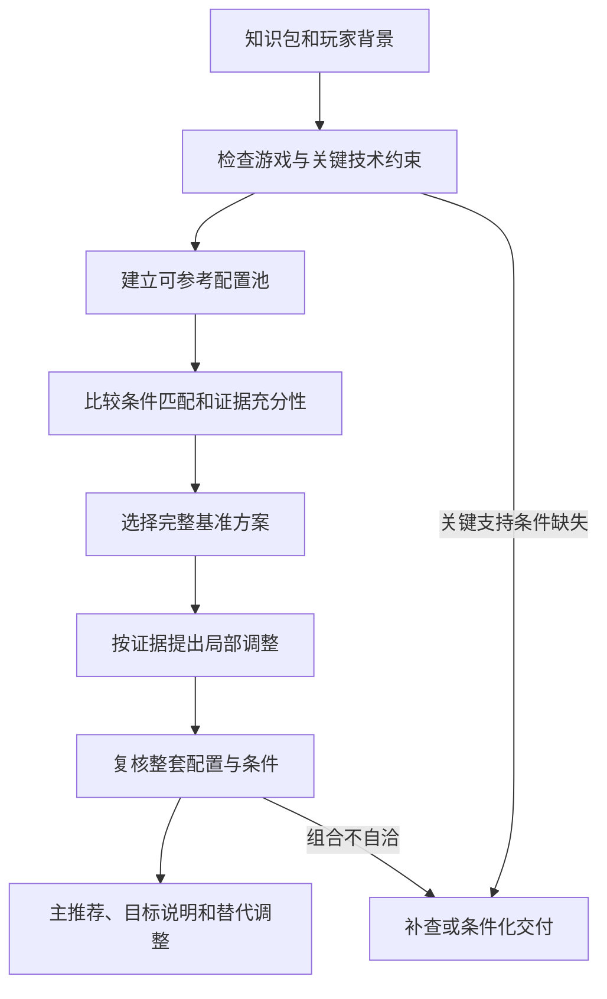

# 03 多来源推荐决策设计

> 推荐设计 v1.0；主推荐、邻近显卡参考、帧率表达三项原则已获用户确认，其余为本稿推荐的决策细节。  
> 返回：[总设计](../../project-design.md)；输入契约见[数据与接口](./07-data-and-architecture.md)。

## 1. 输出目标

系统输出一份可解释的主推荐，以及有证据支持的偏画质/偏性能替代调整。每个设置能回答：建议值是什么、怎么操作、依据是什么、适用条件是什么、还有什么未确定。

不把“平衡方案”定义为所有选项 Medium，也不默认60 FPS。合理取舍来自当前游戏资料和玩家背景；后来表达的明确偏好可以调整选择。

## 2. 输入

| 输入 | 必要程度 | 用法 |
|---|---|---|
| GameContext | 必须 | 游戏身份、平台与已知版本 |
| DeviceSnapshot | GPU 尽量已知，其余可未知 | 匹配与技术分支检查 |
| KnowledgePackage | 必须，允许部分覆盖 | 目录、配置、实测、约束、缺口 |
| 当前配置与历史会话 | 可选 | 减少不必要改动，使用本机证据 |
| ExplicitPreferences | 可选 | 玩家主动提出的保留光追、减少模糊、流畅度等要求 |

目标 FPS、画质倾向不是初次检索的必填条件。已有偏好不删除其他公共证据，避免后续无法解释替代方案。

## 3. 决策顺序

模型负责解释与提出候选；程序负责合法值、引用、明确约束、版本与配置状态检查。模型建议不因措辞肯定就绕过检查。

## 4. 先过滤不能用的分支

排除已证实的平台错配、不可用取值、显卡不支持的技术、明确互斥组合及已证实失效的版本条件。原作者主张保持原样保存，排除作用于当前推荐分支。

关键支持条件未知时先补查；仍不明则给条件分支或暂缓该技术，不能默认为支持。例：推荐矩阵同时给 DLSS/FSR，应按有依据的支持条件实例化，不取第一个。

CPU、驱动或场景未知不自动否定全部配置，但限制 FPS 迁移、严格比较与相关调整。关键项与非关键项的划分必须指明影响的操作，而不是对整篇文章一刀切。

## 5. 硬件匹配层级

| 层级 | 条件 | 可以支持什么 |
|---|---|---|
| 直接参考 | 同 GPU、显存/设备形态明确，关键测试条件接近 | 首选配置依据；FPS 仍是来源参考 |
| 条件参考 | 同 GPU，但分辨率、功耗、CPU/版本等有重要差异 | 推荐设置的部分依据，性能结果不直接迁移 |
| 邻近参考 | 有资料支持性能级别/技术能力相近，且显存等差异可解释 | 条件化候选与本机待验证假设 |
| 游戏一般证据 | 逐项作用、依赖或官方技术说明 | 约束、理由和局部方向，不独自生成本机 FPS |

名称相近不等于性能相近。邻近关系记录依据、适用维度和局限；跨代、桌面/笔记本及显存差异分别处理。没有邻近关系证据就标为“其他设备测试”，不包装成匹配资料。

同卡不同分辨率不绝对优于异卡同分辨率：先判断证据是在说明功能支持、视觉影响还是性能。纹理的显存风险、超分的输入分辨率等不能被“同卡优先”抹掉。

## 6. 如何选择基准配置

先保留通过门槛的候选，再按下面的顺序比较，记录选择和落选理由：

1. **关键适用条件**：版本、平台、技术支持、必要显存条件是否明确。
2. **设备与分辨率接近程度**：GPU 是主要锚点，其余差异按用途解释。
3. **整套方案可复现性**：明确预设/逐项设置、测试条件和超分/帧生成状态。
4. **实测及视觉解释**：是否同时说明性能代价与视觉变化。
5. **原始性与独立交叉支持**：原作者测试、可回溯表格，以及真正独立的佐证。
6. **风险和操作负担**：证据相近时优先较少推断、较少无依据改动的方案。

这是可解释的比较顺序，不是未经验证的线性打分公式。不生成“可信度92分”或把来源数量当选票。资料之间有不可比较的优势时保留差异，不强行排出唯一客观最优。

选择完整作者方案作为基准的意义在于保留组合关系。若所有方案都不完整，可生成带未知项的临时参考，但不把多个作者零散值拼成“完整实测配置”。

## 7. 怎样判断画质收益与性能代价

### 7.1 分别保存依据

每个拟调整项保存：视觉影响等级及场景、性能证据类型、显存/延迟影响、依赖、已知局限。建议视觉等级采用 `negligible/minor/noticeable/major/unknown`，必须附作者描述、画面对比或本机反馈依据，不由模型随意量化成质量分。

性能分为 `measured_comparison`、`author_recommendation`、`general_mechanism`、`unknown`。只有同条件、同口径的可比较测量才计算差值；整套配置改善不拆成每个设置的收益，也不累加不同作者的提升百分比。

### 7.2 推荐的取舍规则

| 证据情形 | 默认处理 |
|---|---|
| 有明确性能改善，且来源说明视觉差异很小 | 优先考虑性能更合理的值 |
| 视觉改善明显、额外开销可解释 | 保留为主方案候选或画质替代项 |
| 代价高，但视觉影响未知 | 先补视觉/场景证据，不自动判为“没必要” |
| 测试场景没有覆盖该效果 | 不用“此场景无差异”证明通用无价值 |
| 性能差异与测量波动接近 | 不以很小数值差距决定最优，保留较可靠基准 |
| 玩家明确重视某效果 | 在兼容性可行范围内提高其选择优先级 |

可在确实可比的配置之间去掉“画质不更好、性能更差”的被支配方案。视觉未知或测试条件不同，则不使用这个规则强行淘汰。

## 8. 多作者分歧

先把分歧归类为条件差异、偏好差异、原文更正、真实矛盾或无法判断。

| 分歧 | 推荐处理 |
|---|---|
| 同名设置，不同版本效果已变化 | 定向复查版本，不做简单投票 |
| 一个作者保留光追，另一个追求流畅 | 记录取舍，作为主方案与替代分支 |
| 数字来自不同分辨率/场景 | 并列参考，不算统一提升比例 |
| 同条件却结论相反 | 查原表、更正和方法；仍冲突则保留并标注 |
| 仅作者经验、缺实测 | 可补充理由，但不能覆盖明确的兼容性或控制测试 |

用其他来源改变基准的某个设置时，记录“原基准值→新建议值→替换证据→依赖复核”。改变后形成的是 Agent 综合方案，不能继续冒称某作者已实测过整套新组合。

## 9. 主方案与替代调整

默认一份主方案。资料支持时附偏画质和偏性能的差异清单；不为凑三套而制造取值。替代调整也是有版本的变更集，可展开成整套配置并重新校验。

替代项必须说明改变了什么、为什么、可能牺牲什么、何种玩家更适合及是否需重启。没有资料证明具体 FPS 时只说明方向和证据级别。

相互依赖的开关作为一个调整组，保持方案自洽。例如某技术会改变其他设置可用性时，应整体核验，不逐项混选。

## 10. 帧率目标与公开参考

严格区分：

- `target_proposal`：Agent 建议值得尝试的目标，依据资料与显示背景，可由玩家调整。
- `reference_results`：来源设备/配置/场景上的报告值，保留统计定义。
- `local_results`：本机采用配置后测得的结果。

有明确同条件作者目标或稳定本机结果时，可以建议具体目标；只有条件不明的公开区间时，说明依据较弱，不把区间中点当目标。资料不足则建议先保持可变帧率完成基线测量，不强填60/120等默认目标。

建议目标不自动意味着写入帧率上限，`target_fps` 与 `frame_cap_setting` 为不同字段。渲染帧率、显示帧率与帧生成状态分别说明，不能把显示帧数当成输入响应证明。

## 11. 输出项与交付状态

每行清单保存：菜单位置、原名/展示名、推荐动作、值/条件、出处、理由、必要依赖、当前值来源和待验证项。

动作采用 `set_value`、`keep_current`、`conditional_strategy`、`check_in_game`、`defer`。`keep_current` 不代表当前值已读到；当前未知就明确未知。

| 状态 | 判定 |
|---|---|
| actionable | 在声明范围内，关键支持/取值/组合已核实，可执行操作明确；性能仍可待本机验证 |
| provisional | 可提供参考或条件策略，但有影响选择的未知；不展示为已确定完整配置 |
| blocked | 身份或关键兼容性/取值问题使当前主方案无法可靠生成 |

设置目录列出已发现的全部相关项，未能确定的逐项解释，不默默漏掉。目录的“已发现范围完整”和“游戏菜单全量完整”分别标记。

## 12. 推荐输出示意

以下是虚构流程例子，不代表 FH6 真实设置或性能：同一作者在同场景比较两套仅阴影档不同的配置，平均呈现率由100升到110，描述视觉差异较小。另一来源也支持该场景下较低阴影档的画面取舍。

系统可选择性能较合理的档位，引用该比较，提供保留高阴影的画质替代项。对不同 GPU 的玩家，该结果仅支持取舍方向，不输出“你的机器也提升10%”。若两套还同时改了其他项，则只报告整套变化，不归因到阴影。

## 13. 首版需要通过的验证

同卡证据缺失能降级；不支持技术不会进入可执行主方案；分歧不被投票掩盖；替代方案不凭空生成；每项局部修改有出处；不冒称综合方案已被作者实测；目标与预测分开；关键未知能阻止错误的完整推荐；可选择维持当前配置。
