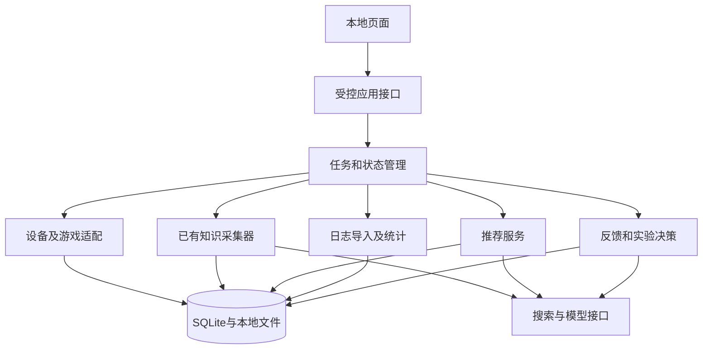
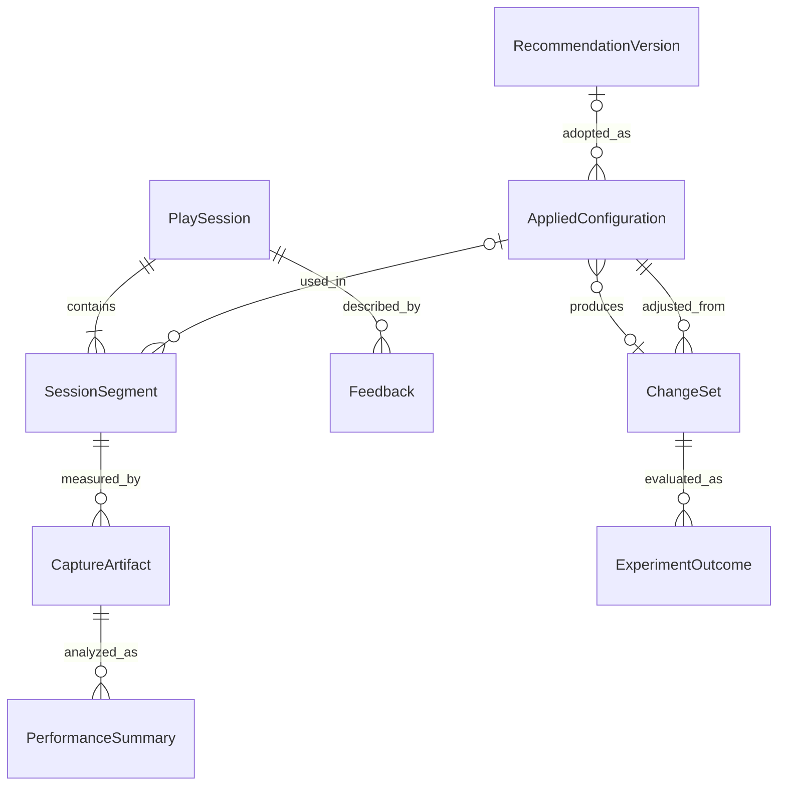

# 07 数据模型、工程架构与接口设计

> 推荐设计 v1.1；补齐调整采用、任务幂等、独立基线和补充回答契约。以下表、接口与状态仍为待实施设计，本轮不建立数据库或服务。
>
> 返回：[总设计](../../project-design.md)。

## 1. 推荐技术组成

| 层 | 推荐 | 原因 |
|---|---|---|
| 核心逻辑 | Python；沿用现有 Pydantic、requests、BeautifulSoup | 复用已有采集程序，保持类型检查 |
| 本地 HTTP | FastAPI＋本地 ASGI 进程 | 给页面提供受控接口；框架是推荐选择，尚未安装或测试 |
| 页面 | 服务端模板＋少量原生 JavaScript | 首版减少独立前端工程与复杂状态框架 |
| 图表 | 本地静态分发 Apache ECharts | 帧间隔时间轴、区段和对比；不依赖运行时公共 CDN |
| 持久化 | SQLite＋JSON＋原始文件目录 | 单机课程项目，按需要索引，不先拆微服务 |
| 后台任务 | 同一进程的显式单工作队列 | 首版一次一个重任务，保留取消、预算与检查点 |
| 模型/检索 | 现有 DeepSeek / Exa 适配器 | 调用与错误继续审计；不增加多 Agent 框架 |

FastAPI 有模板与静态文件集成方式，适合上述页面路线；本稿不把框架后台任务等同于持久队列，长任务状态仍由项目自己保存。[官方模板文档](https://fastapi.tiangolo.com/advanced/templates/)

ECharts 的折线能力可用于时间序列，仍需提供文本摘要及可访问说明，不用图表代替全部数值信息。[官方折线说明](https://echarts.apache.org/handbook/en/how-to/chart-types/line/basic-line/)、[可访问说明](https://echarts.apache.org/handbook/en/best-practices/aria/)

建议在实施时固定依赖版本并运行兼容性测试；本稿不把“官方文档有能力”写成“目标机器已验证可用”。

## 2. 模块边界

所有框是同一应用里的模块，不是独立部署服务。推荐、反馈读取通过校验的数据与版本快照，不直接依赖某次临时聊天记忆。

## 3. 公共知识层继续使用的对象

Game、Source/SourceRevision、Setting、Configuration、Environment、Evidence、Constraint、Comparison、VersionImpact 沿用[既有契约](../../knowledge-intake-contract.md)。

现有采集输出使用 local_id 与 reference_scope 关联。接入时显式保留原作用域，生成全局 KnowledgeRecordRef；不要把其他来源的同名局部 ID 当作同一记录。

KnowledgeRecordRef 最少含 package_id、capture_scope_id、local_record_id、revision_id/内容哈希。导入适配器生成映射表，原始输出和冻结样本不回改。

## 4. 本机闭环新增实体

| 实体 | 核心字段/关系 |
|---|---|
| DeviceSnapshot | id、读取时间、适配器版本、GPU列表、CPU/内存/显示背景、逐字段来源/未知原因 |
| InformationRequest | id/version、source_task_id、上下文版本引用、自动获取失败原因、待补字段及用途、候选、逐字段回答/跳过状态、原话/时间、结果快照引用、生命周期状态 |
| GameInstallation | id、game_id、平台、路径引用、进程匹配线索、版本原标识及来源 |
| KnowledgePackage | id/version、game_id、来源修订集合、记录引用、覆盖矩阵、缺口、创建时间 |
| Preference | id、作用范围、内容、explicit/tentative状态、来源反馈、有效/撤回状态 |
| RecommendationVersion | id、parent_id、设备/游戏/知识包/偏好快照、基准配置、建议动作、目标提议、来源和校验状态 |
| AppliedConfiguration | id/version、game_id、设备/游戏快照、origin、可空recommendation_id、parent_applied_id、change_set_id、restored_from_applied_id、逐项值/确认方法、采用时间、activation_state |
| ConfigurationObservation | id、读取时间、游戏/设备、字段观测、文件/工具来源、与采用配置差异 |
| PlaySession | id、游戏、设备快照、开始/结束、可空初始applied_id、configuration_state、目标建议/玩家接受情况 |
| SessionSegment | id、session_id、时间范围、场景、可空applied_id、configuration_state、binding_revision及绑定事件、流选择与排除标记 |
| CaptureArtifact | id、session/segment、原始文件路径引用及哈希、工具/选项、schema、时间基准 |
| PerformanceSummary | id、artifact与segment/binding_revision引用、分析器/清洗协议、统计值、质量、比较资格 |
| Feedback | id、session/segment、原话、结构化症状、明确偏好、解析状态 |
| Diagnosis | id、输入证据、多个假设、支持/反例/未知、建议动作 |
| ChangeSet | id、base_applied_id、变更/依赖组、假设、来源、协议、rollback_ref |
| ExperimentOutcome | id、change_set_id、base_applied_id、tested_applied_id、前后区段/摘要、可比级别、变化、玩家接受、结论 |
| TaskRun | id、任务类型、输入修订历史/当前input_revision、状态、待回答请求、预算、调用、检查点、错误与停止原因 |
| IdempotencyRecord | 本机用户作用域、HTTP方法/路由、key、request_hash、task/result引用、原响应状态 |

数值项均附 metric、unit、number_kind、frame_stream_kind（相关时）。百分比要有分母和输入引用，空值使用 null 与原因。

设备/游戏字段的 method 区分 `system_probe` 与 `user_provided`，采用配置声明使用 `player_confirmed`。InformationRequest 回答后生成对应快照/配置新版本，不把用户提供升级为程序观测；冲突保留原依据及本轮采用理由。生命周期及继续处理方式见第8.1节。

AppliedConfiguration 的 `origin` 使用 `baseline/recommendation/change_set/manual_edit/rollback`。推荐、父版本、变更与恢复引用可空，但按origin校验：原配置基线不依赖推荐；首次采用推荐时必须给 recommendation_id；采用调整时必须给 change_set_id，parent_applied_id 必须等于该 ChangeSet 的 base_applied_id。首次记录可无父版本，后续手动修改以当前采用版本为父版本；回滚另外保留 restored_from_applied_id，不能把旧版本重新变成一条新事实。当前采用指针按本机游戏安装保存，所有推进操作在事务内检查expected_current_applied_id。

会话/区段的 configuration_state 使用 `bound/unverified/mixed`。`bound` 仅表示已关联具体配置版本，不代表每项均已生效。配置完全未知时 applied_id=null、state=unverified；只知道中途改过但无法分段时 state=mixed。可保留日志和反馈，禁止用最新推荐填补空绑定。

本地统计另有带定义版本的 MetricDefinition；“最慢1%间隔均值倒数”等项目指标不得只借旧字段名而丢掉算法。公共来源原有 metric 与本地可比性通过显式口径映射连接。

ComparisonProtocol保存版本、共同阈值模式/实际值、可选基线引用、聚簇/清洗定义与分母口径；比较结果保存两侧摘要引用和重算值。具体公式见第04章7.2节。

## 5. 核心关联与不变量

必须保证：

1. Session 的实际配置不能默认为最新推荐；未确认就是未确认。
2. 配置、设备、知识包和统计协议使用版本引用；历史不能随当前值漂移。
3. 一条原始日志可有多个分析版本，但原文件哈希不变。
4. 多配置会话必须分段或标为 mixed；严格比较只选条件明确的区段。
5. 来源值、Agent 综合建议和玩家采用值各有独立对象。
6. 修改状态保存事件/历史；原始事实与来源不被新模型输出覆盖。
7. 任何结论引用实际存在、未隔离且适用范围足够的证据。
8. 调整后版本从 base_applied_id 的完整快照合并差异，保留未改字段和未知状态；不得从最初推荐重新展开。摘要绑定的 tested_applied_id 必须能沿采用链追溯到本次 ChangeSet。
9. 原配置可无推荐，会话可无配置；未知绑定不具有设置效果的因果比较资格。待重启、冲突或关键生效状态未知时也不能标为 controlled。

## 6. 推荐的物理存储

继续保留现有 sources/records 兼容导入。新增表可按功能逐步建立，不要求一次拆出所有逻辑实体：

- knowledge_packages、device_snapshots、game_installations。
- recommendation_versions、applied_configurations、configuration_observations。
- sessions、session_segments、capture_artifacts、performance_summaries。
- feedback、diagnoses、change_sets、experiment_outcomes、preferences。
- task_runs、task_events、information_requests、idempotency_records、schema_migrations。

首版复杂字段用 JSON；game_id、版本引用、状态、时间和常用关联建索引。关系由应用校验并尽量使用外键约束。不要只把全部结果放在一个无索引聊天文本中。

原始CSV、必要网页块/图片与导出文件存受管理目录，数据库保存哈希与相对引用。大规模逐帧数据首版保留CSV和必要统计，不要求逐帧写SQLite。

## 7. 对外操作接口

以下路径是推荐接口约定，非已上线API。创建操作返回对象ID或任务ID；获取结果返回状态和可追溯输入版本。所有POST携带持久化的 Idempotency-Key，规则见第7.2节；表中 `?` 表示可空或按操作类型选填。

| 操作 | 输入 | 输出 |
|---|---|---|
| POST /api/device-scans | 探测范围、可选游戏上下文 | task_id，完成后DeviceSnapshot |
| POST /api/knowledge-tasks | game_id、device_id、包版本、运行配置/预算 | task_id |
| GET /api/tasks/{id} | 任务ID | 状态、input_revision、阶段、预算、成果、information_request_ids |
| POST /api/tasks/{id}/cancel | 取消请求、幂等键 | cancel_requested/终态与成果位置 |
| POST /api/tasks/{id}/resume | 父任务ID、检查点、明确的新预算 | 新task_id及parent_id；不重发计费状态未知的调用 |
| GET /api/information-requests/{id} | 请求ID | 问题、用途、候选、已答/未答项、请求与上下文版本 |
| POST /api/information-requests/{id}/responses | expected_request_version、expected_context_revision、answers、skipped_fields、冲突选择? | 回答记录、新快照/配置ID、请求状态、任务状态/input_revision |
| POST /api/recommendations | game_id、device_id、package_id、可选偏好/历史 | task_id或RecommendationVersion |
| POST /api/applied-configurations | origin、game_id、设备/游戏快照、expected_current_applied_id（首次为null）、recommendation_id?、base_applied_id?、change_set_id?、restored_from_applied_id?、确认值/差异及生效状态 | 新AppliedConfiguration及父版本/调整来源 |
| POST /api/sessions | game_id、applied_id?、configuration_state、device_id、场景/协议 | PlaySession与初始区段；允许无推荐/无配置 |
| POST /api/session-segments/{id}/configuration-bindings | expected_binding_revision、applied_id、该时段配置依据/时间范围 | 追加绑定事件及新binding_revision，不改旧摘要或当前采用指针 |
| POST /api/captures | session_id、采集适配器和协议 | task_id与CaptureArtifact |
| POST /api/log-imports | 受管理上传文件、session绑定、格式 | artifact_id，解析/分析任务 |
| POST /api/feedback | session/segment、原文与选项 | Feedback与解析任务 |
| POST /api/next-actions | session、summary?、feedback?及当前版本 | task_id；成果为Diagnosis与主要动作，adjust时附ChangeSet |
| POST /api/experiment-outcomes | change_set_id、base_applied_id、tested_applied_id、前后区段/摘要、玩家接受情况 | 校验关联与可比性后的ExperimentOutcome |
| GET /api/comparisons | 两个summary_id、比较协议版本? | 可比级别、共同阈值/分母、差异、依据/限制 |
| GET /api/exports/{id} | 已生成导出ID | 文件或报告，不接受任意系统路径 |

### 7.1 调整采用与并发检查

1. 服务端读取不可变的基础版本A及以A为基准的ChangeSet C，按A的完整字段合并本轮差异，形成候选B。
2. 逐项检查值、依赖、生效条件和玩家声明差异。声明额外改动时一并保留，但该实验不能继续声称只有C的设置发生变化。
3. 在同一事务检查 expected_current_applied_id=A、保存B、parent_applied_id=A、change_set_id=C，并更新当前采用指针。另一个页面已推进当前版本时返回409及最新版本，不保存B；用户核对后重新生成基于最新版本的变更。
4. 新Session/Segment显式绑定B，结果提交同时引用C、A、B及前后摘要；服务端核对这些引用与区段的实际配置关联。缺失、错配或未落实生效条件时拒绝受控效果结论，并保存具体限制。

例如A在推荐之外已把纹理设为High，C仅调整阴影，则B必须保留High。回滚由玩家手动恢复并确认后另建origin=rollback版本，父版本为当时当前配置，restored_from_applied_id指向恢复目标；旧会话和失败结果不重绑。

### 7.2 创建操作的幂等规则

- 前端在一次逻辑提交前生成并保存key；双击、刷新、超时和响应丢失后的同一次重试沿用该key，不重新生成。知识任务、推荐、采集、日志导入、补充回答、结果保存和恢复任务均适用。
- 去重作用域为本机用户＋HTTP方法＋规范路由＋key，不使用重启就变化的应用会话令牌作为去重作用域。保存规范请求体hash（含输入版本、预算和上传内容hash），不因key相同就忽略参数差异。
- 同key同hash返回同一task/result及原响应语义；任务已结束或失败也不自动另建。同key异hash返回409。同一key并发请求由数据库唯一约束及事务只创建一次；幂等记录与任务/结果注册在同一事务提交，提交成功后才入队和开始外部调用。
- 幂等记录和关联保留跨后台重启，首版不自动过期；清理结果时保留key墓碑，重试返回410，不把旧key当新请求执行。用户修改输入后重新确认、提交下一批回答均为新的逻辑提交，使用新key；明确重跑任务或追加预算也使用新key，并为新任务记录parent_id。
- 不同key也不能在同一Session重复启动本应用的活动采集；已有queued/running采集时返回409和原task_id，需先结束或取消再新建。对外部工具会话仍按第04章边界处理。
- 此规则保证本地任务去重，不能承诺外部模型调用恰好执行一次。请求已发出但结果未知时保留审计，不由客户端重试或任务恢复隐式重发。

## 8. 任务状态与恢复

推荐的执行准备状态 actionable/provisional/blocked、更新复核状态 current/needs_review/superseded、知识入库状态 accepted/quarantined 分开存储。被新资料要求复核不代表原文提取错误；可执行的操作也不代表预计FPS已被本机验证。

TaskRun 统一状态：`queued → running → completed/partial/failed/cancelled/interrupted`；确需本机补充信息时可 `running → waiting_input → queued`。waiting_input释放工作队列，只保存待回答请求和检查点；非关键未知不阻塞可继续的步骤。`cancel_requested` 是运行中的控制标记；queued/waiting_input可直接取消，终态仍必须说明已保存哪些成果。

采集任务里的 `completed_scope/partial_scope` 是领域结果，映射到 completed/partial，不替代全部任务状态。

| 情况 | 处理 |
|---|---|
| 页面刷新/断开 | 后台任务继续，重新按ID查询 |
| 取消 | 在外部调用边界停止新增调用，保存已有成果；不承诺立即中断已提交的付费请求 |
| 模型/网络失败 | 记录调用、保留原输出与已完成模块，输出partial或failed |
| 应用进程退出 | 重启后将原queued/running任务标interrupted；已持久化的waiting_input及问题可继续回答，不能自动标完成 |
| 恢复任务 | 从已完成步骤创建有parent_id的新任务，只补未完成范围 |

不能盲目重发中断时已提交的模型请求，避免双重计费。已计量/未知计费状态分开保存。断点恢复是本设计新增能力，现有采集代码尚无完整入口。

### 8.1 补充信息的回答与继续处理

InformationRequest状态使用 `open/partially_answered/resolved/skipped/superseded`。未提交的空白不表示用户跳过；提交可只回答部分字段，也可明确将剩余字段记为不知道/稍后补充。所有待补字段有可用回答后为resolved；含明确跳过项且无未处理项时为skipped，逐字段状态保留。

1. 后台自动获取失败后保存问题、source_task_id、输入快照版本和所影响步骤；GET任务可发现问题，刷新页面后仍能恢复面板。回答/跳过接口在HTTP层完成短事务，不排在等待自身回答的重任务后面。
2. 提交时检查请求版本和目标设备/游戏/配置上下文。仅expected_request_version过时则返回409及最新请求，不作状态变更；上下文因其他操作改变、原问题已失效时才将原问题标superseded，返回409并重新判断需询问的字段。原任务仍在等待时，同步登记新上下文及替代问题ID；已无待补关键项则重新排队核验，不让任务等待已失效的问题。历史会话问题按它所绑定的历史上下文校验，不能拿当前配置覆盖过去事实。
3. 合法回答追加原话与结构化值，为受影响对象生成新快照/配置版本，并保存新旧引用。不能可靠归一的回答保留原话，相关字段仍未解决；与观测冲突时必须保留两份依据及本轮采用选择。已明确回答且上下文未变的字段不再重复询问。
4. 请求更新、结果快照及等待任务的新input_revision在同一事务保存；原输入修订保持不可变。请求同时推进version和后续回答所需的expected_context_revision，自己的部分回答不被视为外部上下文失效。若关键待答项已回答或明确跳过，waiting_input任务转queued，只重做受影响步骤，沿用剩余预算；仍有关键未处理项则保持等待。跳过后必要条件仍不足时，任务产出partial或带限制/blocked的领域结果，不无限等待或猜值。
5. 对已结束/取消任务的后补回答只保存新快照，不重新启动旧任务或修改其成果；需要再分析时显式新建关联旧任务的新任务。回答时已不是当前采用配置的旧会话信息，也不切换当前采用指针。

## 9. 模型调用契约

每次调用保存任务、模型请求/返回标识、提示版本、Schema版本、输入数据哈希、输出、用量与验证结果。密钥不进入这些文件。

公共页面、日志附带文字和玩家反馈都按数据处理。模型输出只允许生成类型化建议，不能直接执行系统命令、改游戏文件或自创工具调用。

本地原始性能日志默认不上传；先由确定性程序生成必要摘要。向外部模型发送设备摘要、匿名场景、相关配置与反馈文本即可；去掉系统用户名、绝对路径和无关进程信息。

本地HTTP默认只绑定回环地址；状态变更验证同源与本次应用会话标识，不默认开放局域网。浏览器不保存服务密钥到localStorage；后台复用已有用户环境配置，设置页只回显已配置/未配置，不回传完整密钥。上传与导出使用受管理文件ID，不能提交任意系统路径。

## 10. 一致性、迁移与导出

一个采用版本及其差异在同一事务保存；一个摘要保存时绑定完整协议与原件引用。历史区段后补配置须有适用于该时段的依据，通过expected_binding_revision检查后追加绑定事件；旧摘要保留旧绑定，使用新绑定时生成新的分析版本，不改写历史结论。任务事件追加，文件写入先临时文件再原子替换；输出完整性校验失败不宣布保存成功。

Schema 变更有版本和显式迁移。研究 JSON 经导入适配器映射，原文件哈希保留；新字段不知道就保留未知，不为通过新Schema回改金样本。

删除某次会话时处理其依赖或保留不可识别摘要，不能留下伪有效外键。完整导出包含数据版本、来源引用和可分享范围说明；默认不附密钥和本机敏感路径。

## 11. 连接现有原型的顺序

先给采集输出加只读KnowledgePackage导入层；再增RecommendationVersion与AppliedConfiguration；随后接Session与日志；最后接反馈、ChangeSet和历史比较。前端调用相同服务接口，CLI继续保留。

本轮不会改变现有源代码、样本文件或运行结果。所有新增表、HTTP接口和页面都是待审阅的推荐设计。
