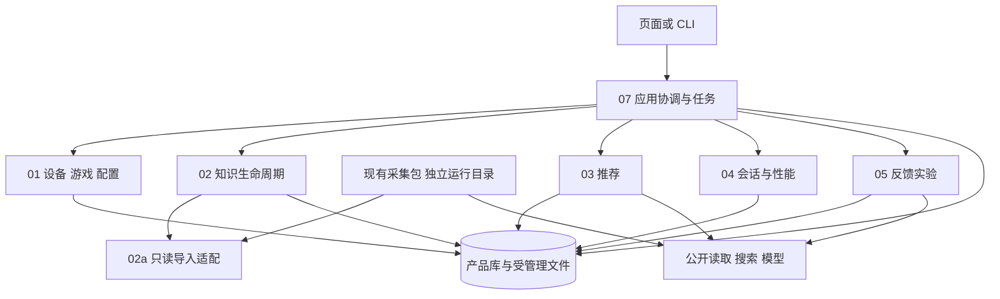

# 阶段 B1：架构基准与跨模块边界

> 建议基线 `product-contract/0.2`；2026-11-01。继承已确认约束，技术组成仍为建议。
> 来源：[总设计](../../project-design.md)、[交接文档](../../design-handoff.md)、[原始 07](../design/07-data-and-architecture.md)。确认状态与重大取舍见[索引台账](./README.md)。

## 1. 目标与适用范围

用一个可追溯的事实链连接设备/游戏、公共知识、推荐、实际采用、会话、性能与反馈。阶段 B 只定义模块间共享契约；候选选择算法、探测实现、日志列映射、页面完整状态、物理表与全量路由在 C 细化。

本设计沿 Q1 的本地网页建议：Python 单应用协调任务、SQLite 与受管理文件，复用现有采集包。FastAPI、模板、ASGI、ECharts 均为未安装/未验证的技术建议。改用 CLI 时复用同一领域契约，不另建一套业务模型。逻辑对象不要求逐一变成物理表、进程或服务。

阶段 B 不写 FH6 实际路径/设置枚举，不宣称日志工具已兼容，不调用外部模型/检索，不把官方文档能力当本机验证结果。

## 2. 组件与数据流

图表示逻辑职责及数据通道；外部调用均经 07 的预算/调用审计协调，非任意模块绕过任务直接付费。原型运行目录中的 SQLite 不成为产品主库。02a 导入冻结快照；不靠把原库挂入产品库实现跨运行历史。

领域模块以明确输入/输出协作；跨模块写入由应用层依次调用所有者并协调本地事务。反馈产生 research/measure 意图，应用层登记后继任务，禁止互相递归启动模型任务。

## 3. 唯一写入所有权

| 对象或事实 | 所有者 | 跨模块规则 |
|---|---|---|
| 游戏规范身份、公共来源修订、知识记录、包、设置映射 | 02；02a 只提供兼容映射 | 01 提交身份线索，02 确认映射；未确认的同名/别名不能合并 |
| 设备快照、GameInstallation/GameContext、本机设置目录、配置观测、采用版本、当前采用指针 | 01 | 03/05 提供推荐/变更意图，07 调用 01 登记当前采用才推进指针；历史配置登记独立保存过去事实，04 再显式补绑 |
| 推荐内容版本与复核事件 | 03 | 02 通知受影响记录；03 追加复核事件，旧内容不变；03 不导入 05 的实验执行逻辑 |
| PlaySession、SessionSegment、绑定修订、日志、摘要、TestProtocol、比较协议与结果 | 04 | 后补绑定需历史依据并追加修订；摘要与比较引用固定修订 |
| Preference、目标接受声明、反馈、Diagnosis、ChangeSet、ExperimentOutcome | 05 | 03 读取偏好及结果的不可变视图；05 不直接更新采用指针 |
| TaskRun、输入修订、InformationRequest 生命周期、幂等、外部调用、文件注册 | 07 | 领域所有者校验问题答案与业务字段；07 协调版本/回答/任务的原子变化 |
| 展示和未提交输入 | 06 | 不独立决定推荐可执行性、比较资格或领域完成状态 |

Source/游戏公共身份与 GameInstallation 的本机线索分开：候选身份未解决也能保存探测与提问，但不能将其发布为匹配的知识包。当前配置按本机用户与安装定位；尚无安装对象时先登记“玩家指定、路径未知”的本机安装上下文，不能把两个安装用 game_id 合并。

## 4. 共享定义与局部定义

| 内容 | 唯一定义位置 | 消费方式 |
|---|---|---|
| 公共知识原语义 | [知识契约](../../knowledge-intake-contract.md) | 本目录只作字段映射和产品包装；不扩改旧枚举含义 |
| 全局 ID、不可变引用、值/来源包装、实体及共享 DTO | [data-contracts.md](./shared/data-contracts.md) | 模块通过链接与类型名使用，不重写第二套字段 |
| 枚举状态、合法转移、守卫、事务/恢复边界 | [state-conventions.md](./shared/state-conventions.md) | 所有者执行，页面只映射为用户表达 |
| 错误包、错误码、重试、幂等接口规则 | [error-conventions.md](./shared/error-conventions.md) | HTTP 与 CLI 可适配，业务错误含义不变 |
| 性能公式、清洗、共同阈值算法 | [原始 04](../design/04-performance.md)；C 阶段对应深化稿 | B 保存版本化协议与输入；不复制另一份算法 |
| 局部调用与具体操作 | C 阶段各模块 | 07 仅集成路由/事务，不重新定义请求体 |

## 5. 确定性程序、模型与玩家的分工

| 执行者 | 负责 | 不能据此升级的结论 |
|---|---|---|
| 确定性程序 | 类型/引用/哈希校验、已证实约束、预算、状态守卫、版本与幂等、固定统计公式 | 校验通过不等于来源主张真实、推荐全局最优或已生效 |
| 模型 | 资料解释、候选/理由、条件歧义、反馈归类、诊断假设 | 模型不能自行宣布缺口关闭、写任意字段或运行命令；输出仍需程序校验 |
| 玩家 | 选择游戏、失败后补充、手动设置/确认、场景标记、体验与接受情况 | 声明不改写成程序观测；满意不等于统计改善 |

本机原始日志由本地程序处理，默认不上传。模型只接收必要设备摘要、匿名场景、相关配置与反馈；去掉用户名、绝对路径、无关进程。来源正文、反馈、模型文本都作为数据处理，不具备执行工具或修改系统的权限。

## 6. 事实链与主要不变量

1. 推荐、采用、观测分别引用；原配置基线可无推荐，未知配置会话可保存日志与反馈。
2. 不可变版本保存输入快照，历史引用不能通过“读取最新版本”漂移。当前指针与复核状态是可重建投影，不是改写历史事实的入口。
3. ChangeSet 以实际配置为基础；采用事务保存完整合并版本与父链，并比较 expected_current_applied_id。
4. 新观测或后补回答不能自动证明过去相同。过去区段要有当时的依据；缺历史配置版本时先独立登记声明及版本，不推进当前指针或虚构采用父链，再通过绑定修订关联并生成新摘要。
5. 知识更新只触发复核，不自动改推荐内容、玩家配置或旧结果。公共知识与私人结果隔离。
6. 原件不完整、引用无效或文件未提交时不发布可用资源。数据库原子性与文件原子替换不是同一事务；中间状态必须可恢复。
7. waiting_input 释放重任务队列；回答短事务不排在等待自身回答的重任务后。终态任务不可因后补回答复活。
8. 本地幂等不证明外部恰好执行一次；请求可能已送达但结果未知时禁止自动重发。
9. accepted、applicability、actionable、needs_review、配置生效与 controlled 各自独立；缺少某维度检查不能补成通过。
10. 活动段的初始绑定允许开放结束点；结束/切段追加闭合修订，分析只接受明确闭合的段及绑定版本，不猜预计时长。
11. 首检查点前中断也可显式恢复为 parent 关联的新任务；空检查点不代表没有外部调用，必须照常核对审计及未知结果。

## 7. 非功能与安全基准

以下继承原始 07 的边界并作共享细化；具体大小/时限/调度参数由 C 用证据给出，不编造性能承诺。

- 本地 HTTP 默认回环绑定；变更请求验证同源与应用会话标识。会话标识用于访问保护，不作为跨重启幂等作用域。
- 密钥仅后台读取现有环境配置；页面只见已配置状态。请求体、调用审计、错误、导出均不得包含密钥。
- 上传、下载、导出使用受管理文件 ID；路径由后台解析并检查受管理目录边界。探测玩家指定目录经受控适配器验证，不让模型选择任意路径。
- 长任务只在可审计边界取消；不自动提权、不停止其他采集会话。一个本应用会话不得有两个活动采集任务。
- 原始 CSV/网页修订保留哈希及相对引用；大体积逐帧记录无需逐帧入库。页面图表可采样展示，统计输入不随展示降采样改变。
- 文件损坏、迁移失败或恢复未完成时保留诊断和原件，资源保持不可用，不以空结果或成功响应掩盖失败。
- 删除需处理依赖或保留墓碑；不得破坏历史引用及旧幂等键的去重语义。备份/保留期与具体迁移操作由 C1/02a/07 细化。

## 8. B1 验收与后继

| 编号 | 检查输入/步骤 | 应得到的结果 | 验证性质 |
|---|---|---|---|
| B-ARC-01 | 对照 C01—C11、交接原则与原始 R 表 | 索引逐条追踪；Q1—Q3/R03 的待确认或建议状态未升级 | 本轮文档静态复核，无 Mock/真实环境 |
| B-ARC-02 | 沿未知基线、局部调整、知识更新三条链核对写入者 | 配置指针只由 01、复核事件只由 03 写入；07 协调跨模块事务 | 本轮文档静态复核，无 Mock/真实环境 |
| B-ARC-03 | 检查源码与本设计的“已实现”表述 | 仅采集原型已有代码；B 的接口、任务与产品库均为建议 | 本轮文档静态复核，无 Mock/真实环境 |

B1 后进入 B2：首先定义 ID/版本、旧输出作用域与值/来源包装，再定义实体和跨模块 DTO。B3 在这些字段上定义状态机和错误语义。B 阶段不设计整套局部算法或提前拆实施任务。
