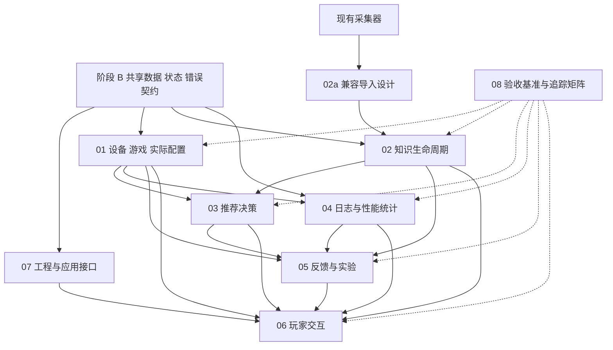

# 设计文档深化计划：阶段 A 全局分析

> 日期：2026-11-01。范围：依据当前工作区完成文档与实现盘点，供进入阶段 B 前审阅。
> 执行依据：[design-handoff.md](../../design-handoff.md)，特别是第十节的阶段 A 限制。
> 本文是分析与深化计划，不是新增业务规则、已批准技术规格或编码授权；本次不进入阶段 B—D。

## 1. 结论与分析边界

项目已经具备覆盖全闭环的产品设计，以及能够运行的公共资料采集原型。现有文档较好地说明了“应该做什么、哪些结论不能下”，但尚不能直接作为整套产品的编码规格：跨模块实体仍多为字段摘要，接口多为操作目录，状态与事务规则尚未落实成完整契约，验收条目也尚未普遍拆成独立测试用例。

建议下一阶段先建立共享契约，再按依赖深化八个模块。优先复用已有 Python 采集包及知识语义，不重新设计整套系统，不把所有对象拆成服务或物理表。

本次全面阅读了仓库内 **24 份项目 Markdown 资料**：根目录 15 份、`docs/design/` 8 份、`docs/validation/` 1 份；另对照源码、测试、依赖声明与本地既有运行产物。`.pytest_cache/README.md` 是工具缓存说明，不计入项目资料。`runs/` 是本地历史证据，不作为新的需求来源。

本次未重新抓取外部网页、探测游戏路径、启动性能采集、调用付费模型或安装依赖。原文中的外部链接只作为后续核验入口；不能把本次阅读日期当成这些第三方能力的重新核验日期。

### 1.1 当前事实与设计状态

| 标记 | 本文使用方式 | 示例与依据 |
|---|---|---|
| 已确认设计 | 当前资料明确记录的业务约束；按适用范围继承 | GPU 为主要依据、初次检索无 FPS/偏好关卡、手动配置；见总设计 C01—C11 与本次交接原则 |
| 实现建议 | 尚待审阅的产品/工程路线，写入计划不使其自动生效 | 总设计 R01—R09；FastAPI、模板、ECharts、单工作队列 |
| 待确认决策 | 会显著影响架构、首版范围或核心交互的取舍 | 第 10 节的三个决策组 |
| 待验证假设 | 必须由官方资料、兼容样本或目标环境证明 | FH6 配置字段/路径、进程绑定、PresentMon 格式与权限 |
| 已实现能力 | 能定位到现有代码，验证结论限定在实际证据范围 | 采集 CLI、类型/引用校验、受控补查与导出；见第 4 节 |

总设计标题中的“完整推荐稿”和模块中的“推荐设计”不表示用户已认可全部技术选择。交接文档本次明确要求的配置来源区分、历史保留等原则应作为本轮约束；不能据此把整张 R01—R09 推荐表升级为已确认。

### 1.2 资料解释规则

1. 本次任务范围以交接文档第十节为准；旧交接中“当前开始做什么”仅作历史上下文。
2. 整体行为以[总设计 v1.1](../../project-design.md)及其链接的当前模块稿理解；原文明确的 C/R 状态随之保留。
3. 公共知识语义继续以[知识采集契约 v0.1](../../knowledge-intake-contract.md)为基线；实现缺项不反向更改契约。
4. 实现范围由代码、测试与实施报告共同界定。旧计划中的完成勾选不代替真实验收。
5. 存在差异时登记位置、影响和建议处理，未经确认不静默改写原文。后续共享契约需明确版本、来源及与旧稿的映射关系。

## 2. 项目模块与文档清单

### 2.1 总体、契约与八个模块

以下全部是已经存在的文件。“对应深化产物”仅为建议路径，除本文外尚未创建。

| 现有文档 | 功能定位与当前信息 | 对应深化产物建议 |
|---|---|---|
| [project-design.md](../../project-design.md) | 全闭环入口；C01—C11、R01—R09、能力等级、首版边界、修订说明 | `00-architecture-overview.md`；需求与决策索引进入未来 README |
| [01-device-game-configuration.md](../design/01-device-game-configuration.md) | 设备/游戏探测、失败提问、推荐/采用/观测分开、基线、修改与恢复 | `01-device-game-configuration.md` |
| [02-knowledge-and-collection.md](../design/02-knowledge-and-collection.md) | 知识复用、覆盖、更新、来源独立性、知识包到推荐的门槛 | `02-knowledge-and-collection.md` |
| [03-recommendation.md](../design/03-recommendation.md) | 匹配、约束、完整基准、局部综合、分歧、目标与输出状态 | `03-recommendation.md` |
| [04-performance.md](../design/04-performance.md) | 会话与日志绑定、帧流、统计公式、清洗、共同阈值与比较等级 | `04-performance.md` |
| [05-feedback-optimization.md](../design/05-feedback-optimization.md) | 症状、偏好、诊断、ChangeSet、采用链、结果与停止 | `05-feedback-optimization.md` |
| [06-player-experience.md](../design/06-player-experience.md) | 六类页面、渐进展开、补充回答、失败恢复、历史与手动操作 | `06-player-experience.md` |
| [07-data-and-architecture.md](../design/07-data-and-architecture.md) | 单进程技术建议、实体摘要、API 目录、幂等、任务恢复与安全边界 | `07-data-and-architecture.md`；公共部分提炼至 `shared/` |
| [08-validation-and-delivery.md](../design/08-validation-and-delivery.md) | 四层验证、C/R 映射、D01—D05 回归要求、M0—M6 里程碑 | `08-validation-and-delivery.md`；开发任务进入实施计划 |
| [knowledge-intake-contract.md](../../knowledge-intake-contract.md) | 公共知识语义、值类型、来源作用域、两道门槛与补查停止规则 | `shared/data-contracts.md` 中的兼容说明及映射；不复制改写旧契约 |
| [web-collector-prototype-design.md](../../web-collector-prototype-design.md) | 现有采集器的原始职责、流程、预算、输入输出与边界 | `02a-collector-integration.md`，单独保留原型到产品的接入设计 |

八个模块均有一份对应深化稿。总设计、知识契约和采集原型设计也有明确对应去向；历史报告不机械再生成一份“详细设计”。

### 2.2 历史背景、实施与证据资料

| 现有文档 | 本次用途与使用限制 |
|---|---|
| [design-handoff.md](../../design-handoff.md) | 本次阶段划分、输出要求和停止边界 |
| [handoff.md](../../handoff.md) | 课程背景、用户问题、初始愿景；驱动配置、视频等较宽范围需结合后续收缩理解 |
| [handoff-search.md](../../handoff-search.md) | 多源证据早期草案；视频方案、混合状态示例与候选工具不是当前定案 |
| [discussion-notes.md](../../discussion-notes.md) | 决策演变与用户确认记录；早期“未选模型/尚未开发”不当作现状 |
| [README.md](../../README.md) | 当前 CLI、输出文件、退出码、使用方式、能力限制 |
| [deepseek-config.md](../../deepseek-config.md) | 现有凭据读取/请求模型配置说明；外部模型别名状态需后续重新核验 |
| [collector-implementation-plan.md](../../collector-implementation-plan.md) | 采集原型 Task 1—5 与实现路径；不替代全产品实施计划 |
| [collector-progress.md](../../collector-progress.md) | 调试、运行和修复历史；“当时无 Git 仓库”是历史事实 |
| [collector-implementation-report.md](../../collector-implementation-report.md) | 已实现范围、真实调用报告、隔离项与未完成验收 |
| [fh6-knowledge-validation.md](../../fh6-knowledge-validation.md) | 手动建模、条件作用域、测量配对、值级版本影响的研究样本 |
| [fh6-extraction-comparison.md](../../fh6-extraction-comparison.md) | 两篇来源的同会话提取对照；不能作为独立盲测 |
| [fh6-new-source-review.md](../../fh6-new-source-review.md) | 新版式、条件矩阵、HDR/区间、硬件与依赖疑点；仍非独立评价 |
| [docs/validation/fh6-dot-comparison.md](../validation/fh6-dot-comparison.md) | 首轮程序对选定固定值的精简回归摘要；不是全量覆盖 |

另有四份冻结研究 JSON：`fh6-extraction-results.json`、`fh6-extraction-checks.json`、`fh6-new-source-extraction.json`、`fh6-new-source-checks.json`。它们是研究/核对资料，不保证天然符合采集器 Schema 或未来产品 Schema，导入必须保留原件与显式映射。

## 3. 当前设计成熟度与逐文档缺口

成熟度采用描述性等级，不估算完成百分比：

- L1：目标、职责与业务流程清楚。
- L2：已有部分模型、状态、算法或接口，但仍有影响编码的歧义。
- L3：字段、调用、状态、失败与验收契约闭合，可据此独立编码。
- L4：相应范围另有实现及验证证据；必须注明范围，不是整份文档自动升级。

**全产品当前主要处于 L1—L2。采集子集有 L4 证据；尚无已验证的端到端产品。**

| 文档 | 当前成熟度与强项 | 距离 L3 必须补充的内容 |
|---|---|---|
| 总设计 | L1—L2；范围、主流程、确认状态与不做事项清楚 | 需求编号到模块/验收的追踪、跨模块所有权、首版选择状态、全局非功能约束；不重写已有原则 |
| 01 设备与配置 | L1—L2；未知、补充路径、采用链及恢复语义较完整 | 逐字段类型/单位/来源封装；探测超时与错误码；游戏安装与进程身份；适配器签名；字段冲突选择；生效状态完整枚举；提问/历史绑定的事务契约 |
| 02 知识与采集 | L1—L2；复用、覆盖矩阵、分支及更新方向明确 | KnowledgePackage 精确结构；来源/设置/别名身份；覆盖格证据规则；关键缺口判定；缓存失效；包发布原子性；影响传播与跨运行复用查询 |
| 03 推荐 | L1—L2；解释性决策顺序、硬件匹配、分歧与输出门槛清楚 | 类型化候选/动作/理由；约束的可执行子集与未知传播；候选不可比或并列时的结果；模型输出 Schema；逐项门槛到总体状态的归约；失败回退、去重与重算 |
| 04 性能 | L2；公式、断段、长帧比较与因果边界最接近可实现 | 已验证 CSV 格式/版本指纹；列单位与时间基准；进程/交换链绑定；流解析；摘要/协议完整字段；多段合并与缺数据规则；数值容差；导入/采集接口及中断清理 |
| 05 反馈 | L1—L2；假设、单组实验、采用与 Outcome 关系清楚 | Feedback/Preference/Diagnosis/ChangeSet/Outcome 完整类型；接受与改善维度；版本/额外改动核对；无已确认基线时 adjust 的处理；重复无效建议与偏好撤回规则 |
| 06 交互 | L1—L2；旅程、页面信息顺序、失败文案与重试意图完整 | 页面状态—任务状态映射；刷新重连与轮询契约；幂等提交保存期限；错误到具体动作；局部/终态结果展示；大表/图表与键盘验收。像素风格可后置 |
| 07 架构与数据 | L2；跨模块关联、事务意图、幂等与等待输入规则丰富 | 全字段字典、必填/null/默认值、唯一/外键/检查约束；状态转移守卫；请求/响应/错误 Schema；事务与文件提交次序；恢复边界；迁移、删除、导出完整性与本地部署约束 |
| 08 验收交付 | L2；验证分层、D01—D05、真实实验限制与里程碑明确 | 每需求的用例编号、夹具/初态、步骤/断言、Mock/真实环境标记、指标分母/容差、门禁与追踪矩阵；里程碑拆成依赖任务及 DoD |
| 知识契约 | 语义 L2，类型/引用等实现子集有 L4 证据 | 契约语义到代码/导出字段的映射；未覆盖检查列表；独立来源、平台版本与 ID 规则；非严格数值边界等表达缺项的兼容演进 |
| 采集原型设计 | 设计 L2，CLI 子集有 L4 证据 | 实际接口/预算/退出码到产品任务模型的映射；跨运行导入、取消与恢复；现有能力和新增能力的分界；图片缺口、版本与别名能力分期 |
| 三份实施文档 | 计划/日志/报告，不按产品规格评级 | 作为证据引用；未来实施计划另建，避免把旧任务勾选当新模块完成 |
| 三份研究报告与验证摘要 | 样本与评价证据，不按产品规格评级 | 整理可复用夹具、选择范围及版本/哈希索引；保留同会话/已见样本限制，不回改答案 |
| README/配置说明/两份旧交接/纪要/本次交接 | 入口、背景或过程材料 | 未来做链接及适用阶段说明即可；不各自产生第二套领域模型 |

## 4. 当前实现核对与证据基线

### 4.1 已存在的代码与职责

| 路径 | 能确认的当前职责 | 不能由此推导的能力 |
|---|---|---|
| [schema.py](../../game_collector/schema.py) | Pydantic 设置/数值/条件/来源定位/提取包类型；严格值形状 | 尚无本机设备、采用配置、会话、任务队列等完整产品类型 |
| [reader.py](../../game_collector/reader.py)、[providers.py](../../game_collector/providers.py) | 正文/表格/图片线索、Exa/公开读取/Jina 与模型适配 | 图片理解、长视频、通用游戏菜单解析 |
| [validation.py](../../game_collector/validation.py)、[reconciliation.py](../../game_collector/reconciliation.py) | 引用/原文/单位/表格检查、有限约束重验与缺口关闭依据 | 完整语义证明、任意版本/别名推理或独立事实核验 |
| [workflow.py](../../game_collector/workflow.py) | 单次发现/提取/补查、硬预算、检查点、采集结果状态 | 持久任务调度、HTTP 取消、waiting_input、跨运行恢复 |
| [storage.py](../../game_collector/storage.py) | 每个运行目录内的 SQLite 索引及 JSON/Markdown 导出 | 全产品数据库、跨运行包索引、事件存储或整组文件原子提交 |
| [__main__.py](../../game_collector/__main__.py)、[config.py](../../game_collector/config.py) | CLI 与进程/Windows 用户环境配置读取 | 本地网页服务、玩家设置页和安全会话协议 |
| [tests/](../../tests)、[compare_fh6_dot.py](../../scripts/compare_fh6_dot.py) | 受控回归及已见固定样本对照 | 当前版本推荐质量、真实游戏采集兼容性或优化收益 |

实际依赖声明见 [pyproject.toml](../../pyproject.toml)：Python `>=3.11`，requests `>=2.32,<3`、BeautifulSoup `>=4.12,<5`、Pydantic `>=2.10,<3`，测试 pytest `>=8,<10`。SQLite 使用标准库。该声明不是全部 Python/依赖组合已验证；本次运行使用 Python 3.13。FastAPI、模板引擎、ASGI 服务器、ECharts 不在当前项目依赖声明内。

### 4.2 本次重新执行的验证

2026-11-01，在现有工作区执行：

```powershell
py -3.13 -m pytest -q
```

结果：**45 passed in 4.61s**。未新增测试、未修改业务代码。结论限于既有测试覆盖。

另通过现有 `scripts.compare_fh6_dot.compare` 函数只读核对本地 `runs/fh6-final-seeded` 和冻结 JSON，未生成新的采集结果：

| 检查 | 本次结果 |
|---|---|
| 选定固定项 | 24/24 一致 |
| HDR/分辨率/FPS 区间三项语义保留 | 全部为 true |
| FPS 证据状态 | `quarantined` |
| 配置候选状态 | `needs_followup` |
| 独立盲测标志 | false |

本地运行产物受 `.gitignore` 排除；其他开发者仅克隆仓库不能直接复现这次本地输入，需保留该限制。历史报告中的“89 条接受、3 条隔离”是该次运行记录，不能转换成全系统准确率。当前没有真实设备探测、性能闭环、页面或玩家效果的新验证证据。

## 5. 模块依赖、数据流与所有权

### 5.1 依赖关系



箭头表示契约/实现依赖，虚线表示验收约束，不表示每条调用或部署关系。性能分析可在没有推荐的情况下从原配置基线或未知配置会话开始；01 不应硬依赖推荐服务生成基线。03 消费推荐能力所需的只读历史视图，不导入 05 的实验执行逻辑。05 发出定向补查/补测请求，由应用任务层调度，避免服务互相递归调用。

### 5.2 主流程的数据交接

| 阶段 | 输入 | 输出与后继 | 关键限制 |
|---|---|---|---|
| 设备与游戏获取 | 游戏选择、只读探测、必要补充回答 | DeviceSnapshot、游戏上下文/安装信息 → 知识与推荐 | 回答不升级为观测；歧义不自动选第一张 GPU |
| 知识获取 | 游戏/设备快照、既有包、预算 | 可追溯 KnowledgePackage → 推荐 | accepted 与本机适用分开；预算结束允许部分包 |
| 推荐 | 包版本、设备/游戏背景、可选偏好/历史 | RecommendationVersion → 玩家手动操作 | 推荐、目标提议不代表实际采用或本机表现 |
| 采用/原基线 | 推荐或当前设置、玩家确认/观测 | AppliedConfiguration 或明确未知 → Session/Segment | 无推荐可建基线；无配置也可记录会话 |
| 性能 | 原始日志、区段绑定、采集/清洗协议 | PerformanceSummary、比较结果 → 反馈 | 不跨未知缺口拼帧，不把不同流混成同口径 |
| 反馈实验 | 摘要、原话、采用链、公共证据 | Diagnosis、主要动作、可选 ChangeSet → 新一轮 | adjust 仍需手动采用；Outcome 追溯基础/测试版本 |

### 5.3 建议的写入所有权

本表是待在阶段 B/C 细化的工程建议，不新增业务功能。

| 数据 | 唯一写入职责 | 其他模块的访问方式 |
|---|---|---|
| 公共来源、记录、包与目录 | 02 知识服务；02a 负责旧格式映射 | 推荐/反馈按包及修订读取，不改来源原值 |
| 设备/游戏快照、配置观测、采用版本及当前指针 | 01 设备与配置服务 | 反馈提交变更意图；应用层调用 01 完成采用事务 |
| 推荐版本 | 03 推荐服务 | 玩家采用只创建关联配置，不修改推荐 |
| 会话、区段、日志、摘要、比较 | 04 会话与性能服务 | 01 提供配置引用；后补绑定由会话服务追加并保留历史 |
| 反馈、偏好、诊断、变更、结果 | 05 反馈实验服务 | 03 读取偏好快照；不得直接推进当前采用指针 |
| 任务、幂等、补充问题生命周期 | 07 应用任务层 | 领域模块提交问题/校验回答；07 协调事务及队列 |
| 页面临时输入与展示 | 06 页面层 | 不独立持有领域真值，不自行决定可比等级 |

跨模块事务如“回答→新快照→输入修订→重排队”“采用→父版本→当前指针”须由应用层协调。一个 SQLite 库内明确事务即可，无需引入分布式事务。

## 6. 优先问题、冲突与不明确项

优先级表示深化顺序：P0 的共享原则与边界须在阶段 B 的共享契约定稿前闭合，不作为启动 B 的前置条件；具体模块的字段约束、事务和恢复步骤在 C 阶段补齐。P1 在对应模块交给编码前闭合，P2 可分期验证。以下区分“历史差异”“实现缺项”和“设计歧义”，不把所有缺项都称为业务冲突。

| 编号/级别 | 类型与位置 | 影响 | 建议处理与交付点 |
|---|---|---|---|
| A01 / P0 | 确认状态：总设计 §3.2 的 R04 等仍为推荐，本次交接 §四已明确要求三种配置/历史区分 | 容易把某项新增约束扩张为全部推荐获批 | 逐条保留 C/R/交接来源；第 10 节集中确认产品取舍，B 建决策索引 |
| A02 / P0 | 身份映射：07 §3 的 KnowledgeRecordRef、代码 `reference_scope/local_id`；`workflow.py` 按游戏名 casefold 后哈希 game_id | 别名/平台/跨运行下可能拆成不同游戏；同名局部 ID 可能误连 | B 明确游戏/安装/来源/修订/提取作用域与映射；02a 保留旧 ID，不回改样本 |
| A03 / P0 | 未知表达：知识契约 §4.4 有五类原因，01/07 还需要“未探测/失败/跳过/冲突/不适用”等获取过程 | 混合获取状态、值状态、来源可信性会把未取得当空值或失败 | B 设计兼容封装与独立状态维度，显式映射公共旧枚举；不直接往旧 Schema 塞新含义 |
| A04 / P0 | 配置与历史：01 §5—7、05 §6—7、07 §4/7.1/10 已有语义，缺完整约束 | 部分采用、重启待生效、并发回答/调整、历史补绑仍可能被不同模块各自解释 | B 固定不可变版本、安装级当前指针及绑定修订；C 完成按 origin 的约束和原子操作 |
| A05 / P0 | 持久化边界：07 要求历史/恢复；`storage.py` 每运行建库并用 `INSERT OR REPLACE` 更新快照 | 现有检查点不等于事件历史/跨运行恢复；全库和文件写出也非共同事务 | B 明确“保留原型＋产品只读导入”与新增任务存储的职责、提交及失败恢复边界；C 在 02a/07 细化导入/发布的事务与文件顺序、故障窗口及恢复步骤 |
| A06 / P0 | 任务语义：07 §7.2/8/8.1 对比 `workflow.py` 的领域结果与 KeyboardInterrupt 路径 | 原型中中断用 partial_scope、interrupted 标志及预算停止原因，不能直接当成统一 TaskRun 终态 | B 给任务/领域/停止原因独立映射，标明新增能力；C 设计取消、等待、重启、幂等与调用未知窗口 |
| A07 / P1 | 命名/模型缺口：02/03 用 GameContext、ExplicitPreferences、source_revision_ids；07 主表有 GameInstallation/Preference；04 简称 Session，07 为 PlaySession；MetricDefinition/ComparisonProtocol/比较结果字段散落 | 开发者可能新建重复实体或返回结构不兼容 | B 建实体/DTO 名称与来源对照，确定同义关系及比较结果所有权；目前仅记录，不宣布改名 |
| A08 / P1 | 门槛缺项：02 §4/8、03 §11，accepted、覆盖、actionable 为不同维度 | 缺少“本操作的关键项”与总体状态归约，模型可能自行解释完成 | C 定义逐项判据、适用操作、未检查/不适用、包发布与推荐降级规则 |
| A09 / P1 | 证据能力差距：契约 §4.2 要求严格/非严格边界；`NumericValue` 当前无专门边界包含标志；复杂条件/版本/别名只实现子集 | 新消费者可能以为类型已涵盖全部契约，或误解旧记录 | B 列出字段映射及缺项；C 提出版本化增补/保留原文方案与兼容测试，禁止回填假值 |
| A10 / P1 | 版本/别名/独立性：02 §5—6/9 与当前精确原名规则 | 来源修订影响传播、设置同名跨版本、转载独立性尚无完整模型 | B 固定来源及版本身份；C 定义关系依据、未知路径和受影响范围，不用域名数量当独立票数 |
| A11 / P1 | 性能格式：04 §1/5—9 已给算法，具体工具版本/列/时钟尚未验证 | 错流、错单位或无法定位历史区段会使公式正确但结论错误 | C 前做只读格式/样本验证计划；CSV 适配器保存映射与协议，真实 FH6 权限另外验收 |
| A12 / P1 | 无配置调整：05 允许文字反馈低确定性调整，但 ChangeSet 要求 base_applied_id；01 允许未知配置会话 | 直接生成可采用变更可能虚构基线及回滚值 | C 明确该分支先补少量原值/建立基线，或仅交付排查建议；正式 ChangeSet 前置条件不可省略 |
| A13 / P1 | Outcome：05 §7 的 accepted 与 improved_but_rejected 等枚举混合玩家接受和测量结果 | 无复测但接受、测得更好但拒绝等组合容易歧义 | B 保留既有枚举语义，同时提出独立接受/效果字段的兼容表达；C 给组合判定表，不把接受当统计改善 |
| A14 / P1 | HTTP 操作缺口：07 有 comparisons/exports GET，但比较持久化与导出生成入口、响应/错误尚不完整 | 无法从操作目录实现完整前后端；GET 若隐式创建资源会模糊幂等边界 | C 明确查询与生成职责、持久化位置、文件 ID、错误包、超时/重试，不在 A 先定新 API |
| A15 / P1 | 资源生命周期：07 §10 提到删除、迁移、文件原子替换，但缺规则表 | 级联删除可能破坏证据，文件/DB 失败可能留下假有效引用 | C 定义删除/墓碑/保留与校验、Schema 升级/备份恢复；采用最小必要机制 |
| A16 / P2 | 历史材料：handoff-search 的视频/广范围、纪要早期未选模型、实施计划当时无 Git | 旧草案被误当现行要求或现状 | 只在新索引登记阶段及替代关系；保留原文；视频继续后置 |
| A17 / P2 | 图片：总设计 §4、02 §7、契约 §1 的项目范围与代码仅保存线索 | “范围内”可能误被理解为 M1 已完成 OCR/VLM | 第 10 节审阅首版范围；C 给增强里程碑、缺口与降级；不得因未读图阻断已合格文字证据 |
| A18 / P1 | 验收映射：08 §3 列了 C01—C08/C11 及部分 R，C09/C10 等未逐项覆盖 | 模型审计/暂停编码等约束可能在任务拆分中遗漏 | 08 深化时补全确认原则与新契约追踪；D01—D05 保持回归门禁，不用单元测试替代真实效果 |

阶段 B 优先消歧 A01—A06 的共享原则与边界：它们决定同一条事实如何被定位、标记、保存与恢复；进入 C 时继续完成各项模块细节。性能工具验证也应尽早安排，避免等页面完成后才发现日志无法可靠关联。

## 7. 后续文档组织与唯一权威定义

建议沿用根目录原始总设计与 `docs/design/`，全部深化稿放在本目录。以下为未来目录计划，不表示内容已经生成：

```text
docs/technical-design/
├── 00-deepening-plan.md             # 本次唯一新增产物，阶段 A
├── README.md                        # 后续：索引、状态、来源与决策台账
├── 00-architecture-overview.md      # 后续：全局职责、边界与非功能要求
├── shared/
│   ├── data-contracts.md            # 公共与本机对象、DTO、兼容映射
│   ├── state-conventions.md         # 状态维度、转移、守卫与历史
│   └── error-conventions.md         # 错误包、码表、重试与幂等语义
├── 01-device-game-configuration.md
├── 02-knowledge-and-collection.md
├── 02a-collector-integration.md      # 采集原型设计的单独深化对应稿
├── 03-recommendation.md
├── 04-performance.md
├── 05-feedback-optimization.md
├── 06-player-experience.md
├── 07-data-and-architecture.md
├── 08-validation-and-delivery.md
└── implementation-plan.md           # 后续：可独立实施的任务与 DoD
```

权威分工建议：

- 需求与确认状态引用原始总设计、本次交接和明确的后续决策，不在新稿声称已获批准。
- 公共知识语义继续引用 v0.1 契约；`shared/data-contracts.md` 负责字段级细化与兼容映射。若确实改变旧语义，先记录变更提案与迁移影响，不能建立两个不同“权威”。
- 新增本机对象、ID、单位、空值、来源封装与跨模块 DTO 在 `shared/data-contracts.md` 唯一定义；模块稿通过链接使用。
- 通用状态与错误由 `shared/` 定义。07 负责物理存储、事务、任务队列、迁移及 API 集成，不复制第二套逻辑实体。
- 性能公式/清洗/比较算法以 04 为唯一算法定义，05/06/08 引用相同协议；来源报告指标保留其原口径。
- 模块局部接口在对应模块稿定义；07 维护对外路由及共享契约链接，避免两份请求体长期漂移。

## 8. 分阶段深化顺序与交付检查

这是**文档深化顺序**，不代表已经授权执行后续阶段或编码。未来编码的任务顺序由 `implementation-plan.md` 另行给出。

下表“依赖”列只列前序交付物或审阅条件；A 编号是本阶段需处理的问题，不是必须预先完成的外部依赖。B1 处理 A01 的来源与确认状态，B2 处理 A02—A04 的共享定义，B3 处理 A05—A06 的持久化与任务边界；这些共享部分闭合后方可定稿阶段 B。C 阶段补齐模块细节，若发现需要改变共享原则或边界，须先回修并复核 B 契约。

| 顺序/阶段 | 工作 | 依赖 | 输出与退出条件 |
|---|---|---|---|
| A / 本次 | 全局阅读、实现核对、成熟度与冲突清单 | 当前仓库 | 本文覆盖清单、缺口、依赖、顺序及关键决策；原稿/业务代码不变 |
| B1 | 来源/需求/决策索引及架构基准 | 审阅第 10 节；未决项保留状态 | README、架构概览；C/R/交接原则有出处，建议与确认不混淆 |
| B2 | 统一对象、引用、获取/值/来源状态与版本；处理 A02—A04/A07/A09 的共享定义与兼容映射 | B1 | data-contracts；每字段有类型/必填/null/默认值/来源/修改与历史策略；旧记录可无损定位 |
| B3 | 状态、错误、幂等与恢复公共约定；处理 A05—A06 的职责、提交、失败恢复边界及状态映射 | B2 | state/error conventions；合法转移、守卫、终态、领域结果映射、未知调用处理可检查；A01—A06 的共享原则与边界均闭合后定稿 B |
| C1 | 07 工程骨架设计；08 验收编号与基准先建 | 已定稿的 B1—B3 | 细化共享接口/存储责任、迁移边界和测试模板，补齐 A05—A06 在 07 的事务与恢复步骤；不等待全部模块写完才设计验收 |
| C2 | 01 设备/游戏/配置，02a 旧采集兼容，02 知识生命周期 | 共享契约、C1 | 模块各自完整稿；补齐 A02—A05 的模块字段约束、映射、原子操作及导入/发布恢复步骤；探测失败回答、旧格式导入与部分知识包流闭合 |
| C3 | 04 性能与 03 推荐 | C2 的相应数据契约 | 两者可独立深化；04 不以 03 产出为前提；正式工具兼容事实必须有核验记录 |
| C4 | 05 反馈实验 | 01/02/03/04 | 偏好、诊断、ChangeSet→采用→复测→Outcome、拒绝与恢复均能追溯 |
| C5 | 06 完整交互，回补 07 集成与 08 用例 | 领域模块契约 | 页面/任务/接口/错误一一对接；无需理解工程字段也能正常操作 |
| D | 跨文档复核、问题与决策清单、实施计划 | 全部深化稿 | 单一定义、引用/状态/接口一致；每个任务有依赖、组件、契约、验收和 DoD；剩余未知明确阻止哪些操作 |

### 8.1 每份模块深化稿的最低内容

每份稿按交接要求覆盖十项：目标职责、功能拆解、组件与调用、数据模型、接口契约、核心流程、异常边界、技术依赖、测试验收、实施任务。不适用的部分说明原因，不套用空模板。

功能与测试建议采用模块前缀，如 `DEV-*`、`KNW-*`、`REC-*`、`PERF-*`、`FBK-*`、`UX-*`、`ENG-*`、`VAL-*`。这是编号建议，阶段 B 统一后再使用，不与已有 C/R/D 编号混用或覆盖。

每次完成一份，逐项检查：

1. 所有重要设计可追溯到原需求，或明确标记为实现建议/假设。
2. 功能有触发、输入输出、前提、正常/分支/异常、依赖及验收。
3. 核心对象有字段类型、单位、必填、默认/null、唯一与关联、时间、来源、修改与历史规则。
4. 关键接口有类型化请求/响应、失败码、前提、副作用、幂等、事务、超时与重试；示例只用于设计说明。
5. 流程贯通校验、获取、判断、状态、持久化、后继任务、输出与恢复；复杂跨模块流程配时序/状态图。
6. 每个关键用例含编号、关联需求、目的、初态、输入、步骤、输出/状态断言、Mock 与真实环境要求。
7. 开发任务有依赖、组件、逻辑、接口/结构、验收及 DoD，能独立实现、测试和提交。
8. 依赖的其他模块契约均已定义或显式登记缺口，没有“后续自行约定”的隐式接口。

### 8.2 阶段 D 必须复走的跨模块链路

- 探测失败→提问→部分回答→刷新→明确跳过→有限结果；包含过时请求与终态后补。
- 无推荐的原配置基线→日志→推荐后采用→复测；未知配置会话也能保存反馈。
- 实际配置 A＋局部变更 C→B→下一轮；保留自定义值，过时提交冲突，手动恢复新建版本。
- 知识包更新→受影响推荐 needs_review；历史证据、采用与旧会话仍可复现。
- 长帧共同阈值/时长分母/断段→比较→Outcome→页面，同一口径不被重新解释。
- 创建请求并发/响应丢失/进程退出→相同幂等结果；外部调用结果未知不自动重发。

这些链路复用原 D01—D05，不把本次列出清单描述为程序已经通过。

## 9. 后续外部核验与工程验证计划

本阶段只记录核验任务，不凭印象补出第三方 API、配置路径或支持范围。新技术事实应记录官方链接、核验日期、版本/样本、观察结果及未验证限制。

| 核验项 | 已有依据/入口 | 应补的证据 | 未通过时的设计降级 |
|---|---|---|---|
| Windows 设备读取 | 01 §3 引用的微软 CIM 类文档 | 字段类型/单位、现代显存限制、多 GPU 与笔记本样本；程序参数与错误样本 | 集中询问，未知保留，不依赖猜测显存 |
| FH6 适配 | 01 §4 的待验证声明 | 目标平台/构建、只读配置路径和字段映射、进程身份/匹配样本 | 玩家选择/确认，有限能力等级，不承诺全自动 |
| PresentMon 导入/引导采集 | 04 §1 引用的官方控制台文档 | 固定工具版本及参数、原始 CSV、列/单位/帧流、时间转换、权限与异常退出 | 首先只支持已验证格式；未知格式保存原件并解释缺项 |
| 本地网页技术栈 | 07 §1 的 FastAPI/ECharts 官方链接 | Python/框架/模板/静态资源兼容矩阵、本地分发与图表性能/可访问性；候选取舍 | 保留服务接口与 CLI 验证，不引入第二套业务逻辑 |
| 模型/搜索服务 | 当前 providers 与配置文档 | 官方请求/响应格式、模型别名和用量口径、错误/超时；必要时经授权的小预算实测 | 保存部分成果，模型错误不变成空成功；不估算未知费用 |
| 图片增强 | 02 §7 的缺口流程 | OCR/VLM 的来源定位、图表单位/图例/数字准确性及输出校验 | 未读图关键条件继续未知，不替换已合格文字记录 |

不是所有项都阻塞阶段 B。B 可先规定数据/失败/未知表达；正式把某项外部能力写成确定接口前才需要相应核验。真实本机效果还需 08 所述受控协议与玩家反馈，官方文档不能证明优化收益。

## 10. 进入阶段 B 的理由与少量关键决策

建议进入 B，因为八个模块已经在使用同一批核心概念，继续逐份扩写会放大 ID、状态、空值、版本、错误和事务的不一致。先收敛这些契约，可以复用采集原型，并让推荐、性能、反馈和交互在同一事实链上设计。

请优先审阅以下三个决策组。它们来自[交接文档第五、十节](../../design-handoff.md)要求集中提出重大决策、完成 A 后再说明 B 的安排；不是要求重新确认已经明确的手动配置等原则。阶段 A 的成果已经写出，本次到此停止。

| 决策 | 推荐选择与对应原稿 | 需要用户确认的影响与备选 |
|---|---|---|
| Q1 产品与部署形态 | Windows 本地网页＋Python 单进程＋SQLite；07 的 FastAPI/模板/ECharts 作为实现建议继续细化（R01） | 决定应用接口、页面状态和任务生命周期。若先做纯 CLI，可保留相同领域契约，但产品验收范围需调整；原生桌面壳成本更高 |
| Q2 首版验收范围 | FH6 一游戏完整闭环，游戏内显示/图形设置为可执行优化对象；驱动优化和长视频后置；网页图片保留增强里程碑，首轮未读取部分明确为缺口（R02/R09、总设计 §4） | 决定适配与验收规模。若必须首版就覆盖多游戏/驱动，或必须在首次演示前完成图像理解，需要调整里程碑；不因分期把图片移出项目范围 |
| Q3 玩家确认与测试参与量 | 手动设置后一次声明确认并记录差异；先导入一种已验证日志，再接引导采集；固定场景验证、每轮一个设置或必要联动组（R05—R08） | 决定采用记录、比较门槛和玩家操作量。可改为更细逐项确认或更轻日常游玩记录，但未知/非受控结果仍须保留，不能因此宣称严格改善 |

不要求用户先决定 UUID 格式、表名、超时秒数、颜色字体等常规细节。它们可在 B/C 给有理由的默认建议并登记。Q1—Q3 若只认可部分，其余继续标“待确认”；不以未回复视为批准，也不据此恢复编码。

## 11. 本次交付核对

- 已给出文档与模块清单、逐文档成熟度/缺口、已有实现证据、依赖与所有权建议。
- 已记录原稿差异、工程缺项和设计歧义，给出优先级、影响及深化归属。
- 已给出 B—D 的建议顺序、产物映射、逐稿检查及全局复核入口。
- 已集中列出三个影响架构/范围/核心交互的决策组。
- 本次仅新增本文；原始设计、冻结样本、源码、依赖声明与既有运行产物未作内容修改。工作区已有未提交设计修订继续保留。
