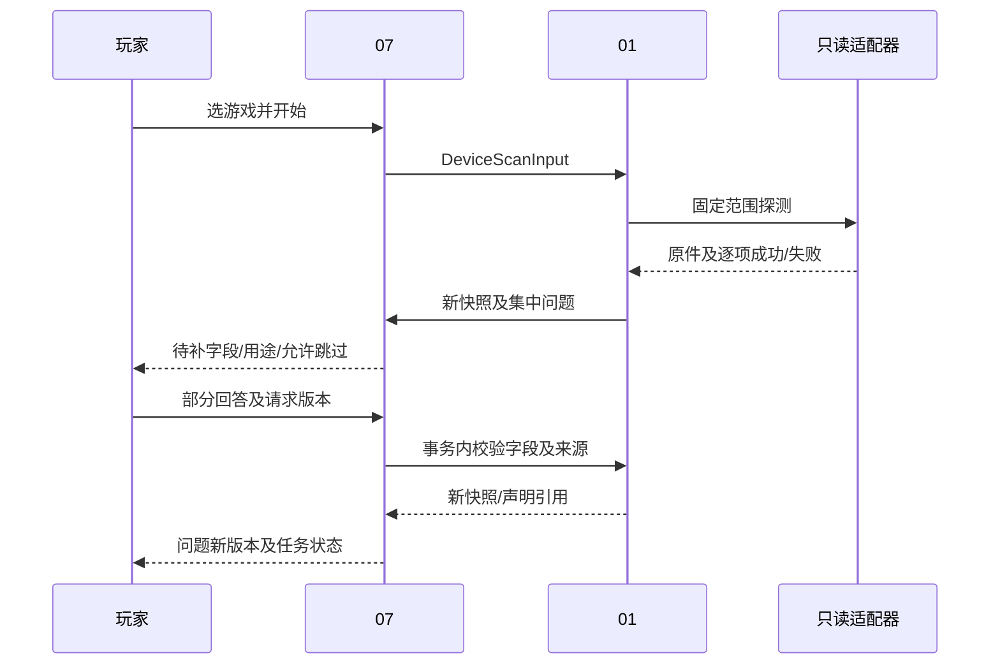

# 01 设备、游戏上下文与配置历史详细设计

> 阶段 C2；2026-11-01；建议基线 `product-contract/0.2`；产品模块未实现。
> 来源：[原始 01](../design/01-device-game-configuration.md)、C01/C05/C07/C11、D01/D03/D04、[共享数据 §2—6/9](./shared/data-contracts.md)、[状态 §4/7](./shared/state-conventions.md)。

## 1. 职责与确认状态

01 提供只读设备探测、安装上下文、配置观测、玩家声明、当前采用与历史补录。公共 Game/别名由 02 确认；会话绑定由 04 写；推荐由 03 写。01 不预测 FPS、不生成驱动命令、不执行游戏配置修改。独立基线、用户回答不冒充观测、历史不可覆盖为已确认约束；Q3 一次确认及继承明确推荐项仍为建议。现有 Collector 不提供完整设备/配置模块。

## 2. 功能需求与字段策略

| 功能 | 触发/输入/前置 | 处理及输出 | 分支/验收 |
|---|---|---|---|
| DEV-F01 设备扫描 | 玩家选游戏或刷新；DeviceScanInput，受控字段路径 | 适配器只读输出→原件→逐字段 FieldValue→新 DeviceSnapshot | 失败/歧义集中建问题；DEV-V01/02 |
| DEV-F02 安装及身份 | 平台/库目录线索或 ContextDeclarationInput | 保留线索，02 确认 Game；不同安装分别登记 GameInstallation/GameContext | 未知路径允许手工上下文，禁止全盘猜扫；DEV-V02 |
| DEV-F03 观测与采用 | 已验证配置适配器或 AdoptConfigurationInput | 先观测、再声明；按 origin/预期当前 ID 合并并原子推进 | 无推荐可 baseline；未知不造采用对象；DEV-V03 |
| DEV-F04 调整/恢复 | ChangeSet 或历史目标，当前指针匹配 | 从实际 A 合并完整 B，保存父链/差异；恢复另建版本 | 额外改动保留并降级实验；过时409；DEV-V04 |
| DEV-F05 历史补录 | 旧闭合段及当时依据；HistoricalConfigurationInput | 独立历史版本/声明，不写当前指针，交04显式补绑 | 不能用当前确认证明过去；DEV-V05 |

输入字段白名单以适配器注册表为准，建议首版如下；未知字段直接 INPUT_VALIDATION_FAILED，不把任意表达式交 PowerShell。Scalar 之外的复合值由后端将配套标量字段组装，部分缺失则整体未知并保留已得原件。

| 路径组 | 来源、单位和关键性 | 失败后问题/降级 |
|---|---|---|
| cpu、memory_bytes、os_version | 固定只读系统查询；内存 byte；通常非关键 | 一组可选补充；不填 0 |
| gpus.*.raw_name / vram_bytes / driver_version | 保存全部 GPU，容量来源单独核验 | 先问型号/设备形态，显存仍未知则相关分支条件化 |
| selected_gpu_id、device_form | 运行证据/玩家选择，不取第一项 | GPU 歧义关键于设备匹配，但不阻止无设备公共收集 |
| display.desktop_resolution.width/height、refresh_hz | 显示背景，不是游戏渲染分辨率 | 配对构造 Resolution；未知不默认1080p/60Hz |
| platform、build_identifiers.*、private_path | 平台/文件版本/游戏内原标识或用户声明 | 路径未知可继续；无依据不比较不同平台版本序 |
| settings.<登记设置ID> | 配置原件/玩家声明；值类型由本机目录决定 | 只问本轮关键设置；用户说不知道可明确跳过 |

ContextDeclarationInput.fields 只接受上述上下文标量路径、[04登记的运行条件路径](./04-performance.md#4-数据时钟与局部输入)及适配器登记的受控路径线索，不用于批量游戏设置采用；采用值使用 SettingDeclaration。字段用途/required_for 同时写 InformationRequest，避免“所有字段都必填”。GPU扫描失败时 gpus=[] 只表示本次未登记任何适配器成员，必须同时记录失败/未覆盖检查，不据此断言机器没有GPU；不造一个虚构GPU填列表。

## 3. 组件与获取流程

`ProbeAdapter` 只执行打包的查询参数，返回原始文本/结构及退出状态；`SnapshotAssembler` 做单位/类型/来源包装；`ContextResolver` 与02协调公共身份；`ConfigurationReader` 按已核验游戏适配器读取；`AdoptionService` 处理声明/合并；`QuestionPlanner` 汇集获取失败及冲突，交07管理生命周期。未来建议文件为 `game_app/device.py` 与 `game_app/adapters/windows_probe.py`、`game_app/adapters/games/`。



## 4. 数据、唯一性与历史

字段定义统一引用 shared；本模块不保留原稿的 observed 单一 status，而用 ValueState、AcquisitionStatus、AcquisitionMethod 和 ActivationState 四维表达。

| 共享对象 | 本模块约束/来源 | 修改规则 |
|---|---|---|
| DeviceSnapshot/GpuSnapshot | 所有 GPU 带原名，selected_gpu_id 须属于该快照；正字节/Hz，数值类型严格 | 回答/新探测生成新版本；不更新旧 provenance |
| GameInstallation/GameContext | user_scope+安装区分；路径绑定后台私有；game_revision 属于 game_id | 安装头按 revision 更新并保留完整旧快照；GameContext 新版本 |
| ConfigurationObservation | 必须有实际只读原件、适配器版本与 observed_at；声明不能伪装探测 | 只追加；没有适配器不能造“空观测成功” |
| AppliedConfiguration/PlayerDeclaration | 字段确认与观测分开；采用与历史 registration_kind 分开；至少已确认项/预设 | 全部不可变；当前指针 unique(scope,installation) |
| LocalSettingDefinition | 同安装下由 namespace/raw_name/menu_path+依据定位；不能仅中文名归一 | 新条目追加，冲突不静默并名；公共映射由02核验 |
| InformationRequest/Response | 问题关联具体设备/游戏/采用版本；answers 不与 skipped_fields 交叉 | 问题聚合修订、回答不可变；生命周期07所有 |

未知设置项不从预设名推导。预设引用只能代表声明范围；若原配置仅记得预设与少量差异，保留此范围，不声称读取了全菜单。历史补录只按 B3 §4.4 创建独立 baseline，不编造未知的采用链或 ChangeSet 执行事实。

## 5. 接口、前置与副作用

以下函数均为未来设计。所有同步变更传 MutationContext，返回 ResourceResult，失败为共享 ErrorEnvelope；创建扫描经07返回 TaskAccepted。只读探测重试最多一次且只针对明确瞬时失败；建议每个受控探测 10 秒超时、同轮总探测 30 秒为待验证初值，超时后主动询问，不提权。数据库失败沿07同 key 重送，不自动重新写游戏。

| 01 接口 | 逻辑输入/返回 | 守卫与写入 |
|---|---|---|
| scan_device | DeviceScanInput→任务成果 DeviceSnapshot/GameContext/问题引用 | 固定白名单、原件已登记；只读探测；失败保存 attempts |
| declare_context | ContextDeclarationInput→ResourceResult | raw_text/结构化声明持久化，构造 user_provided；路径校验失败不执行目录命令 |
| adopt_configuration | AdoptConfigurationInput→ResourceResult | 当前指针及全部 origin 约束；声明、完整配置、事件和幂等响应同事务 |
| record_historical_configuration | HistoricalConfigurationInput→ResourceResult | 闭合段、修订、时段依据；历史 adopted_at 可 null；不更新指针/绑定 |
| validate_information_answer | InformationResponseInput及固定上下文→新对象候选 | 不自行提交；07短事务内复核版本并保存回答/快照/任务输入 |

下例是虚构 baseline 逻辑输入，不是 FH6 设置；预设未展开，不宣称已运行生效。ID 均为虚构合法 UUID。外部入口不接受 system_probe 来源字段。

```json
{
  "kind": "adopt_configuration",
  "origin": "baseline",
  "installation_id": "00000000000000000000000000000101",
  "device_snapshot_id": "00000000000000000000000000000102",
  "game_context_id": "00000000000000000000000000000103",
  "expected_current_applied_id": null,
  "recommendation_id": null,
  "base_applied_id": null,
  "change_set_id": null,
  "restored_from_applied_id": null,
  "declared_settings": [],
  "preset_reference": "玩家声明的预设P，具体项未展开",
  "claimed_activation": "unknown"
}
```

## 6. 采用、回答与历史补录的关键步骤

采用：取固定推荐/基础/变更→展开已明确的项（条件项不自动选）→合并玩家差异→核对依赖/重启→事务比较 expected_current_applied_id→保存本次声明、完整新版本和父链→推进当前指针并存原响应。多余玩家改动不丢弃，但不能继续把实验说成只改原单元。回滚先由玩家手动操作，确认后 parent=恢复前当前、restored_from=历史目标，不重用旧 ID。

回答：读取原请求/固定历史上下文→核验 answers 路径/类型/冲突选择→07事务再查两个版本→保存 InformationResponse、新设备/游戏快照、问题修订、等待任务输入修订→关键项 answered/skipped 后排队，其余问题可仍部分未答。用户声明与 system_probe 冲突时 value=conflicting、value=null、保留至少两份依据；明确选择后新快照保存 FieldResolution，不覆盖旧冲突。

历史：玩家补充过去区段事实→问题回答先存为新依据→必要时登记历史 AppliedConfiguration/PlayerDeclaration→返回版本 ID→04 按独立 BindConfigurationInput 校验最新段/绑定、追加绑定→另建分析。两次提交之间当前指针变化不影响历史事实；段修订变化只使后续绑定冲突，不撤销合法已存声明。

## 7. 异常与降级

| 情况 | 预期行为/错误/恢复 |
|---|---|
| 探测全部失败 | 记录 failed/parse_failed，集中询问；用户跳过后 device_scan 按 limited/unavailable 交付，公共收集可继续 |
| 同名 GPU/笔记本或 PID 重用 | 不自动合并/选择；保留功耗与启动时间未知；未确认进程不自动采集 |
| 路径不可读/配置格式未知 | 无 ConfigurationObservation 假成功；询问当前采用及关键差异；保存失败原件/错误 |
| 回答不能可靠归一 | 原话保存，answer_state=unresolved，不用模型猜测数值进入已知字段 |
| 请求版本/上下文过时 | B3 对应409；新问题/解除等待与维护响应原子；已答有效字段保留 |
| 当前配置并发推进 | CURRENT_CONFIGURATION_CONFLICT，无半声明/采用；读取差异后新 key 重新确认 |
| 历史依据不足 | PRECONDITION_UNVERIFIED，仍可保存原回答，但不生成假已知历史配置/绑定 |
| 生效待重启/无法核对 | restart_pending/unknown；采用事实可记录，controlled 比较禁止；不替玩家重启游戏 |

## 8. 依赖、核验与能力门禁

建议只读 Windows CIM 适配器优于要求安装专有工具；厂商遥测留扩展，用户补充始终可用。2026-11-01 核验微软文档：Win32_VideoController 的 AdapterRAM 是 uint32 且单位 byte，因此不能独自表达所有现代显存容量，这是字段宽度带来的设计限制；非 WDDM 硬件还可能返回不准确属性。[微软官方类文档](https://learn.microsoft.com/en-us/windows/win32/cimwin32prov/win32-videocontroller)。本次没有在玩家机器运行查询。

具体 CPU/内存/显示字段的 Windows 查询实现须以固定查询脚本及单位样本验收，未核验者仍未知。FH6 路径、进程名、配置格式、菜单枚举、构建映射未取得本机证据；适配器注册为空时 can_read_config/can_bind_capture 保持 not_run/unknown，不能预置 pass。只有将支持版本、原件、读取失败样本与比较规则登记后才启用对应能力；公共 knowledge_only 不受配置适配器缺失阻断。

## 9. 验收场景

| 编号/需求/目的 | 初态/输入 | 操作 | 输出及状态断言 | Mock / 真实环境 |
|---|---|---|---|---|
| DEV-V01 / C11、D04：失败后回答 | GPU探测失败，CPU已知；问题有两个关键字段和一非关键 | 部分回答→刷新→再答/明确跳过；旧 key 重试；终态后补 | 已知项不重填，用户来源不变观测；等待释放槽，输入修订原子，终态不复活 | 探测/调度桩；免游戏 |
| DEV-V02 / C01/C05：不误配 | 双 GPU、同名 Laptop/桌面、路径未知、重复 PID 不同启动时刻 | 探测/选择并创建安装上下文 | 未确定GPU不取首项；安装不按game合并；未知路径/显存保留 | 固定探测原件；真实Windows多GPU样本另验 |
| DEV-V03 / C07、D03：独立基线 | 无推荐，只有显式预设；另有完全未知配置 | 保存 baseline / 仅创建会话 | baseline 推荐空、预设不展开；未知无假采用对象；受控适配器未写游戏文件 | 文件写入监视桩；真实只读探测需集成 |
| DEV-V04 / D01：连续调整/恢复 | A含自定义项，C1只改一项；另页推进 | 采用B→C2基于B→旧A提交→手动恢复确认 | 未改项/未知保留，过期409；父链/ChangeSet正确；恢复新ID | 临时DB/抽象设置；手动游戏操作另验 |
| DEV-V05 / D03/D04：历史补录 | 当前B，旧段未知，有/无当时A的依据 | 回答→登记历史A→显式补绑；模拟响应丢失 | 有依据生成独立A及声明，未知采用时间null；当前B不变，同key同A；无依据不绑 | 时间/声明夹具；免游戏 |

## 10. 实施任务与 DoD

| 任务/目标 | 依赖 | 拟建组件/文件 | 必须逻辑与接口 | 验收/完成定义 |
|---|---|---|---|---|
| DEV-T01 只读获取与来源包装 | ENG-T01/02 | game_app/device.py、adapters/windows_probe.py；tests/product/test_device.py | scan_device、字段白名单/单位/原件、失败提问与快照 | DEV-V01/02；无默认值造假，脚本只读/超时可测 |
| DEV-T02 安装与配置目录 | DEV-T01、KNW-T01 身份服务 | game_app/adapters/games/、device.py；test_context.py | 安装隔离/路径保护/配置读取能力、LocalSettingDefinition | DEV-V02/03；未核验适配器不得报支持 |
| DEV-T03 采用及历史事实 | DEV-T02、ENG-T01—03 | device.py；test_adoption.py、test_historical_configuration.py | adopt/历史登记/合并/父链/声明/幂等；04绑定独立 | DEV-V03—05；并发/丢响应/历史指针均可断言 |
| DEV-T04 问题归一与接续 | DEV-T01/03、ENG-T02 | device.py、tasks.py；test_information_answers.py | 两版本校验、冲突选择、FieldResolution、终态后补 | DEV-V01/05；所有回答状态有夹具，来源不可升级 |
