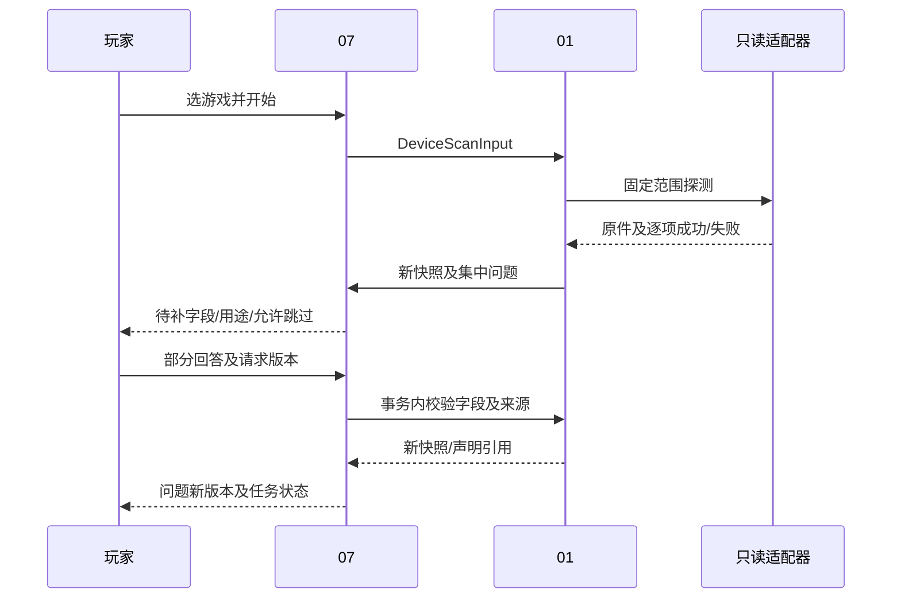
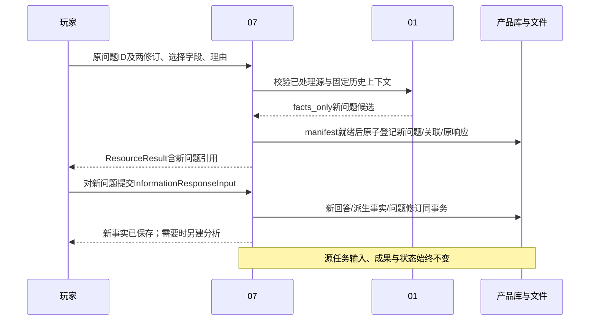

# 01 设备、游戏上下文与配置历史详细设计

> 阶段 C2及D-P01/02/04补全；2026-11-01；建议基线 `product-contract/0.4`；产品模块未实现。（独立审计修订；兼容见共享数据§12.2）
> 来源：[原始 01](../design/01-device-game-configuration.md)、C01/C05/C07/C11、D01/D03/D04、[共享数据 §2—6/9](./shared/data-contracts.md)、[状态 §4/7](./shared/state-conventions.md)。

## 1. 职责与确认状态

01 提供只读设备探测、安装上下文、配置观测、玩家声明、当前采用与历史补录。公共 Game/别名由 02 确认；会话绑定由 04 写；推荐由 03 写。01 不预测 FPS、不生成驱动命令、不执行游戏配置修改。独立基线、用户回答不冒充观测、历史不可覆盖为已确认约束；Q3 一次确认及继承明确推荐项仍为建议。现有 Collector 不提供完整设备/配置模块。

## 2. 功能需求与字段策略

| 功能 | 触发/输入/前置 | 处理及输出 | 分支/验收 |
|---|---|---|---|
| DEV-F01 设备扫描 | 玩家选游戏或刷新；DeviceScanInput，受控字段路径 | 适配器只读输出→原件→逐字段 FieldValue→新 DeviceSnapshot | 失败/歧义集中建问题；DEV-V01/02 |
| DEV-F02 安装及身份 | 平台/库目录线索或 ContextDeclarationInput | 保留线索，02 确认 Game；不同安装分别登记 GameInstallation/GameContext | 未知路径允许手工上下文，禁止全盘猜扫；DEV-V02 |
| DEV-F03 观测与采用 | 已验证配置适配器或 AdoptConfigurationInput | 先观测、再声明；按 origin/预期当前 ID 合并并原子推进 | 无推荐可 baseline；未知不造采用对象；DEV-V03 |
| DEV-F04 调整/恢复 | ChangeSet 或历史目标，当前指针匹配 | 从实际 A 合并完整 B，保存父链/差异；恢复另建版本 | 额外改动保留并降级实验；过时409；DEV-V04 |
| DEV-F05 历史补录 | 旧闭合段及当时依据；HistoricalConfigurationInput | 独立历史版本/声明，不写当前指针，交04显式补绑 | 不能用当前确认证明过去；DEV-V05 |

输入字段白名单以适配器注册表为准，建议首版如下；未知字段直接 INPUT_VALIDATION_FAILED，不把任意表达式交 PowerShell。Scalar 之外的复合值由后端将配套标量字段组装，部分缺失则整体未知并保留已得原件。

| 路径组 | 来源、单位和关键性 | 失败后问题/降级 |
|---|---|---|
| cpu、memory_bytes、os_version | 固定只读系统查询；内存 byte；通常非关键 | 一组可选补充；不填 0 |
| gpus.*.raw_name / vram_bytes / driver_version | 保存全部 GPU，容量来源单独核验 | 先问型号/设备形态，显存仍未知则相关分支条件化 |
| selected_gpu_id、device_form | 运行证据/玩家选择，不取第一项 | GPU 歧义关键于设备匹配，但不阻止无设备公共收集 |
| display.desktop_resolution.width/height、refresh_hz | 显示背景，不是游戏渲染分辨率 | 配对构造 Resolution；未知不默认1080p/60Hz |
| platform、build_identifiers.*、private_path | 平台/文件版本/游戏内原标识或用户声明 | 路径未知可继续；无依据不比较不同平台版本序 |
| settings.<登记设置ID> | 配置原件/玩家声明；值类型由本机目录决定 | 只问本轮关键设置；用户说不知道可明确跳过 |

ContextDeclarationInput.fields 只接受上述上下文标量路径、[04登记的运行条件路径](./04-performance.md#4-数据时钟与局部输入)及适配器登记的受控路径线索，不用于批量游戏设置采用；采用值使用 SettingDeclaration。字段用途/required_for 同时写 InformationRequest，避免“所有字段都必填”。GPU扫描失败时 gpus=[] 只表示本次未登记任何适配器成员，必须同时记录失败/未覆盖检查，不据此断言机器没有GPU；不造一个虚构GPU填列表。

DeviceSnapshot 带 `user_scope_id`（持久任务所有者），采用与回答只接受本人快照。同一用户的重复扫描按槽投影沿用同一设备序列：有安装绑定时 `installation:<id>`，否则 `context:<id>`，两者皆无时 `user`；首次建槽，后续读取槽并令 version=该序列最新版本+1。已存回答只叠加到本次请求字段域，已答路径不再探测或提问；新问题字段集合与最近一条 source_task 请求相同且没有新增回答时不再建问题，任务以 input_unresolved 结束。

## 3. 组件与获取流程

`ProbeAdapter` 只执行打包的查询参数，返回原始文本/结构及退出状态；`SnapshotAssembler` 做单位/类型/来源包装；`ContextResolver` 与02协调公共身份；`ConfigurationReader` 按已核验游戏适配器读取；`AdoptionService` 处理声明/合并；`QuestionPlanner` 汇集获取失败及冲突，交07管理生命周期。未来建议文件为 `game_app/device.py` 与 `game_app/adapters/windows_probe.py`、`game_app/adapters/games/`。



## 4. 数据、唯一性与历史

字段定义统一引用 shared；本模块不保留原稿的 observed 单一 status，而用 ValueState、AcquisitionStatus、AcquisitionMethod 和 ActivationState 四维表达。

| 共享对象 | 本模块约束/来源 | 修改规则 |
|---|---|---|
| DeviceSnapshot/GpuSnapshot | 所有 GPU 带原名，selected_gpu_id 须属于该快照；正字节/Hz，数值类型严格 | 回答/新探测生成新版本；不更新旧 provenance |
| GameInstallation/GameContext | user_scope+安装区分；路径绑定后台私有；game_revision 属于 game_id | 安装头按 revision 更新并保留完整旧快照；GameContext 新版本 |
| ConfigurationObservation | 必须有实际只读原件、适配器版本与 observed_at；声明不能伪装探测 | 只追加；没有适配器不能造“空观测成功” |
| AppliedConfiguration/PlayerDeclaration | 字段确认与观测分开；采用与历史 registration_kind 分开；至少已确认项/预设 | 全部不可变；当前指针 unique(scope,installation) |
| LocalSettingDefinition | 同安装下由 namespace/raw_name/menu_path+依据定位；不能仅中文名归一 | 新条目追加，冲突不静默并名；公共映射由02核验 |
| InformationRequest/Response | 问题关联具体设备/游戏/采用版本；answers 不与 skipped_fields 交叉 | 问题聚合修订、回答不可变；生命周期07所有 |

未知设置项不从预设名推导。预设引用只能代表声明范围；若原配置仅记得预设与少量差异，保留此范围，不声称读取了全菜单。历史补录只按 B3 §4.4 创建独立 baseline，不编造未知的采用链或 ChangeSet 执行事实。

## 5. 接口、前置与副作用

以下函数均为未来设计。所有同步变更传 MutationContext，返回 ResourceResult，失败为共享 ErrorEnvelope；创建扫描经07返回 TaskAccepted。只读探测重试最多一次且只针对明确瞬时失败；建议每个受控探测 10 秒超时、同轮总探测 30 秒为待验证初值，超时后主动询问，不提权。数据库失败沿07同 key 重送，不自动重新写游戏。

| 01 接口 | 逻辑输入/返回 | 守卫与写入 |
|---|---|---|
| scan_device | DeviceScanInput→任务成果 DeviceSnapshot/GameContext/问题引用 | 固定白名单、原件已登记；只读探测；失败保存 attempts |
| declare_context | ContextDeclarationInput→ResourceResult | raw_text/结构化声明持久化，构造 user_provided；路径校验失败不执行目录命令 |
| adopt_configuration | AdoptConfigurationInput→ResourceResult | 当前指针及全部 origin 约束；声明、完整配置、事件和幂等响应同事务 |
| record_historical_configuration | HistoricalConfigurationInput→ResourceResult | 闭合段、修订、时段依据；历史 adopted_at 可 null；不更新指针/绑定 |
| validate_information_answer | InformationResponseInput及固定上下文→新对象候选 | 不自行提交；07短事务内复核版本并保存回答/快照/任务输入 |

下例是虚构 baseline 逻辑输入，不是 FH6 设置；预设未展开，不宣称已运行生效。ID 均为虚构合法 UUID。外部入口不接受 system_probe 来源字段。

```json
{
  "kind": "adopt_configuration",
  "origin": "baseline",
  "installation_id": "00000000000000000000000000000101",
  "device_snapshot_id": "00000000000000000000000000000102",
  "game_context_id": "00000000000000000000000000000103",
  "expected_current_applied_id": null,
  "recommendation_id": null,
  "base_applied_id": null,
  "change_set_id": null,
  "restored_from_applied_id": null,
  "declared_settings": [],
  "preset_reference": "玩家声明的预设P，具体项未展开",
  "claimed_activation": "unknown",
  "setting_ref_replacements": []
}
```

### 5.1 D-P01 本机安装登记与选择

公共游戏目录、选择和GameSelectionRequest唯一见[02 §5.1](./02-knowledge-and-collection.md#51-d-p01-空库游戏目录与选择)。07协调02身份与01上下文构造，领域所有者分别提供事务内校验/写入，不互相递归调用。01提供纯`prepare_game_context(game_revision_id:ID,platform:string?,installation_id:ID?,base_context_id:ID?=null)->GameContext候选`给协调层；07提交前复核其引用，候选构造不自行提交、不探测/联网。base非空仅限同game series/同安装的固定原上下文，用于有依据的身份核验新输出，保留原build/process/声明背景及未知，不从当前安装或设备投影补值；新身份/平台证据单列检查，原上下文不改。

本节局部DTO字段全R（标D者除外），是外部原始声明，不接收FieldValue/来源或路径：

| DTO | 字段 | 守卫与返回 |
|---|---|---|
| InstallationCatalogQuery | game_id:ID、cursor:string?、limit:int（D=20） | 同用户/游戏，1—100；游标固定过滤和截止点；无记录空页 |
| InstallationChoice | installation_id:ID、revision:Revision、display_label:string、game_context_id:ID | game_context_id为固定版本，标签取登记声明，不泄露路径；不表示当前配置已读取 |
| InstallationChoicePage | choices:InstallationChoice[]、next_cursor:string? | 有序分页，只读；不创建安装/上下文 |
| CreateInstallationRequest | game_context_id:ID、display_label:string? | 引用已选GameContext；null标签由后台生成“本机记录＋短编号”，仅展示用途；不根据标签判断同一安装 |
| InstallationRegistration（持久，含EntityHeader） | input:CreateInstallationRequest、installation_id:ID、game_context_id:ID、declaration_file_id:ID | 关联原公共上下文、新安装及带安装的新GameContext；声明manifest按文件发布保存 |

接口`list_installations(InstallationCatalogQuery)->InstallationChoicePage`、`create_installation(CreateInstallationRequest,MutationContext)->ResourceResult`。后者首次201返回InstallationRegistration、GameInstallation与新GameContext三类引用；新上下文固定同Game版本/玩家背景，installation_id为新安装。此前上下文不变。已有安装从列表选择，经02 GameSelectionRequest带installation_id/expected_installation_revision复核后生成新选择上下文；不要用创建接口“更新”已有安装。

创建前读key；准备声明manifest后，短事务保存registration、origin=user_provided的安装、private_path_ref=null、平台继承原上下文声明/未知、新GameContext、引用与原响应。不同key表示明确新建独立本机记录，不按相同标签/游戏自动合并；同key丢响应回同ID，异内容409。用户先前创建的无安装公共上下文可收集知识，本机采用/会话必须使用返回的带安装上下文。此操作不伪造DeviceSnapshot：接着以新game_context_id提交DeviceScanInput，失败按C11问答；全部字段无法取得也保留逐字段unknown快照/失败问题，但Task领域仍按limited/unavailable如实归约，快照不是“成功探测”。

选择、登记不预置当前配置，不写CurrentAppliedPointer；paths未知且没有已验证适配器时，不产生ConfigurationObservation。实际路径只能经原有受控声明/适配器校验，不新增模型或网页任意磁盘访问权限。安装修订过时使用INSTALLATION_REVISION_CONFLICT；同名游戏选择歧义由02正常needs_choice处理。

虚构安装登记输入；game_context_id来自游戏选择返回，不由玩家填写，display_label=null不表示路径已识别：

```json
{
  "game_context_id":"00000000000000000000000000000903",
  "display_label":null
}
```

### 5.2 D-P02 本机设置条目登记

01拥有以下同步操作；它登记目录身份，不采用值，也不直接建立公共SettingIdentityMapping。DTO字段全R：

| DTO | 字段 | 约束 |
|---|---|---|
| RegisterLocalSettingRequest | installation_id:ID、raw_name:string、menu_path:string[]、identity_mode:string、reuse_local_setting_id:ID?、supersedes_local_setting_id:ID?、raw_text:string | 0.4字段全R；identity_mode仅auto/reuse/distinct；raw_name非空白且原字保留，路径未知可[]；raw_text可空；namespace后台固定player，不接受取值/来源/合法枚举 |
| LocalSettingRegistration（持久，含EntityHeader） | input:RegisterLocalSettingRequest、definition_id:ID、declaration_file_id:ID | input保留更正前引用；声明manifest含原输入与目标定义ID；不能用定义自我引用作为证据 |

接口`register_local_setting(RegisterLocalSettingRequest,MutationContext)->ResourceResult`，201返回LocalSettingRegistration、LocalSettingDefinition及manifest的ManagedFile引用。原key命中在新建声明/时间之前返回原响应；同key异内容IDEMPOTENCY_CONFLICT。

- 定位与身份分开：位置键为`(user_scope_id,installation_id,namespace,raw_name,menu_path的有序原字JSON)`，不折叠大小写/空白/翻译。menu_path非空表示玩家明确声明的位置，当前精确键唯一索引仅覆盖这些已定位的有效头；[]表示位置未知，不参与位置唯一性、不证明同名条目相同。未知位置可有多个同名series，各有独立后台ID；raw_text只作原件，不由模型据此自动合并。历史版本不参与当前位置索引。
- 首次且supersedes=null：auto要求menu_path非空、reuse_local_setting_id=null，事务内精确键唯一时复用，否则新series/version=1、parent=null；distinct要求menu_path=[]、reuse_local_setting_id=null，表示玩家明确选择“作为不同条目登记”，每个新key创建独立series；reuse要求显式reuse_local_setting_id指同安装同player namespace的当前头，且原名/路径逐字相符，复用指定ID并保存新声明。路径未知却auto、缺少选择ID或字段组合非法均422；同名未知候选不能自动取第一项。不同key的distinct是明确不同意图，不自动去重；同key仍回同资源。
- 更正：supersedes非空时必须identity_mode=reuse且reuse_local_setting_id等于supersedes；它是当前定义头，不要求新元数据等于旧元数据。若父已非当前头/已有后继，LOCAL_SETTING_CONFLICT返回后继。元数据未变则返回原定义及新登记声明；变化则另建同series/version+1、parent=固定旧id及local_setting_supersedes引用。新路径非空时若目标位置已属另一series则409，不合并；新路径仍[]时只移动该series头，不与其他同名未知条目冲突。补齐/清除路径时同事务进入/退出已定位精确索引。恢复历史名称也另增版本/ID；每父一个直接后继，竞争仅一方推进，绝不复用祖先成环。
- 无隐式值迁移：目录更正只解释元数据谱系，不改变采用值/历史引用。新当前配置需要替换旧引用时，使用shared AdoptConfigurationInput.setting_ref_replacements，按下述显式替换守卫重新确认旧值/新值。适配器namespace仍只能由受控适配器登记。
- 提交：先查key→准备manifest→短事务重查安装、identity_mode对应定位/指定头/后继守卫→保存定义/registration/引用/文件发布和原响应。并发auto精确登记只得到一个定义，并发distinct允许独立未知条目；并发补齐相同已定位位置只有一方成功。冲突/发布失败无半定义；文件就绪但未提交沿07恢复。

`list_local_settings(installation_id:ID)->LocalSettingChoice[]`为01只读接口；LocalSettingChoice全R字段`definition_id:ID,series_id:ID,raw_name:string,menu_path:string[],location_known:bool`，只列当前用户该安装每series当前头，location_known等于menu_path非空。通过GET /api/local-settings提供选择，返回[]合法，无写入/探测；明确复用/目录更正均从该列表取得固定definition_id，禁止手填ID。过时头用LOCAL_SETTING_CONFLICT，跨安装用REFERENCE_INVALID。

显式引用替换只允许origin=manual_edit，且base_applied_id=expected_current_applied_id为同安装非空当前A。setting_ref_replacements每项给旧/新本机ID、严格标量expected_old_value及显式可空expected_old_unit；旧ID须在A恰出现一次且其值known、值/单位逐字逐类型匹配。新ID须为旧定义同series的严格后继、同安装当前头，且不在A；每个旧/新ID仅出现一次，两集合不交叉，不接受替换链。declared_settings必须恰有一份新ID的known值/单位和本次生效声明，不能同时再声明旧ID。先从A完整复制，移除明确列出的旧引用，以新声明构造新ConfirmedSetting，再合并其余显式差异，K/未知项/预设原样保留。未给映射却声明同series另一ID、旧值/单位不符或新头过时用LOCAL_SETTING_CONFLICT；错类型/跨安装/跨series用REFERENCE_INVALID；非法组合或重复用INPUT_VALIDATION_FAILED；旧值未知用PRECONDITION_UNVERIFIED，先独立确认原值。expected当前冲突仍用CURRENT_CONFIGURATION_CONFLICT。任一失败无声明/采用/指针部分写。替换不是ChangeSet，不授予实验归因；A、旧摘要、目录原件不变，B.parent=A。其他origin必须空映射；baseline不作为隐式全量替换的绕过入口。

玩家从返回定义取得`SettingRef={kind:"local",local_setting_id:<返回ID>}`，另以SettingDeclaration提交baseline或历史配置。登记成功、随后采用因当前指针冲突，是两次独立提交：条目和原声明保留，采用无部分写。没有任何公共知识或配置适配器也能完成此路径；登记的名称不证明菜单取值合法、设置已生效或有优化依据。

虚构条目登记输入：

```json
{
  "installation_id":"00000000000000000000000000000101",
  "raw_name":"玩家自定义设置甲",
  "menu_path":["图形","自定义"],
  "identity_mode":"auto",
  "reuse_local_setting_id":null,
  "supersedes_local_setting_id":null,
  "raw_text":"这是我在菜单里记得的条目，当前值稍后确认"
}
```

### 5.3 D-P04 已处理问题的关联更正

本入口与ContextDeclarationInput分开；它只对原记录事实补答/更正，不推进当前配置、不回填过去区段，也不自动重算。01校验领域字段，07管理问题/原子登记。局部DTO全R：

| DTO | 字段 | 约束 |
|---|---|---|
| CreateInformationAmendmentRequest | source_request_id:ID、expected_request_version:Revision、expected_context_revision:Revision、field_paths:string[]、reason:string | source须为链头的resolved/skipped请求；field_paths非空无重复且属于固定根问题字段域，允许未出现在直接源.fields的根字段；保留用户次序；reason非空白；根定位由后台推导，不接受source_task_id/状态/上下文指针 |
| InformationAmendment（持久，含EntityHeader） | input:CreateInformationAmendmentRequest、new_request_id:ID、declaration_file_id:ID | 声明manifest固定源request版本/上下文引用、选定字段和后台新request ID；同一源请求只允许一个直接更正后继 |

接口`create_information_amendment(CreateInformationAmendmentRequest,MutationContext)->ResourceResult`，201含InformationAmendment、新InformationRequest与manifest引用；响应丢失按原key返回相同ID，改字段/理由须新key。新的request：version=1、expected_context_revision=1、continuation_mode=facts_only、amends_request_id=直接源ID，source_task_id保留原触发任务。后台固定amendment_root_ref={request_id,version}：首次取原source_task问题本次已处理快照，后续沿用链中根引用；根字段域不随每次选择缩小。根快照、直接源快照及两者context_refs写入声明manifest/references；不读根问题当前投影替代固定版本。旧0.3链按shared §12.2回溯，缺证据拒绝，不创建半问题。

新问题仅将本次选中的根field_path/purpose/required_for及经领域校验的候选依据复制到fields，answer_state重置unanswered、value为unknown/not_provided/not_attempted。字段合法性查根域，不要求直接源也问过该字段。GET新问题返回amendment_root_ref，页面再GET根问题指定revision取得完整可更正字段选项；旧已答值/原话仅供参考，不算新答案。context_refs以直接源已固定的派生历史上下文为基底，首次为根上下文；回答只覆盖本次选择字段，前轮更正的其他字段/出处保留，不能因重新选根字段而回退先前更正。各轮仍须同设备series/安装/历史范围，不从最新设备或当前采用补值；根域不授予扩大原适用时段的权限。创建不伪造事实快照，回答后按既有规则派生新版本/context修订。facts_only不占重槽、不排队、不写源任务，即使源任务仍running。

创建守卫按顺序：权限和报文→查原key→复核源request version/context revision→复核resolved/skipped与直接后继→校验字段/历史对象可用性→准备manifest→短事务重查全部守卫并保存问题、amendment、关系、open事件及原响应。request版本旧用INFORMATION_REQUEST_VERSION_CONFLICT；上下文修订旧用INFORMATION_CONTEXT_CHANGED；尚open/partial用INFORMATION_REQUEST_STATE_CONFLICT并引导回答原问题。superseded源不可创建，返回INFORMATION_CONTEXT_CHANGED及已有替代；已存在直接更正后继也返回该码与后继定位，不另建并列链、无维护写。纯冲突不消耗key。再次更正应从最新已resolved/skipped的后继发起，形成可追踪链，不回改祖先状态/回答。

新请求回答的短事务保存InformationResponse、派生事实、问题投影/事件及post版本；**facts_only分支不写任何TaskInputRevision/TaskEvent/TaskRun**。facts_only固定原历史上下文：本请求context修订过时只返回409及当前问题定位，无维护写；原历史引用暂不可用返回ARTIFACT_UNAVAILABLE或PRECONDITION_UNVERIFIED，不自动supersede、改指当前背景或创建替代问题，修复原依据后仍对本请求补答。它不能复用source_task问题的“外部背景变化→自动替代/解除等待”分支。原本仍open/partial的终态后补继续用旧回答入口，原本已resolved/skipped的补答必须本入口；两者不要混同。

虚构更正请求示例；返回ResourceResult包含后台新建InformationAmendment、新InformationRequest及ManagedFile三个引用，客户端随后GET新问题再回答：

```json
{
  "source_request_id":"00000000000000000000000000000141",
  "expected_request_version":3,
  "expected_context_revision":2,
  "field_paths":["gpus.0.raw_name"],
  "reason":"此前选择不知道，现在补充当时记录的型号"
}
```

设备/游戏字段回答只生成对应派生快照；设置回答先作为InformationResponse依据，当前采用须另AdoptConfigurationInput，过去配置须HistoricalConfigurationInput及04独立补绑，不能把回答直接转成对过去已生效的证明。新分析仍由玩家显式提交固定新引用/预算。



## 6. 采用、回答与历史补录的关键步骤

本节“回答后更新等待任务/继续”仅用于continuation_mode=source_task且任务状态允许的分支；facts_only必须执行§5.3的零源任务写入规则。两者共享答案归一及问题修订，不共享排队副作用。

采用：取固定推荐/基础/变更→展开已明确的项（条件项不自动选）→合并玩家差异→核对依赖/重启→事务比较 expected_current_applied_id→保存本次声明、完整新版本和父链→推进当前指针并存原响应。多余玩家改动不丢弃，但不能继续把实验说成只改原单元。回滚先由玩家手动操作，确认后 parent=恢复前当前、restored_from=历史目标，不重用旧 ID。

回答：读取原请求/固定历史上下文→核验 answers 路径/类型/冲突选择→07事务再查两个版本→保存 InformationResponse、新设备/游戏快照、问题修订、等待任务输入修订→关键项 answered/skipped 后排队，其余问题可仍部分未答。用户声明与 system_probe 冲突时 value=conflicting、value=null、保留至少两份依据；明确选择后新快照保存 FieldResolution，不覆盖旧冲突。

历史：玩家补充过去区段事实→问题回答先存为新依据→必要时登记历史 AppliedConfiguration/PlayerDeclaration→返回版本 ID→04 按独立 BindConfigurationInput 校验最新段/绑定、追加绑定→另建分析。两次提交之间当前指针变化不影响历史事实；段修订变化只使后续绑定冲突，不撤销合法已存声明。

## 7. 异常与降级

| 情况 | 预期行为/错误/恢复 |
|---|---|
| 探测全部失败 | 记录 failed/parse_failed，集中询问；用户跳过后 device_scan 按 limited/unavailable 交付，公共收集可继续 |
| 同名 GPU/笔记本或 PID 重用 | 不自动合并/选择；保留功耗与启动时间未知；未确认进程不自动采集 |
| 路径不可读/配置格式未知 | 无 ConfigurationObservation 假成功；询问当前采用及关键差异；保存失败原件/错误 |
| 回答不能可靠归一 | 原话保存，answer_state=unresolved，不用模型猜测数值进入已知字段 |
| 请求版本/上下文过时 | B3 对应409；新问题/解除等待与维护响应原子；已答有效字段保留 |
| 当前配置并发推进 | CURRENT_CONFIGURATION_CONFLICT，无半声明/采用；读取差异后新 key 重新确认 |
| 历史依据不足 | PRECONDITION_UNVERIFIED，仍可保存原回答，但不生成假已知历史配置/绑定 |
| 生效待重启/无法核对 | restart_pending/unknown；采用事实可记录，controlled 比较禁止；不替玩家重启游戏 |

## 8. 依赖、核验与能力门禁

建议只读 Windows CIM 适配器优于要求安装专有工具；厂商遥测留扩展，用户补充始终可用。2026-11-01 核验微软文档：Win32_VideoController 的 AdapterRAM 是 uint32 且单位 byte，因此不能独自表达所有现代显存容量，这是字段宽度带来的设计限制；非 WDDM 硬件还可能返回不准确属性。[微软官方类文档](https://learn.microsoft.com/en-us/windows/win32/cimwin32prov/win32-videocontroller)。本次没有在玩家机器运行查询。

具体 CPU/内存/显示字段的 Windows 查询实现须以固定查询脚本及单位样本验收，未核验者仍未知。FH6 路径、进程名、配置格式、菜单枚举、构建映射未取得本机证据；适配器注册为空时 can_read_config/can_bind_capture 保持 not_run/unknown，不能预置 pass。只有将支持版本、原件、读取失败样本与比较规则登记后才启用对应能力；公共 knowledge_only 不受配置适配器缺失阻断。

## 9. 验收场景

| 编号/需求/目的 | 初态/输入 | 操作 | 输出及状态断言 | Mock / 真实环境 |
|---|---|---|---|---|
| DEV-V01 / C11、D04：失败后回答 | GPU探测失败，CPU已知；问题有两个关键字段和一非关键 | 部分回答→刷新→再答/明确跳过；旧 key 重试；终态后补 | 已知项不重填，用户来源不变观测；等待释放槽，输入修订原子，终态不复活 | 探测/调度桩；免游戏 |
| DEV-V02 / C01/C05：不误配 | 双 GPU、同名 Laptop/桌面、路径未知、重复 PID 不同启动时刻 | 探测/选择并创建安装上下文 | 未确定GPU不取首项；安装不按game合并；未知路径/显存保留 | 固定探测原件；真实Windows多GPU样本另验 |
| DEV-V03 / C07、D03：独立基线 | 无推荐，只有显式预设；另有完全未知配置 | 保存 baseline / 仅创建会话 | baseline 推荐空、预设不展开；未知无假采用对象；受控适配器未写游戏文件 | 文件写入监视桩；真实只读探测需集成 |
| DEV-V04 / D01：连续调整/恢复 | A含自定义项，C1只改一项；另页推进 | 采用B→C2基于B→旧A提交→手动恢复确认 | 未改项/未知保留，过期409；父链/ChangeSet正确；恢复新ID | 临时DB/抽象设置；手动游戏操作另验 |
| DEV-V05 / D03/D04：历史补录 | 当前B，旧段未知，有/无当时A的依据 | 回答→登记历史A→显式补绑；模拟响应丢失 | 有依据生成独立A及声明，未知采用时间null；当前B不变，同key同A；无依据不绑 | 时间/声明夹具；免游戏 |
| DEV-V06 / D-P01：路径未知安装 | 已选公共上下文，无安装/GPU/路径；另有两个同游戏本机记录 | 登记安装→同key重试→扫描失败回答；列安装并显式选择；旧revision重选 | 同key同安装/新上下文；不同记录不按游戏合并；无默认路径/GPU/采用；失败快照保留unknown，任务不假成功；旧修订409无半上下文 | 临时库/探测桩；不做真实设备扫描 |
| DEV-V07 / D-P02、D01/D03：本机条目 | 无包/配置适配器；当前指针null；两客户端登记相同条目，另有跨安装/更正竞态 | 登记→baseline A→局部变更B；重试登记；更正目录再恢复旧名；采用时注入冲突；另测未知路径同名distinct两项/按ID复用、补齐路径冲突、目录后继L2的显式采用替换 | 当前精确键唯一；原hash/依据可读；A/B保留自定义项；登记不采用/不改历史引用；更正后继唯一，恢复旧名另增ID/version且无环；跨安装422，冲突采用零部分写且条目保留；仅已定位键唯一；未知同名不误合并；替换仅B移除L1/重新声明L2，K/未知U/预设保留，旧A不变；无映射/错旧值/跨series拒绝 | 文件/DB/抽象菜单与领域桩；无游戏写入 |
| DEV-V08 / D-P04、D02/D04：已处理问题补答 | 已skipped/resolved问题、原任务终态或仍running、旧历史上下文 | 建facts_only更正→丢响应重试→部分回答→跳过/完成→从后继再更正；并发建两个后继/过时/源superseded；R0含GPU/显存，第一轮只改GPU，第二轮从链头再选显存；旧0.3链缺根依据 | 每源一个直接后继、同key同ID；旧问题/原话不变，新两修订从1起；任何回答/取消竞态均不写源任务输入/事件/状态/成果；过时/非法源409、错误指后继；过去配置仍独立登记/绑定；根域始终包含两字段，第二轮可达且保留第一轮GPU更正；根固定revision，缺依据拒绝不猜根 | 双客户端/临时库/任务事件计数桩；免网络 |

## 10. 实施任务与 DoD

| 任务/目标 | 依赖 | 拟建组件/文件 | 必须逻辑与接口 | 验收/完成定义 |
|---|---|---|---|---|
| DEV-T01 只读获取与来源包装 | ENG-T01/02/03 | game_app/device.py、adapters/windows_probe.py；tests/product/test_device.py | scan_device、字段白名单/单位/原件、失败提问与快照 | DEV-V01/02；无默认值造假，脚本只读/超时可测 |
| DEV-T02 安装与配置目录 | DEV-T01、KNW-T01 身份服务 | game_app/adapters/games/、device.py；test_context.py | prepare_game_context、list/create_installation、register_local_setting、安装隔离/路径保护/配置读取能力及声明manifest；list_local_settings及auto/reuse/distinct，已定位槽/未知位置独立身份 | DEV-V02/03/06/07；无包也可登记条目，未核验适配器不得报支持 |
| DEV-T03 采用及历史事实 | DEV-T02、ENG-T01—03 | device.py；test_adoption.py、test_historical_configuration.py | adopt/历史登记/合并/父链/声明/幂等；04绑定独立 | DEV-V03—05；并发/丢响应/历史指针均可断言；DEV-V07显式引用替换保留K/未知U及旧A |
| DEV-T04 问题归一与接续 | DEV-T01/03、ENG-T02 | device.py、tasks.py；test_information_answers.py | 两版本校验、冲突选择、FieldResolution、终态后补、create_information_amendment与facts_only分支；固定根域、两轮不相交字段更正及先前更正保留 | DEV-V01/05/08；所有回答状态有夹具，来源不可升级，facts_only不写源任务 |
