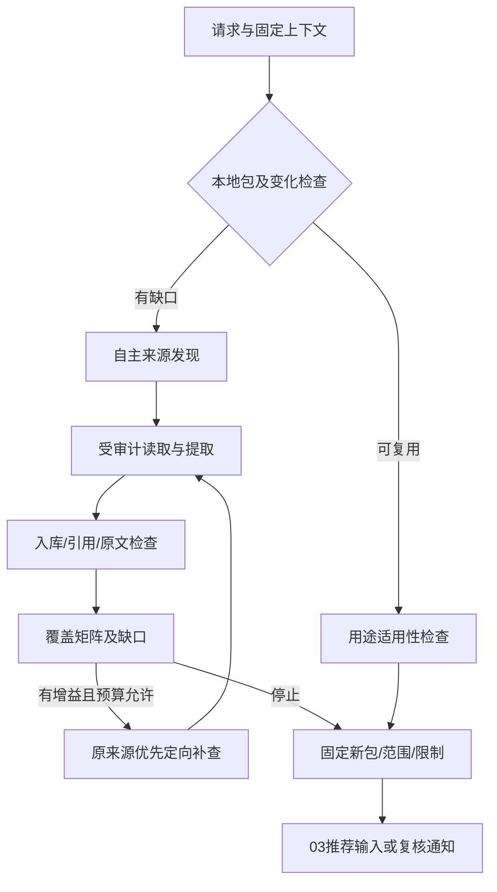

# 02 公共知识生命周期、覆盖与更新详细设计

> 阶段 C2；2026-11-01；建议基线 `product-contract/0.2`；未实现产品知识服务。
> 依据：[原始 02](../design/02-knowledge-and-collection.md)、[公共知识 v0.1](../../knowledge-intake-contract.md)、C01—C05/C08/C09、[共享数据 §3—4/8—10](./shared/data-contracts.md)、[02a](./02a-collector-integration.md)。

## 1. 职责与状态

02 拥有公共 Game 身份、来源修订、设置映射、知识记录与包、覆盖矩阵和更新影响通知。只消费02a已校验导入及07受审计的新采集输入；私人会话/偏好/性能不进入公共包。Agent自主收集、来源/环境/版本可追溯为已确认原则；完整作者方案优先及首游戏范围仍是建议。现有采集原型已能发现/读取/提取/部分校验与补查，不具有产品跨运行知识库或完整更新传播能力。

## 2. 功能与操作范围

| 功能 | 触发/输入/前置 | 流程与输出 | 分支/验收 |
|---|---|---|---|
| KNW-F01 身份与复用 | KnowledgeInput，GameContext身份可解析，设备可空 | 固定Game版本→查包/检查关键差异→复用或补查 | 别名未知不合并；无GPU可先公共收集；KNW-V01 |
| KNW-F02 自主收集与覆盖 | 无匹配包/显式刷新/关键缺口，明确预算 | 广泛发现→原文定位/提取→检查→缺口定向补查→领域结果 | 达预算保留partial与原因，不靠来源数证明充分；KNW-V02 |
| KNW-F03 组包/设置映射 | published导入/新采集、记录依赖闭合 | accepted子集、固定出处、目录/映射/覆盖→新包 | 隔离记录仅诊断引用；KNW-V03 |
| KNW-F04 图像增强 | 影响操作的关键图表缺口，有验证过图像适配器 | 定向获取原图→表头/单位/图例/数字定位→检查 | 未读/不清楚保持unknown；长视频后置；KNW-V04 |
| KNW-F05 更新传播 | 新修订、更正、VersionImpact/约束变化 | 定位受影响包成员→通知03→推荐复核事件 | 不直接修改推荐/采用/旧会话；KNW-V05 |

声明操作范围使用稳定字符串：`collection.public_graphics`、`recommendation.configuration`、`recommendation.target`、`diagnosis.<症状>`、`comparison.settings_effect`。范围词表由02登记，不由模型临时改名。一个字段可对配置选择关键、对来源归档非关键；critical_gaps 的关键性必须带 operation_scope。

## 3. 组件与数据流

建议 `game_app/knowledge.py` 内的 IdentityService、PackageRepository、CoverageEvaluator、FollowupPlanner、ImpactPublisher；`game_app/collection.py` 的 CollectionSnapshotWriter 管理新采集的兼容冻结输出；现有 reader/validation/reconciliation 作为可复用的受控函数，不把同模型检查当独立真值。07唯一调度/审计；03消费固定包，01提交身份线索。



## 4. 数据、覆盖归约与身份规则

复用 shared 的 Game/IdentityMapping/SourceRevision/ImportedRecord/KnowledgePackage/SettingIdentityMapping/CoverageCell/KnowledgeGap；不新增平行字段。版本头、原件hash、member引用和状态规则均由共享契约解释。原包的检查/成员不可覆盖；更新生成新版本，旧包保留。

| 覆盖格/维度 | covered 条件 | 不充分/不适用处理 |
|---|---|---|
| 图形/显示目录与取值 | 声明菜单范围有可定位条目、原名/值形状与未覆盖说明 | 只读一表为部分菜单，不宣称游戏全量 |
| 硬件与设备形态 | 所声明档位存在条件足够的原始测试/配置 | 同名桌面/笔记本分格；邻近设备仅有依据才映射 |
| 分辨率/超分/FG/RT | 当前操作需要的支持条件、输入/输出背景可核对 | 不支持且有证据为not_applicable；未知不是不适用 |
| 不同取舍 | 有不同性能/视觉方向及相应证据 | 只有一套可用方案时保持部分覆盖，不为数量补造 |
| 测量与环境 | 原 metric/number_kind、配置/环境/来源位置可定位 | FPS unspecified可按原值归档，但不足以关闭平均FPS/目标缺口 |
| 版本/依赖/独立性 | 指定平台版本条件/约束/来源关系已有足够依据 | 年龄新/域名多均不自动pass；关系不明保留unknown |

同一格：没有合法依据为 unknown；有已知子维度但关键子项未处理为 partially_covered；全部本操作必需子项有通过依据为 covered；有排除依据且确实不适用于操作为 not_applicable。检查未执行不能归入 covered。收集 completed_scope 仅在声明必需格全部 covered/有依据not_applicable、关键gap已解决或有明确不适用处理时成立；其他为 partial_scope。无单一采集执行事实的多运行聚合包，collection_result/stop_reason/execution_ref 三者均null，不能从新覆盖推造历史运行事实。

Game别名通过显式原名/来源证明后建立新版本；旧Game.series_id不变。SettingIdentityMapping 只在同游戏/平台及可核验版本范围内启用，保留原 Setting 名称/值；音频/相机目录可归档，不能当GPU优化候选。映射范围与检查版本写 checks.note/输入引用；缺版本映射保持条目独立，不能凭中文译名合并。

## 5. 接口与局部结果

| 拟建接口 | 输入→返回 | 前置、写入及失败 |
|---|---|---|
| collect_knowledge | KnowledgeInput+MutationContext→TaskAccepted | 无FPS/偏好门槛；07注册 knowledge，预算与调用边界审计；输出包/领域结果 |
| assess_reuse | GameContext、DeviceSnapshot?、package_id:ID?、operation_scope:string→ReuseDecision | 只读；固定引用与当前用途检查，不修改旧包 |
| build_package | import_snapshot_ids:ID[]、prior_package_id:ID?、declared_scope:string→KnowledgePackage候选 | 受信任应用内部接口；成员/依赖/原件齐备后07发布，不作为浏览器任意JSON入口 |
| resolve_game_identity | 原名/平台及EvidenceRef[]→Game版本/IdentityMapping | 来源充分才确认；未确认返回诊断/问题，不猜合并 |
| notify_impacts | old_package_id:ID、new_package_id:ID→影响通知 | 02登记通知、03按依赖写复核事件；同一通知重复不产生重复事件 |

ReuseDecision 为局部只读 DTO，字段全R：`package_id:ID?,mode:string,checks:CheckResult[],gap_keys:string[],reason:string`；mode仅 reuse/followup/discover，不能由模型覆写程序门槛。ImpactNotice 为02局部不可变操作消息：`notice_id:ID,old_package_id:ID,new_package_id:ID,affected_record_ids:ID[],reason:string,evidence_refs:EvidenceRef[]`，均R，created_at后台生成；unique(old,new,受影响记录集合hash,规则版本)。03消费后与03复核事件在同一产品库事务登记已处理notice_id，失败可重试；不需要消息队列。

共享变更幂等、ResourceResult/TaskAccepted与错误统一07/B3。新包构建与通知登记是发布事务的一部分，消费通知不能网络回调。时间/调用预算沿Budget：thorough默认12URL/12搜索/2轮/每gap2查询/16模型/36读取，不保证充分；smoke只用于显式开发任务，不作为玩家默认。

```json
{
  "kind": "knowledge",
  "game_context_id": "00000000000000000000000000000301",
  "device_snapshot_id": null,
  "prior_package_id": null,
  "budget": {
    "max_urls": 12, "max_searches": 12,
    "max_followup_rounds": 2, "max_queries_per_gap": 2,
    "max_model_calls": 16, "max_read_calls": 36,
    "max_seconds": null
  }
}
```

## 6. 检索、补查、停止与更新步骤

首次在声明范围内分别发现官方版本/兼容资料、条件实测、配置取舍资料；GPU已知可进入查询，但不先要求目标FPS。canonical URL去重保留必要参数，hash相同建立相同捕获内容关系，不计独立支持。

每轮先按P0/P1/P2与受影响操作排序gap；先重读原表/图注/更正，再查原始出处，再定向独立来源。格式/定位错误不能由另一作者填原表真值。模型提出resolution必须引用新相关证据并重新核对来源/作用域；通过才新版本闭合gap。信息增益为关键字段新增、条件补齐、冲突解决或不同取舍新增，不是网页数量增加；连续两轮无有效增益可low_information_gain停止，但不声称全量充分。

调用前07核验剩余预算、取消与prepared/in_flight；读取返回原件先保存，再作模型提取和确定性检查。到预算或服务失败保留已有成员、缺口和具体停止原因；未知调用禁止重发。增预算通过ResumeTaskInput新建parent任务，仅复用输入兼容的成果，已有失败/隔离原件不删除。

新采集记录同样要满足ImportedRecord.import_snapshot_id的必填关系：CollectionSnapshotWriter在本次独立受管理捕获目录输出02a规定的标准兼容文件组，保存真实捕获run ID/source作用域、原载荷、检查与提取原件，不改旧CLI输出。07调用02a内部冻结/映射能力登记origin=collector_run的ImportSnapshot，再由02组包；这是当前knowledge任务的已审计步骤，不递归新建knowledge_import重任务。产品TaskRun、捕获run ID和导入快照ID分别保留关联；KnowledgePackage.collection_execution_ref指本次真实TaskRun，旧采集stop_reason不承担用户取消等产品执行状态。检查点只复用已提交快照/原件，未提交输出按07恢复日志核对。

更新按显式刷新、首次进入版本背景变更或有证据的更新线索触发；可以建议7天复查调试策略，但时间本身不证明适用。新修订有定向影响时保存新包/ImpactNotice，03写needs_review，若内容要变另建RecommendationVersion；不改玩家当前采用，不改旧摘要/Outcome。

## 7. 错误与降级

| 情况 | 结果及恢复 |
|---|---|
| 游戏身份/平台不能确认 | 暂存来源/映射线索；不发布为匹配包；本机身份问题交01询问，公共检索不转嫁玩家 |
| 抓取失败/模型未配置 | 保存失败来源/原件及缺口；有成果partial，无有效成果failed；PROVIDER_*按B3，不假提取 |
| 作者分歧/转载不明 | 保留不同主张/关系unknown；不简单多数票，不永久写硬规则 |
| 原文版本/CPU/场景未知 | 可accepted归档；当前用途检查unknown/降级，非整条来源一刀切 |
| 图表未读/单位图例不清 | 关键图像gap未解；仅文字部分可用，不要求玩家逐页截图 |
| 撤回/成员文件损坏 | 新使用阻止消费，ARTIFACT_UNAVAILABLE；影响通知03，旧历史保留不可复算原因 |
| 包检查或引用缺失 | REFERENCE_INVALID/IMPORT_SNAPSHOT_INCONSISTENT，未发布；修复新版本而非原地改成员 |

## 8. 依赖、已知差距与验证门禁

复用现有 ExaSearch/PublicReader/Extraction 与确定性校验，产品调用必须接07持久审计；不直接依赖进程内_call实现exactly-once。研究导入由02a注册mapper。画像/向量检索只在实际查询瓶颈后评估，初版按明确字段与原文索引。

DeepSeek Flash 是已确认模型方向，但模型别名、端点、thinking/max_tokens等不能因原providers中存在参数就认为当前产品已兼容。本次不调用模型；未来接入需为ModelClient.extract保留真实envelope.model的可空字段，原CLI的兼容model字段可保留，产品ExternalCallRecord.returned_model不得取兼容回填值。接口参数与真实认证/输出Schema须在明确预算下验证，失败保持PROVIDER_*和已有原件。图片适配器未验证时保持禁用，任务仍保留项目范围与对应缺口。官方外部核验入口沿原02/07与工程清单，不编造已读图或泛化准确率。

## 9. 验收场景

| 编号/需求/目的 | 初态/输入 | 操作 | 输出/状态断言 | Mock / 真实环境 |
|---|---|---|---|---|
| KNW-V01 / C01/C02：无目标复用 | 无设备/目标；已有同游戏不同平台包及正确平台部分包 | assess_reuse、收集 | 不误用错平台；无GPU也能discover，FPS/偏好非必填 | 固定包/检索桩；免网络 |
| KNW-V02 / C03、充分性 | 关键格unknown、重复转载、两轮无增益、随后预算耗尽 | 广泛发现及定向补查、停止/增预算 | 不按网页数completed；partial及原原因保留，新任务不重读全部，计数正确 | 可计数供应商桩；真实提取另行验证 |
| KNW-V03 / A02/入库边界 | accepted/隔离记录混合、未确认别名、区间FPS | 组包/跨源设置映射/推荐输入 | 仅依赖闭合成员可用；隔离只诊断；别名不猜合并，区间不变均值 | 固定JSON；免真实服务 |
| KNW-V04 / C08：未读图缺口 | 文字已过，图片有关键条件/图例不清 | 禁用/启用图像适配器并尝试闭合 | 文字仍可用，图像无新依据不resolved，无长视频任务 | 图像输出桩；真实OCR/VLM需独立标注/预算 |
| KNW-V05 / C09、更新传播 | 旧推荐依赖旧包，新增定向更新，模型返回名缺失 | 发布新包/通知重投/读取旧历史 | 03只追加一次needs_review；旧推荐/采用不改，returned_model=null，密钥不出现 | 通知/供应商桩；免付费 |

## 10. 实施任务与 DoD

| 任务/目标 | 依赖 | 拟建组件/文件 | 必须逻辑与接口 | 验收/完成定义 |
|---|---|---|---|---|
| KNW-T01 公共身份/固定包索引 | ENG-T01、B数据 | game_app/knowledge.py；tests/product/test_identity.py | Game/别名/IdentityMapping与用途级assess_reuse；独立于导入器 | KNW-V01/03；不依赖IMP-T02而形成循环 |
| KNW-T02 覆盖与包发布 | KNW-T01、IMP-T03、ENG-T03 | knowledge.py；test_packages.py | CoverageEvaluator、依赖闭合、build_package、私人与公共隔离 | KNW-V02/03；声明范围及未知格可逐项核对 |
| KNW-T03 自主补查与审计接入 | KNW-T02、ENG-T02、IMP-T02 | knowledge.py、collection.py及未来providers边界；test_collection_tasks.py | FollowupPlanner、CollectionSnapshotWriter/标准组、增益/预算/中断、新调用审计、模型标识 | KNW-V02/04/05；新记录经快照映射后入包，旧CLI保留，未知调用不重发 |
| KNW-T04 更新影响与图像门禁 | KNW-T02/03、REC-T03消费接口 | knowledge.py；test_impacts.py | ImpactNotice去重、03复核事务、来源修订；图像mapper启用条件 | KNW-V04/05；只通知不写推荐内容，图像未验证不报完成 |
