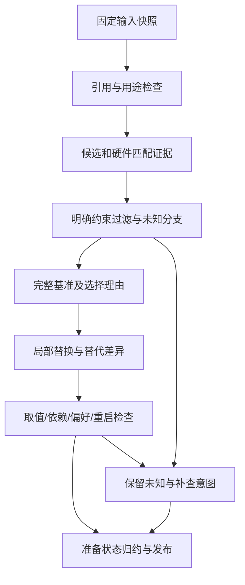

# 03 多来源推荐、约束与准备状态详细设计

> 阶段 C3；2026-11-01；建议基线 `product-contract/0.2`；未实现推荐引擎。
> 来源：[原始 03](../design/03-recommendation.md)、C01/C02/C04—C06、R03、[共享数据 §4—5/9](./shared/data-contracts.md)、[状态 §5](./shared/state-conventions.md)。

## 1. 目标、范围与确认状态

输入固定游戏/设备/知识包、可选实际配置/偏好/历史，输出一份主推荐及有依据的替代差异、目标提议和公开参考。GPU主要匹配、邻近可条件参考、三类帧率表达分开为已确认；完整作者方案优先为R03建议，本稿按此设计，不升级待确认状态。

03不写玩家采用/设置、不执行实验、不直接发起递归补查。资料不足可provisional/blocked，失败外部调用没有合法内容则任务failed/partial，不用“blocked”掩盖系统故障。模型只提候选/解释，程序核验可执行性。

## 2. 功能与门槛

| 功能 | 触发/输入/前置 | 处理与输出 | 分支/验收 |
|---|---|---|---|
| REC-F01 输入与候选池 | RecommendationInput，固定可见已发布包 | 核对游戏/版本/依赖→用途检查→保留条件候选 | 非法引用422；合法但无候选blocked；REC-V01 |
| REC-F02 匹配与基准 | 同卡/条件/邻近/一般证据分层 | 逐用途比较，选择完整作者基准并保存落选理由 | 没邻近依据不叫邻近；不按来源数投票；REC-V02 |
| REC-F03 综合动作与替代 | 基准、明确偏好及原始证据 | 有依据局部替换→依赖组核验→明确动作/条件/未知 | 不支持分支排除；不凑三套；REC-V03 |
| REC-F04 目标及公开参考 | 有统计定义与适用条件的资料/本机历史 | 保存TargetProposal及reference_results，来源限定 | 区间不求中点，本机结果不能由公开资料填；REC-V04 |
| REC-F05 发布与复核 | 合法内容/输入、ImpactNotice | 新RecommendationVersion及current复核；更新后仅追加复核事件 | 不改旧内容/采用；REC-V05 |

## 3. 组件与推理分工

建议 `game_app/recommendation.py` 中 InputGate、CandidateBuilder、ConstraintEvaluator、BaselineSelector、ActionValidator、ReadinessReducer、ReviewService。03通过07调用模型，接收类型化候选；公开/私有数据先由应用脱敏。外部请求超时/未知结果沿B3，默认不自动重发模型。



## 4. 输入、候选与版本数据

持久内容唯一结构为shared RecommendationVersion/RecommendationAction/Alternative/TargetProposal/ReviewEvent。input保存完整RecommendationInput，不只存task ID；package_id/DeviceSnapshot等均固定不可变ID。RecommendationAlternative不是ChangeSet，玩家未采用时不要求虚构base_applied_id。

本模块临时值 `CandidateAssessment` 字段全R：`configuration_ref:KnowledgeRecordRef,match_class:string,condition_checks:CheckResult[],visual_basis:EvidenceRef[],performance_basis:EvidenceRef[],independence_checks:CheckResult[],selection_reason:string,limitations:string[]`。match_class仅direct/conditional/neighbor/general；该标签表示用途匹配层次，不是可信度概率。候选判断结果作为CheckResult/理由和候选文件manifest保留，不能只留模型最后一句话。

依赖图以SettingIdentityMapping通过后的规范ID为节点，否则保持原SettingRef独立。只有明确、verified_scope成立的声明式等值约束进入确定性执行器；数字阈值、严格边界、复杂版本条件若未有验证过的转换规则，只作unknown/补查，绝不eval模型表达式。unknown前提不能当false，从而绕过约束。

## 5. 接口、输出及副作用

`recommend(input:RecommendationInput,context:MutationContext)->TaskAccepted` 经07注册recommendation任务。只读内部函数 `assess_candidates(input)->CandidateAssessment[]`、`validate_actions(input,actions:RecommendationAction[])->CheckResult[]`、`reduce_readiness(checks,declared_scope)->RecommendationReadiness` 均为未来建议，不持久化任意模型JSON。`publish_recommendation` 在单事务保存内容、目标提议身份、初始复核投影、检查与Task成果引用；不推进CurrentAppliedPointer。

ReviewService `consume_impact(notice_id:ID)->ResourceResult` 校验02消息/依赖，追加一次ReviewEvent及消费标记；无受影响依赖仅登记已处理/理由。不发模型、不改推荐内容。重新核验由显式recommendation任务生成检查/必要新版本，superseded旧版本不能变current。

逻辑输入示例不含目标FPS；ID为虚构合法UUID，package必须已发布且属于游戏，非实际数据：

```json
{
  "kind": "recommendation",
  "game_context_id": "00000000000000000000000000000401",
  "device_snapshot_id": "00000000000000000000000000000402",
  "package_id": "00000000000000000000000000000403",
  "preference_ids": [],
  "applied_id": null,
  "history_summary_ids": []
}
```

模型调用消耗07任务预算，建议单次沿现有10/300秒网络超时起点；没有合法输出且失败则PROVIDER_*/CALL_OUTCOME_UNKNOWN；原文/合法候选可保存，不发布假完整方案。确定性核验没有网络副作用，可在输入兼容的新任务重做；创建去重与文件提交沿07。

## 6. 基准选择、动作和readiness归约

先排除已证实平台错配/不支持技术/无效取值/明确互斥；未知条件保留为conditional或defer。匹配时GPU为锚点，但用途决定差异影响：功能支持看明确兼容性，纹理看显存，超分看渲染/输出分辨率，功耗/CPU/版本差异限制测量迁移。邻近必须有带来源的硬件级别/技术关系，不按型号数字或相似名字排序。

基准比较遵循原03顺序：关键适用→设备/分辨率用途匹配→整套复现性→实测和视觉解释→原始性/独立支持→风险/负担。使用可解释的逐维比较，不给无验证权重分或“可信度92%”。证据无法严格排序时保留多候选差异，可按较少推断/改动选择一份暂定主方案并标provisional；稳定ID仅用于展示排序，不能证明更优。

每次替换保存原基准引用、原值→新值、替换证据与依赖复核。来源测试只证明某场景或整套变化时，不把收益拆到单项，不累加跨作者百分比。视觉描述等级可沿原03记录作者主张，缺依据为unknown，不生成画质雷达分。偏好明确且范围匹配时保护，tentative只作弱参考，不能覆盖硬约束。

| 检查组 | pass条件 | 未通过时动作 |
|---|---|---|
| 身份/引用/原件 | 游戏、包、记录/修订成员、hash、可见与可用性有效 | 错引用请求422；合法来源无法形成方案则blocked，旧事实保留 |
| 分支支持/取值 | 当前上下文的必要兼容性明确，set_value为fixed且值有依据 | fail排除分支；unknown用conditional/check_in_game/defer，不给fixed |
| 组合/偏好 | 所有依赖组自洽，明确偏好不被静默破坏 | 无合法组合blocked；可条件化则provisional |
| 操作与重启 | 设置身份/菜单或可靠操作说明明确；必要重启事实已说明 | 菜单/支持未知且影响执行则provisional；不把restart_required未知填false |
| 依据与边界 | 每个确定动作有适用证据，已发现范围/缺失项明确 | 单纯理由无证据不能通过，非关键未知逐项展示 |

总体：身份合法且至少有有依据参考、但关键支持/取值/组合未闭合为provisional；不存在可用主分支或关键已证实冲突使主方案不成立为blocked；声明范围内所有关键执行检查pass或有依据not_applicable且操作明确为actionable。非关键defer可以保留，但声明范围必须清楚，不能将排除的必要项悄悄改为非关键。readiness只回答能否操作，不证明已经生效或FPS效果；needs_review独立显示。

替代项逐一应用action_overrides后完整重新核验。没有证据的偏画质/偏性能项返回空数组与解释；不能生成取值使表格凑齐。主方案保持作者基准来源，替换后的组合明确叫综合方案，不说作者已测试整套。

## 7. 目标、参考与错误分支

TargetProposal目标单位FPS，帧流必须声明；仅有统计定义/条件足够的作者目标或稳定本机历史可建议具体数值。证据不足可为null或unknown，不将区间中点、显示刷新率、公开平均FPS当默认目标；不自动写帧率上限。TargetAcceptance由05保存，不回写目标内容。

| 情况 | 结果/恢复 |
|---|---|
| 包合法但覆盖不足/只有FPS区间 | provisional/blocked与逐项缺口；区间保持fps_unspecified，不能作为average_fps |
| GPU未知/只有其他设备测试 | 有依据可条件参考，限制设备适用与FPS迁移；不编邻近关系 |
| 同条件作者结论冲突 | 先原表/更正/方法核对，仍冲突保留候选/局限，交02定向补查意图 |
| HDR仅not_detected | 保留观察，不生成“关闭HDR”固定动作 |
| 旧包受更新影响 | current→needs_review；新采用前重核关键条件或降级，不能自动改当前配置 |
| 输出引用非法/自创菜单值 | validate失败保留原输出诊断，不发布为actionable；只重做核验或显式新任务修复 |
| 公共来源要求执行脚本 | 当来源文本数据保存，不产生工具执行权限 |

## 8. 依赖与待验证项

复用02包/设置映射、01实际配置、04不可变摘要、05偏好与Outcome视图，单向读取。03不导入05实验执行模块；需要补查时只返回明确操作缺口，由07另建knowledge任务，原推荐任务按合法结果结束，不递归消耗模型。

技术选择为严格类型+确定性约束执行器+模型解释，替代纯模型整套JSON直出；前者多一次校验但能追溯错误和阻止非法动作。无可靠数值模型时不实现性能预测或收益加总。模型/搜索参数兼容沿07/02核验门禁，本次没有新增模型试跑；候选/门槛与多作者效果仍需08的未见样本和本机验证。

## 9. 验收场景

| 编号/需求/目的 | 初态/输入 | 操作 | 输出/状态断言 | Mock / 真实环境 |
|---|---|---|---|---|
| REC-V01 / C01/C02：输入门槛 | 有效部分包/未知GPU；另有跨游戏引用 | 无FPS生成推荐；提交错误引用 | 合法部分输入可条件输出；错引用422无假版本，accepted不直接actionable | 包/模型桩；免网络 |
| REC-V02 / C05：匹配与基准 | 同名Laptop/桌面、异分辨率、无邻近依据、转载多份 | 建候选/选基准 | 分层/落选理由可查；不按名字/数量投票；FPS不迁移本机 | 固定候选；迁移质量真实未见评价另做 |
| REC-V03 / C04：动作及替代 | 条件DLSS/FSR、依赖互斥、明确保留偏好、无替代证据 | 实例化/局部替换/完整重验 | 不取第一分支；冲突不交fixed；综合来源明确；替代可空，非ChangeSet | 模型候选桩；免游戏 |
| REC-V04 / C06：数值隔离 | 区间FPS、未检测HDR、统计定义未知、无目标接受 | 生成目标/公开参考/设置清单 | 不求中点、不写HDR关闭、不默认60，不伪造本机结果/接受 | 固定知识夹具；免付费 |
| REC-V05 / 更新历史、D02 | current推荐，重复ImpactNotice；重新计算新输入 | 消费两次、重算、读旧版本 | 单一needs_review事件；新内容另ID，旧superseded不可current；当前采用不变 | 通知/临时DB；免网络 |

## 10. 实施任务与 DoD

| 任务/目标 | 依赖 | 拟建组件/文件 | 必须逻辑与接口 | 验收/完成定义 |
|---|---|---|---|---|
| REC-T01 候选与约束执行 | KNW-T02、DEV-T01、ENG-T02 | game_app/recommendation.py；tests/product/test_recommendation_gate.py | CandidateAssessment/用途匹配/声明式约束与未知分支 | REC-V01/02；非法引用/分支不能执行 |
| REC-T02 基准/动作/目标 | REC-T01、KNW-T03 | recommendation.py；test_recommendation_actions.py | 原03顺序、替换证据、替代重验、TargetProposal、readiness | REC-V03/04；非确定文本可变，关键约束不漂移 |
| REC-T03 发布与复核消费 | REC-T01/02、ENG-T01/03 | recommendation.py；test_recommendation_review.py | 内容/目标原子保存、ReviewService/通知去重；消费接口先独立定义 | REC-V05；不要求KNW-T04实现才构建消费接口，避免任务循环 |
