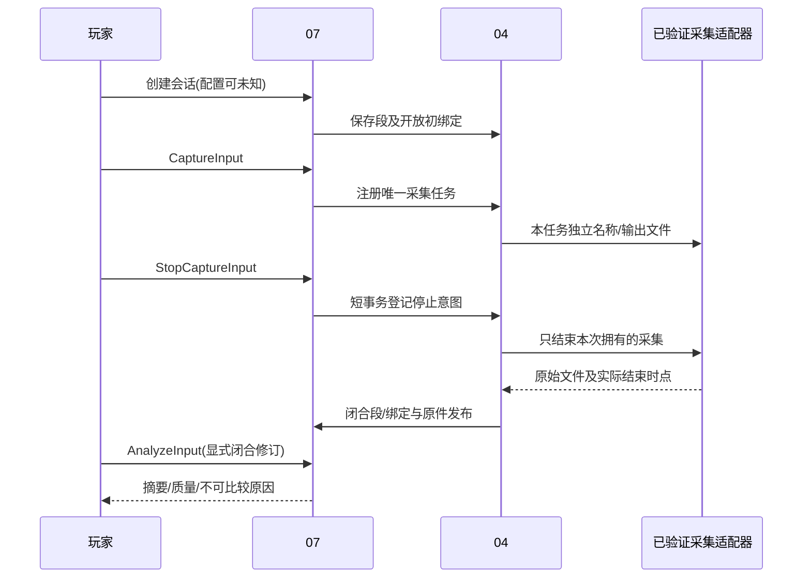

# 04 会话、采集、分析与比较详细设计

> 阶段 C3及D-P03补全；2026-11-01；建议基线 `product-contract/0.4`；未安装/启动采集工具，未验证 FH6 日志。（独立审计修订；兼容见共享数据§12.2）
> 依据：[原始 04](../design/04-performance.md)、D03/D05、[共享数据 §6/9](./shared/data-contracts.md)、[状态 §4](./shared/state-conventions.md)。公式继续以原始04为准，本稿给出实现步骤与夹具，不另创统计口径。

## 1. 职责、范围与能力门禁

04 拥有 PlaySession/SessionSegment、ConfigurationBinding、CaptureArtifact、TestProtocol、MetricDefinition、PerformanceSummary、ComparisonProtocol/PerformanceComparison。01拥有实际配置事实；05解释体验与实验；07协调持久事务。R06日志导入先行、R07固定场景为建议；配置未知也可保存日志/反馈、共同阈值比较是已有约束。

首版只启用通过格式夹具和本机核验的日志适配器，未知格式仅保留 ManagedFile。没有已验证PresentMon工具时允许产品完成知识/手动声明与反馈，不冒称已支持采集。正常流程无自动提权、不停止外部采集会话、不自动启动/修改游戏。

## 2. 功能与操作门槛

| 功能 | 触发/输入/前置 | 处理与输出 | 分支/验收 |
|---|---|---|---|
| PERF-F01 会话与区段 | CreateSessionInput，安装/设备/游戏固定 | 创建活动段与开放初绑定；结束/切段追加闭合修订 | 无配置unverified允许；开放修订不分析；PERF-V01 |
| PERF-F02 导入/采集 | LogImportInput/CaptureInput，文件或验证过适配器 | 固定段/绑定→工具/格式核对→原件/时钟/流选择 | 未知格式retained_only；已有采集不重复启动；PERF-V05/06 |
| PERF-F03 清洗统计 | AnalyzeInput，闭合段/绑定与可解释原件 | 分流/断段/排除→确定性指标/manifest→新摘要 | 真尖峰保留；无数据unknown而非0；PERF-V02 |
| PERF-F04 共同口径比较 | CompareInput，两个摘要及固定协议 | 检查条件→按同阈值重算→逐项结果/总体级别 | 不可比项单独限制；PERF-V03/04 |
| PERF-F05 历史补绑 | BindConfigurationInput，当时配置依据 | 校验两修订/时段→新绑定/段快照→新分析 | 不改旧摘要/当前指针；PERF-V01/05 |
| PERF-F06 比较协议冻结 | CreateComparisonProtocolRequest，已选比较口径及合法基线 | 后台核算阈值、冻结输入和规则→不可变ComparisonProtocol | 同key同ID，事后探索另建；PERF-V07 |
| PERF-F07 外部日志人工关联 | 已验证格式的ManagedFile、时间锚点/流选择及依据 | 预览原时基→关联已有段或建立历史会话→新CaptureArtifact/闭合绑定 | 不猜历史时间，不改旧原件/摘要；PERF-V08 |

## 3. 组件与采集生命周期

建议 `game_app/performance.py` 内 SessionService、ArtifactImporter、FrameNormalizer、Analyzer、ComparisonService；`game_app/adapters/presentmon.py` 只负责固定工具/参数/列映射与本次进程句柄。采集占重任务槽，停止/取消/结束标记经07短控制请求处理。



## 4. 数据、时钟与局部输入

所有持久领域实体复用 shared；新分析永不覆盖原文件或旧摘要。SessionSegment.revision 与 binding_revision 分开校验；场景/排除/运行条件更改也生成新段快照。TimeRange 必须闭合，BindingRange 可对活动修订 end=null；初绑定无结束值不计算时长。

以下为04拥有的局部逻辑 DTO，字段均R；外部请求只接收玩家原值/引用及预期版本，后台构造可信包装与时间来源。方法返回 ResourceResult，控制/事实与幂等响应原子；逻辑输入不是客户端提交provenance的权限。

| DTO | 字段 | 守卫/结果 |
|---|---|---|
| RunDeclarationInput | installation_id:ID、fields:map<string,Scalar>、raw_text:string | 允许 output_width/height、render_width/height、frame_generation、upscaling、scenario 及协议登记的 scene.*；先用01 ContextDeclarationInput 保存对应声明，再构造RunConditions，未知不猜值 |
| EndSegmentInput | segment_id:ID、expected_segment_revision:Revision、expected_binding_revision:Revision、end_s:float、time_basis:string | 后台单调计时或有依据日志映射；end>start；结束与闭合绑定同事务，旧修订保留 |
| SplitSegmentInput | ending:EndSegmentInput、new_applied_id:ID?、configuration_state:ConfigurationState、scenario:FieldValue<string>、run_conditions:RunConditions | 在相同边界创建新活动段/初绑定；未知/mixed照实，配置由01先建，不跨未知时点假切 |
| EndSessionInput | session_id:ID、expected_session_revision:Revision、active_segments:EndSegmentInput[] | 验证活动段集合无遗漏，全部闭合及session ended同事务；session ended_at来自后台时间映射 |
| StopCaptureInput | task_id:ID | 只登记本任务的停止意图，任务仍running直至文件收尾；重复同key无新增效果；终态返回已有引用 |

RunDeclaration 的实际字段白名单由本章定义，01只登记声明/来源及路径安全，不解释性能可比性。生成 PlayerDeclaration.input 为 ContextDeclarationInput，fields可使用这些已登记的运行条件路径；不允许模型添加任意字段。直接采用、配置读取失败问题仍走01。

### 4.1 浏览器请求到逻辑输入

浏览器不提交FieldValue/Provenance/RunConditions。下列外部请求字段全R，问号字段显式可空；07转交04核验，先构造玩家声明再生成上表逻辑输入，声明与会话/段变更同事务提交，失败不留下半声明。

| 外部DTO | 字段 | 后台转换 |
|---|---|---|
| CreateSessionRequest | installation_id:ID、device_snapshot_id:ID、game_context_id:ID、applied_id:ID?、configuration_state:ConfigurationState、run_declaration:RunDeclarationInput、test_protocol_id:ID?、recommendation_id:ID? | 校验run_declaration安装相同；scenario与RunConditions由原值/声明构造；applied=null须unverified或有明确依据的mixed；非空绑定不代表active_confirmed |
| EndSegmentRequest | segment_id:ID、expected_segment_revision:Revision、expected_binding_revision:Revision | 从后台会话单调时钟/已核验映射生成EndSegmentInput.end_s/time_basis；不能可靠计时则拒绝闭合并保留原件，不用浏览器当前时间猜过去 |
| SplitSegmentRequest | ending:EndSegmentRequest、new_applied_id:ID?、configuration_state:ConfigurationState、run_declaration:RunDeclarationInput | 生成同一边界的结束与新段逻辑输入；新配置由01已有事实引用，运行条件保留声明来源 |
| EndSessionRequest | session_id:ID、expected_session_revision:Revision、active_segments:EndSegmentRequest[] | 一次核对活动集合及后台结束时刻，生成EndSessionInput；会话与所有活动段闭合同事务 |

创建后导入历史日志时，若原时基尚不能映射该会话，先保留原件/原时基，随后使用§4.3的人工关联入口；不能因已有Session ID便标ready。EndSegmentRequest仍用于实时会话，历史日志的可靠结束点由LogAssociationRequest显式提供依据。可信CLI也通过同一声明/计时校验，不能自报system_probe绕过来源。

### 4.2 比较协议创建与冻结请求

`CreateComparisonProtocolRequest`为04局部外部DTO：`threshold_mode:ThresholdMode,threshold_ms:float?,baseline_summary_ids:ID[],baseline_binding_refs:BindingRef[],cleaning_definition:string,clustering_definition:string,denominator_definition:string,exploratory:bool`，全R。fixed模式threshold_ms可为null，此时后台展开项目默认50ms；非空须有限且>0，两组baseline引用可均为空。baseline_derived模式threshold_ms必须为null、两组基线引用均非空且绑定均已闭合；summary固定具体原件、流与分析范围，binding集合须与这些summary完全一致。后台从所选摘要的原件按登记清洗规则复算，以`max(50ms,2×全部基线有效间隔的中位数)`计算实际阈值，不能使用客户端声称的计算结果。三个definition只能引用已登记规则版本，基线须同游戏、同帧流且满足所选清洗规则；重复摘要ID/重叠原始区间拒绝，缺原件/有效间隔则不冻结。

创建即冻结：在事务外准备计算，在短事务内复核文件hash/引用可用性，保存含EntityHeader/VersionHeader的ComparisonProtocol、基线与规则引用及幂等原响应；baseline_summary_ids同时写07的references关系，保留计算原件/范围/规则证据，frozen_at由后台生成。新建版本族version=1；改阈值、基线或规则须新key、新协议ID，不提供原地修改或另行“解冻”。返回ResourceResult中的协议引用，页面据此填CompareInput.protocol_id，并以现有资源GET读取具体版本；重复原key不得重算或改变frozen_at。此同步操作不调用模型、不新增TaskType。

exploratory=true明确表示探索；false只声明预先计划的用途，不能由此证明玩家尚未看过后测。执行比较时仍核对产品内后测采集/结果登记事件及可靠原始时间：后测开始早于冻结、冻结前已登记可读后测结果，或无法证明先后时，非探索性协议返回PRECONDITION_UNVERIFIED并引导新建exploratory=true协议；冻结后的正常采样及结果登记不触发此拒绝。不能倒填frozen_at或原地改标志，外部日志的上传时间不证明采样晚于冻结。新规则用于本入口创建的比较，不改写既有协议/历史比较。探索性比较可以展示差异，但05不得据此宣称预先计划实验的稳定改善。

### 4.3 日志预览、时间声明与人工关联

`inspect_log(file_id:ID,source_schema:string)->LogInspection`为有界只读解析，不发模型、不创建会话/分析。LogInspection为局部DTO，全R字段`file_id:ID,content_hash:Hash,source_schema:string,source_ranges:TimeRange[],streams:LogStreamCandidate[],limitations:string[]`；LogStreamCandidate全R字段`stream_key:string,process:ProcessIdentity?,swapchain_id:string?,frame_stream_kind:FrameStreamKind`。stream_key由后台基于原件hash和实际进程/交换链/流生成；进程未能识别时process=null，不造PID。预览仅返回已验证格式实际存在的时基、范围和流，不证明本机配置；未知格式返回UNSUPPORTED_ARTIFACT_FORMAT，原件保留。

`LogAssociationRequest`为04局部外部DTO，全R字段`file_id:ID,content_hash:Hash,source_schema:string,source_range:TimeRange,stream_key:string,source_anchor:float,target_anchor_s:float,target:ExistingLogTarget或HistoricalLogTarget,evidence_refs:EvidenceRef[],raw_text:string`。source_range须位于所选原件/流的可解释范围；source_anchor为其中的有限时间点，target_anchor_s为对应会话秒数，须>=0。后台从注册格式确定单位换算scale，按`target_s=(source_time-source_anchor)*scale+target_anchor_s`推导TimeMapping.offset/scale；本入口不接受客户端提交TimeMapping、CheckResult、任意缩放或provenance。证据非空且覆盖锚点/关联范围，原话和用户确认与计算规则保存到受管理声明manifest；用户提供的对应关系始终标user_provided，不能升级为自动观测或仅凭此判controlled。无法解释时钟漂移时保持未关联，不猜scale。

| target局部DTO | 字段（全R） | 守卫/写入 |
|---|---|---|
| ExistingLogTarget | mode=`existing_segment`、session_id:ID、expected_session_revision:Revision、segment_ref:BindingRef、close_at_s:float? | 同安装/游戏/历史上下文；映射后非负且落于目标段。已闭合段close_at_s必须null且不改边界；开放段必须给有限结束点及依据，且覆盖映射范围，按段/绑定双修订原子追加闭合事实。源日志若早于该会话实际开始，不得把新建实时会话冒充过去会话，应选historical_session |
| HistoricalLogTarget | mode=`historical_session`、installation_id:ID、device_snapshot_id:ID、game_context_id:ID、started_at:Timestamp、run_declaration:RunDeclarationInput、test_protocol_id:ID? | started_at是有依据的实际历史起点（保留声明来源），不得填上传/导入时间；source_anchor必须等于source_range.start且target_anchor_s=0。后台从已核验时长算ended_at，新建ended会话及已闭合初段/初绑定，applied_id=null、unverified；没有当时配置不读当前指针。历史配置需要时另走01历史登记和04补绑 |

会话、段或绑定修订过时均用BINDING_REVISION_CONFLICT，field_errors标明具体维度并返回当前定位；缺锚点依据/历史开始时间用PRECONDITION_UNVERIFIED，允许继续只保留文件。若历史UTC开始时间仍未知，界面明确缺此依据，不能虚构PlaySession.started_at以满足非空字段。声明中的run_declaration.installation_id须与目标安装一致；历史设备/版本未知字段保留未知，不能拿当前探测冒充过去观测。

解析/计算在写事务外，建议120秒有界；超时不发布关联、原件保留。07按文件import发布流程先准备声明manifest，再在短事务重查key、文件hash、会话/段/绑定修订，原子保存声明manifest引用、新CaptureArtifact、必要的新会话或闭合修订及原响应。声明manifest全R字段为`input:LogAssociationRequest,artifact_id:ID,bindings:BindingRef[],session_revision:Revision,time_mapping:TimeMapping,rule_version:string`，由后台构造，bindings固定本次闭合修订；通过CaptureArtifact.checks的artifact EvidenceRef及07 references关联。CaptureArtifact固定本次映射和段ID；原有artifact/摘要/终态导入任务均不覆盖，也不修改当前配置指针。ResourceResult.refs返回新artifact及manifest的ObjectRef；页面授权读取manifest取得固定BindingRef后另建AnalyzeInput，不扩展公共ResourceResult为任意载荷，也不从最新段投影猜修订。修正关联用新key、新artifact，旧分析继续可追溯。此操作复用已有TaskType及错误码，不把人工关联变成隐式分析/供应商调用。

NormalizedFrame 为分析器内存值，不入产品表：`event_index:int,timestamp:float,time_basis:string,process:ProcessIdentity,swapchain_id:string?,frame_stream_kind:FrameStreamKind,interval_ms:float?,frame_type:string?,gpu_busy_ms:float?,cpu_busy_ms:float?,validity:string`；全R，未知计时null，validity为valid/break/invalid。原工具列与单位在CaptureArtifact.source_column_map固定；来源区间型间隔需说明对应前/后事件，不按相似列名猜。

CaptureLease 是04局部恢复日志（含EntityHeader），字段全R：`task_id:ID,session_id:ID,native_name:string,process_pid:int?,process_started_at:Timestamp?,file_id:ID,state:string`；state仅prepared/owned/finalized/unresolved，每次变化保存事件。按session保证未finalized租约唯一，工具启动前先登记owned意图；native_name由后台task ID生成。重启遇到可能仍活动的本次工具进程，先核验PID+启动时刻及native_name；无法确认归属则PRECONDITION_UNVERIFIED，不启动第二采集，不使用停止所有会话的命令。原任务仍按B3 interrupted，新任务不能借旧任务终态绕过租约检查。

### 4.4 D-P03 测试协议创建与指标目录

TestProtocol描述本轮拟固定的场景、条件和采样计划；ComparisonProtocol描述跨轮长帧比较口径。前者的ID用于CreateSessionRequest.test_protocol_id、CaptureInput.protocol_id、ChangeSet.protocol_id，后者的ID只用于CompareInput.protocol_id；类型错误REFERENCE_INVALID。创建计划不表示已执行、已生效或controlled，也不能把事后登记伪装为事前实验。

以下为04唯一拥有的外部/局部DTO，字段全R；接口同步且不新增TaskType：

| DTO | 字段 | 规则 |
|---|---|---|
| MetricCatalogQuery | frame_stream_kind:FrameStreamKind? | null列全部；只读打包规则及已登记定义，不联网/写库 |
| MetricChoice | key:string、label:string、unit:string、frame_stream_kind:FrameStreamKind、definition_id:ID? | key为固定`metric_key/definition_version`；空库definition_id=null，创建时后台分配，页面不手填ID |
| MetricChoicePage | choices:MetricChoice[]、registry_version:string | 打包规则版本固定；缺少规则目录则空choices，不伪造度量定义 |
| CreateTestProtocolRequest | game_context_id:ID、parent_protocol_id:ID?、scenario:string?、condition_fields:map<string,Scalar>、controlled_variables:string[]、metric_registry_version:string、metric_keys:string[]、warmup_seconds:float?、sample_duration_seconds:float?、repeat_count:int?、note:string | 字段均R；规则版本来自GET目录并进入请求hash；schema不接受FieldValue/provenance/created_at/controlled；scenario非空白或null，note可空 |

接口`list_metric_definitions(MetricCatalogQuery)->MetricChoicePage`、`create_test_protocol(CreateTestProtocolRequest,MutationContext)->ResourceResult`；201返回具体TestProtocol和声明manifest的ManagedFile引用，经资源GET可读固定版本。无需先建Session/AppliedConfiguration；game_context_id可指无安装的公共上下文，Game身份/实际测试可行性未知以检查/说明保留，不把玩家给了标题当作适配已验证。

请求/来源守卫：condition_fields只允许本章RunDeclaration已有的output_width/height、render_width/height、frame_generation、upscaling及已登记scene.*；scenario单列，不在条件映射重复。分辨率必须成对且正整数，类型严格；缺失整个条件构造成unknown/not_provided/not_attempted，已声明的值以user_provided及artifact EvidenceRef包装。controlled_variables无重复，只能引用`scenario`或本次condition_fields中完整、已知且受词表支持的逻辑变量（成对尺寸用output_resolution/render_resolution）；不能把缺条件说成已受控。空列表表示未声明固定变量，不暗含“全都相同”。

frame_generation须严格bool，upscaling为非空白string，scene.*按登记词表类型核对；不把字符串false转bool。初版project-metrics/1的四个规则key明确登记frame_stream_kind=application_present，选择该指标不证明实际采集流；实际流若displayed/unknown，需使用对应已登记定义或将该计划指标标不可用，不能改名为原生FPS。后续支持其他帧流须另增无歧义规则key/版本并验收，不在同一个key下用不同流替换。

metric_keys非空无重复且全部来自返回目录的固定规则key。初版打包目录按本章现有算法登记`average_present_rate/v1`、`interval_p95_nearest_rank/v1`、`interval_p99_nearest_rank/v1`、`slowest_1pct_inverse_mean/v1`，其原文算法/帧流/minimum_sample_rule由打包manifest固定，版本及hash进入声明；这些是项目拟建规则，不依赖未知PresentMon列。共同阈值长帧指标需具体ComparisonProtocol，不从测试协议冒造。不存在的key或未登记规则INPUT_VALIDATION_FAILED；空目录时PRECONDITION_UNVERIFIED，不接受用户填写任意MetricDefinition JSON。首个协议创建的事务同时登记所需不可变MetricDefinition，unique(rule key,registry version,规则hash)，并发复用同一映射ID；GET不触发惰性写入。

初版拟建规则目录标识为`project-metrics/1`；metric_registry_version必须定位后台保留的具体规则manifest，不隐式取最新。升级规则另增版本并保留旧manifest；同key查重先于版本可用性重算，原key已提交则回原响应。尚未提交且所选版本已不可用为PRECONDITION_UNVERIFIED，无部分定义/协议；客户端刷新目录、确认改变后用新key，不能自动替换规则版本。

warmup_seconds若非null须有限且>=0；sample_duration_seconds若非null须有限且>0；repeat_count为严格整数>=1或null，bool不算整数；null保留未规定，不默认60秒/3次。值合法不代表满足报告/效果的样本门槛；05仍独立核对至少三轮/重复波动/资格，实际热身、时长及条件逐轮核验。

版本/事务：先按外部请求及打包规则版本查key；manifest准备中不重算新的提交身份。parent=null时创建新series/version=1；parent非空须同Game.series_id且可见，表示基于固定父协议另建同series的新版本，在短事务分配下一version并保存parent_protocol_id，不覆盖父内容。并发两个不同key可形成两个有同一父的显式版本，version按提交分配，仅表示登记顺序，不自动选择“最新计划”；场景/条件是否一致仍逐轮判。GameContext、完整外部输入、声明来源、规则key→definition ID映射、规则manifest hash和后台登记时刻写入受管理声明manifest；TestProtocol.declaration_file_id必须非空，references固定所有输入。manifest就绪后同事务保存定义映射、协议/版本、引用、文件发布及幂等原响应；失败零部分协议，孤立文件按07恢复。

编辑已有计划用新key及parent协议ID另存版本，已有Session/ChangeSet仍引用旧ID；采样后新增/更正不回写早前采样计划，也不绕过ComparisonProtocol冻结时序。原key重送回同协议/声明/原响应，不因现在规则版本变化或时间变化重算。旧协议无声明manifest可以只读显示未核验来源，但不补造当时计划事实。

虚构首次协议请求（没有客户端生成ID/来源/资格字段）：

```json
{
  "game_context_id":"00000000000000000000000000000401",
  "parent_protocol_id":null,
  "scenario":"玩家声明的固定路线甲",
  "condition_fields":{"output_width":1920,"output_height":1080,"frame_generation":false},
  "controlled_variables":["scenario","output_resolution","frame_generation"],
  "metric_registry_version":"project-metrics/1",
  "metric_keys":["average_present_rate/v1","interval_p99_nearest_rank/v1"],
  "warmup_seconds":null,
  "sample_duration_seconds":60,
  "repeat_count":3,
  "note":"仅为计划示例，真实执行与可比性另核对"
}
```

最短旅程：选择游戏/本机上下文→GET指标目录→POST test-protocols→新会话明确引用返回ID→采样/闭合基线→POST comparison-protocols保存口径→采用B及新会话明确沿用测试协议→复测→comparisons→Outcome。若无需协议可显式test_protocol_id=null记录自然游玩；不能据此声称固定协议已执行。

## 5. 核心接口与格式准入

`create_session(CreateSessionInput,MutationContext)`、`end_segment(EndSegmentInput,MutationContext)`、`split_segment(SplitSegmentInput,MutationContext)`、`end_session(EndSessionInput,MutationContext)`、`bind_configuration(BindConfigurationInput,MutationContext)` 为同步资源操作；与01跨域只经07事务协调。

`capture(CaptureInput,MutationContext)`、`import_log(LogImportInput,MutationContext)`、`analyze(AnalyzeInput,MutationContext)` 返回TaskAccepted。`stop_capture(StopCaptureInput,MutationContext)` 返回ResourceResult；与取消区分：正常停止尝试 captured/completed，取消保存原件后cancelled。`compare(CompareInput,MutationContext)` 返回ResourceResult，计算在写事务外，最终结果/幂等响应在短事务发布，不发模型。

`create_comparison_protocol(CreateComparisonProtocolRequest,MutationContext)`、`associate_log(LogAssociationRequest,MutationContext)`返回ResourceResult；`inspect_log`为只读。请求、守卫、冻结/声明与固定引用见§4.2/4.3；均经07权限和幂等协调，CLI复用同一入口。上传历史日志可以直接预览/人工关联，无需事先伪建实时Session或重跑已终态log_import任务。

stop_capture在短事务追加同状态TaskEvent（cause=capture_stop_requested、from_state=to_state=running）及幂等原响应，不设置cancel_requested；执行器按事件序号读取停止意图并进行收尾。queued尚未开始时停止按任务取消处理；终态返回现有结果。CaptureLease仅在确认本次工具已退出/从未启动、文件状态已登记后才finalized；无法确认仍为unresolved并阻止新采集，不能仅凭TaskRun终态清除租约。

FormatRegistry 的局部登记含 `format_id:string,tool_name:string,tool_version:string,header:string[],options_fingerprint:Hash,column_map:ColumnMapping[],time_mapping_rule:string,frame_stream_kind:FrameStreamKind,fixture_hashes:Hash[],checks:CheckResult[]`（全R）；登记不可变，同版本列不同也要分schema。官方当前文档存在不同指标模式和时钟输出，因此主分支列名不能替代固定二进制样本。候选列可以按原文作方案，但必须经sample核验才进入enabled registry；没有合法schema时任务保留原件/retained_only，无假CaptureArtifact解析成功。

## 6. 确定性统计与比较步骤

1. 核对授权、原件hash、格式ID、工具选项、进程/交换链和时钟映射；无法关联会话时保存原时基并提出本机绑定问题。不能凭文件名/mtime推定配置。进程启动时刻不明不能标可靠自动绑定。
2. 按进程、交换链、帧流、段/绑定分开。只保留连续有效区段内的相邻间隔；坏事件/重复/倒退/未知缺口断开。输入已给interval的模式必须核对其前后端点，不在删去一帧后重连两侧。加载/菜单/切出/热身只有明确区间与理由才排除；游戏尖峰不因离群删除。
3. 原始04平均率和nearest-rank口径实施：m个间隔，T=sum(d)/1000，F=1000*m/sum(d)；多个连续段累加m/T，分位数与low对所有保留间隔集合计算，同时保留每段明细。m=0、T=0或不足样本生成NumericValueV01 unknown及原因，不输出0 FPS或0卡顿冒充测量。
4. 最近秩P95/P99使用升序第ceil(p*m)项；最慢1%间隔均值倒数使用最大ceil(.01*m)项。0.1%尾部少于20样本不展示；建议1%也需20个尾部样本，否则unknown并说明项目门槛。少于30s或1000有效间隔至少limited，此为调试默认，非充分性保证。
5. 每连续段按原04的自适应阈值定位，保留实际阈值、间隔/簇数和完整长帧时长；相邻超阈值间隔归同簇，遇普通间隔或缺口即结束簇。
6. CompareInput读取固定ComparisonProtocol。fixed默认50ms；baseline_derived从冻结基线的全部有效间隔取得中位数并冻结实际阈值，不能在看后测后选阈值。两侧按同阈值严格大于重算；K/T及长帧时长/T按原04计算。阈值/清洗/聚簇/分母写入definition_version和算法引用，不能只比较两个旧AdaptiveLongFrame计数。
7. 若原件可用则比较重新读取相同清洗/流/闭合绑定的有效间隔；计算不改变旧摘要。若本地重算超过建议120秒或原件不可得，则该项status=unknown/delta=null并保存原因，其余可用指标仍比较；不为完成同步请求创建未登记TaskType。重送可能重复本地只读计算，但最终结果按key去重，绝不重发外部调用。
8. 同时检查游戏/构建、设备/驱动、场景、分辨率/FG/帧流、生效/配置、协议/清洗。关键项全通过且只声明设置/联动组变化为controlled；有可解释少量次要差异且核心事实可知为approximate；配置/生效/场景等关键未知或mixed为descriptive。逐项指标定义不同时仅该项不可比，不掩盖其他观察。
9. 文件及manifest就绪后保存新摘要/比较及检查，07写领域结果/Task事件；分析不自动切换配置或创建Outcome。05另行解释变化与玩家接受。

MetricDefinition 建议注册 `average_present_rate/v1`、`interval_p95_nearest_rank/v1`、`interval_p99_nearest_rank/v1`、`slowest_1pct_inverse_mean/v1` 及带共同协议指纹的长帧发生率/时间占比定义，分别标FPS/ms/簇每分钟/ratio。delta使用相同定义单位，`right-left`；相对变化仅左值非零且口径可比时另定义百分比指标，保留分母与输入引用。不平均各段FPS，也不把1000/P99命名为1%Low。

## 7. 异常、边界与数值夹具

| 情况 | 预期结果/恢复 |
|---|---|
| 活动开放段/绑定被分析 | PRECONDITION_UNVERIFIED，无摘要；先显式结束取得闭合修订 |
| 日志无法解释格式/单位/流 | 保留ManagedFile，retained_only/UNSUPPORTED_ARTIFACT_FORMAT；不猜列；配置未知单独限制归因，不应使可解释日志invalid |
| 时钟offset/scale未知 | 保留原时基；通过§4.3预览和人工关联补充锚点/依据，仍不能核验则仅保留文件 |
| 多流没有主流证据 | 只显示候选与未知，不全部合并统计、不冠名游戏原生FPS |
| 工具权限不足/已有外部采集 | 不自动提权/停止外部会话；导入已支持日志或继续仅反馈 |
| 停止/取消/进程退出 | 本任务安全收尾；原件发布才返回可用引用，失败retained_only或cancelled/interrupted；不假造最后区段时长 |
| 后补绑定/场景更正 | 双修订校验，追加新段快照/绑定，重分析显式新摘要；旧比较/Outcome保留 |
| 零分母/小样本/统计舍入 | unknown/null delta及原因；整数簇数精确，计算容差见08；不把未知改为“没有问题” |

基础可复算夹具：间隔 `[10,20,30,40]`，T=0.1s，F=40FPS，P95=P99=40ms，最慢1%逆均值=25FPS（算法原始值；启用20尾部样本报告门槛时该指标对用户unknown）。`[60,70,16,50,80]` 在共同50ms下实际超阈值为60/70/80三项、两簇，长帧完整时长210ms；等于50不计。该序列T=.276s，K/min=120/.276，time_share=210/276，因样本短质量limited。

## 8. 依赖与官方核验

2026-11-01只读核验 [PresentMon官方控制台说明](https://github.com/GameTechDev/PresentMon/blob/main/README-ConsoleApplication.md)：存在按进程ID过滤、指定CSV输出、独立会话名和多种指标/时钟模式。设计只生成本任务独立名称、受管理输出路径；不启用停止现有全局会话或自动提权选项。FrameType需要额外工具/应用支持，缺失不推测生成帧。官方说明不证明FH6适配成功。

选择固定格式CSV导入而非宽松列名自动识别，牺牲部分便利换取单位与帧流可解释性；实际版本/列映射/启动停止/原始日志金样本必须在PERF-T01先取得。原始04公式与本项目门槛是项目定义，不称行业统一卡顿标准。没有端到端输入测量，不生成延迟ms结论；页面采样绘图不改变原统计输入。

## 9. 验收场景

| 编号/需求/目的 | 初态/输入 | 操作 | 输出/状态断言 | Mock / 真实环境 |
|---|---|---|---|---|
| PERF-V01 / D03：开放/历史修订 | 无配置活动段，end=null；结束后旧摘要及历史依据 | 结束/切段、分析开放与闭合修订、补绑重算 | 原开放修订保留不可分析，闭合新绑定；双修订冲突无部分写；旧摘要/当前指针不变 | 时间桩/临时DB；免游戏 |
| PERF-V02 / D05：公式/清洗 | 上述两序列，另有坏值/重复/缺口/多流 | 清洗/排序统计/小样本报告 | 40FPS/40ms等原始算法值正确；报告门槛另判；不平均瞬时FPS，不跨坏值重连，真尖峰不删 | 人工序列；免工具 |
| PERF-V03 / D05：阈值陷阱 | A中位16/B中位40，尖峰60/70；固定50 | 自适应定位与共同阈值重算 | 两侧共同计入尖峰，不以自适应减少判改善；阈值恰等不计 | 人工序列；免工具 |
| PERF-V04 / D05：分母与部分比较 | 60秒2簇/120秒4簇，零时长、无原件不同旧阈值 | compare、baseline_derived冻结及事后探索 | 两者2簇/分钟；零分母unknown；不可重算只该项unknown；事后协议exploratory | 固定摘要/协议；免网络 |
| PERF-V05 / D03、配置边界 | 配置unknown/restart_pending/mixed，另有FG/场景差异 | 有效日志分析与前后比较 | 可生成有限摘要，不能controlled；无输入遥测不造延迟，显示流不当原生流 | 日志/配置桩；真实CSV格式另验 |
| PERF-V06 / D02、采集归属 | queued/running采集；重启后本任务工具归属不明 | 不同key再开、停止/取消、重启核验 | 原任务引用/租约阻止重复；只停止可确认自己进程，不提权；原件就绪才发布 | 进程适配器桩；真实Windows/PresentMon必需 |
| PERF-V07 / D02/D05：协议入口 | 空协议库、合法基线中位40ms；缺原件/开放基线及已看后测分支 | 创建fixed默认协议；创建derived；原key重试/改输入；冻结后采样并比较，另在后测后创建探索协议 | 可取得具体protocol_id，默认50/derived80ms；同key同ID/frozen_at，异内容409；基线摘要/范围固定，无依据不冻结；正常先冻结路径可比较，事后非探索拒绝，探索不冒称预先计划 | 临时DB/固定序列/后台时间桩；免网络 |
| PERF-V08 / D03/D04：历史日志关联 | 相对日志[900,960)s、有历史起点/锚点及unknown配置；另有开放旧段、过时修订/无依据/未知格式 | 预览→historical_session以900映射0→分析；existing_segment显式闭合；丢响应重试/更正 | 得到[0,60)s闭合绑定与新artifact，可显式分析；同key同ID，过时冲突无半声明；未知配置仍unverified，当前指针不变；无依据不猜，旧artifact/摘要不改 | 已验证抽象CSV/临时文件DB/时间桩；真实格式另验 |
| PERF-V09 / D-P03、D02/D05：测试协议入口 | 空协议/指标库但有打包规则；另有缺规则、坏key/条件、父协议及两个并发编辑 | GET目录→创建TestProtocol→同key重试/异内容→基线会话→冻结ComparisonProtocol→后测引用原测试协议；另存子版本 | GET零写；同key同协议/manifest/定义ID；并发规则映射不重复；合法父同series递增且旧会话引用不变；null时长/次数不补默认，bool次数/半分辨率/跨游戏父拒绝；测试与比较协议错型422；创建不自报controlled/已执行 | 临时DB/文件/打包规则/时间桩；无网络/真实采集，实际协议执行另验 |

## 10. 实施任务与 DoD

| 任务/目标 | 依赖 | 拟建组件/文件 | 必须逻辑与接口 | 验收/完成定义 |
|---|---|---|---|---|
| PERF-T01 格式与标准帧适配 | ENG-T03、DEV-T02、VAL-T01 | adapters/presentmon.py；tests/product/test_log_formats.py | FormatRegistry、真实样本manifest、列/时钟/流、未知格式保留 | PERF-V05/06；未有样本不得启用支持标志 |
| PERF-T02 会话与不可变绑定 | ENG-T01/02、DEV-T03 | performance.py；test_sessions.py、test_test_protocols.py | create/end/split/bind、开放→闭合、RunDeclaration来源；list_metric_definitions/create_test_protocol、打包规则定义映射及历史日志关联守卫接口 | PERF-V01/08/09；状态/双修订/历史/协议均可复现 |
| PERF-T03 确定性分析比较 | PERF-T01/02 | performance.py；test_metrics.py、test_comparisons.py、test_log_association.py | Analyzer、ComparisonService、create_comparison_protocol/inspect_log/associate_log、固定协议与逐项资格/分母 | PERF-V02—05/07/08；与原04公式一致，协议创建/冻结、锚点闭合、幂等/故障窗口通过 |
| PERF-T04 拥有采集及安全收尾 | PERF-T01/02、ENG-T02/03 | adapters/presentmon.py、performance.py；test_capture_lifecycle.py | CaptureLease、单任务停止/取消/重启核对、原件发布 | PERF-V06；真实目标游戏权限/格式另验，禁止通用支持宣称 |
