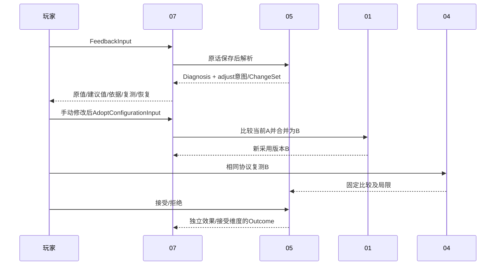

# 05 反馈、偏好、诊断与调整实验详细设计

> 阶段 C4及D-P03引用回补；2026-11-01；建议基线 `product-contract/0.4`；闭环尚未实现。（独立审计修订；兼容见共享数据§12.2）
> 来源：[原始 05](../design/05-feedback-optimization.md)、D01/D03/D05、[共享数据 §7/9](./shared/data-contracts.md)、[状态 §5](./shared/state-conventions.md)、[01](./01-device-game-configuration.md)、[04](./04-performance.md)。

## 1. 职责、边界与确认状态

05保存体验反馈、偏好、目标接受情况，提出诊断假设、主要动作与ChangeSet，校验并记录ExperimentOutcome。性能/比较归04，采用版本/当前指针归01，公开补查归02，调度归07。模型不能自行宣布controlled、把假设当原因或直接执行设置。

满意可以keep，无日志可以排查，缺基线不造ChangeSet，接受不等于改善是继承约束。每轮一设置/必要依赖组、连续两轮无明确改善后暂停为R08及原05的建议初值，不当作用户已批准或普遍收敛保证。

## 2. 功能与决策输入

| 功能 | 触发/输入/前置 | 流程与输出 | 分支/验收 |
|---|---|---|---|
| FBK-F01 原话与解释 | FeedbackInput，session可见，segment属于session | 先持久原文/选项，再解析症状；解释带explicit/inferred/uncertain | 解析失败保留unparsed；FBK-V01 |
| FBK-F02 偏好/目标接受 | 明确玩家声明、原反馈/目标引用 | 追加有范围偏好或接受/拒绝，撤回新版本 | 推断只tentative、不扩张global；FBK-V02 |
| FBK-F03 下一动作 | NextActionInput，固定绑定/摘要/反馈/当前实际配置 | 检查证据→假设/反例→主要动作；adjust附合法ChangeSet | 无基线measure/排查；FBK-V03 |
| FBK-F04 采用后实验结果 | OutcomeInput、真实采用链/前后绑定 | 04比较→05评估效果/接受→不可变Outcome | 额外改动降级；拒绝未测不造性能；FBK-V04/05 |
| FBK-F05 停止与防循环 | 满意/反证/重复无效尝试 | keep或有目的measure/research；保留失败经验 | 无新证据不重复旧无效改动；FBK-V06 |

症状词表建议：stutter/low_rate/blur/ghosting/input_feel/scene_specific/other；仅分类，不绑定预置因果。严重程度、范围/时间未知使用FieldValue未知，不能把无症状文本解释成没有偏好。用户选项可明确表示满意/想改善/问题；纯自然语言不可靠则uncertain。

## 3. 组件与调用方向

建议 `game_app/feedback.py`：FeedbackParser、PreferenceService、DiagnosisPlanner、ChangeSetValidator、OutcomeEvaluator、LoopGuard。所有者只返回后继意图，不互相递归发模型任务；07在原任务结束后，按明确范围与预算登记下一任务。未接受目标不得作为“未达标”强制继续调整的原因。



## 4. 数据与不可变解释

共享Feedback/Symptom/Preference/TargetAcceptance/Diagnosis/Hypothesis/ChangeSet/ExperimentOutcome字段不在此重定义。原话、模型解释、玩家明确偏好分别存。Feedback是事实对象，不原地把unparsed改成已解析；原始反馈与任务注册同事务，模型解释产生新的Feedback记录（复制原话/选项，新增结构化解释），并保存局部不可变关系 `FeedbackInterpretationLink={source_feedback_id:ID,derived_feedback_id:ID,task_id:ID}`（全R，含EntityHeader，derived唯一）。查询按此关系展示一条原话及解释历史；诊断读取输入指定版本，同一原话重复ID不算两份独立反馈。

| 关系 | 必须守卫 | 历史/来源 |
|---|---|---|
| Feedback→Session/Segment | 安装/游戏/区段归属一致；无时点不配尖峰 | 原话submitted事实不覆盖，解释通过link追加 |
| Preference→Feedback | 明确表达才explicit；scope=game/experiment对应游戏/ChangeSet，global scope_id=null | 按series追加，撤回不改旧推荐输入 |
| TargetAcceptance→TargetProposal/Feedback | 目标属于当前声明会话相关推荐；session与feedback一致 | supersedes指同session/目标旧接受记录，不改proposal |
| ChangeSet→AppliedConfiguration | base真实不可变同安装，改项原值足以恢复，依赖/受保护偏好有效 | 原值来自base；新值固定标量，无候选条件未落实项 |
| Outcome→ChangeSet/采用/绑定 | base等于ChangeSet.base，tested沿采用链包含此变更，前后绑定对应实际版本 | 后补更正生成新结果，不反写旧测量/接受事实 |

Hypothesis支持/反例/未知并列，不能仅因模型措辞肯定关闭缺口。ChangeSet.hypothesis_id须定位本次Diagnosis的假设；rollback_ref指同安装可恢复版本，实际恢复步骤只展开已知旧值/预设，未知旧值影响恢复时先询问。

TestProtocol通过[04 §4.4](./04-performance.md#44-d-p03-测试协议创建与指标目录)正式创建，ChangeSet.protocol_id可引用明确选定的具体版本；比较口径仍由ComparisonProtocol单独冻结。没有已选测试协议可保留null并限制结果，不能让模型自行构造TestProtocol ID或把比较协议ID填入。协议子版本不自动替换旧ChangeSet/Session的计划；实际条件/次数/生效依然逐轮核验，计划登记本身不证明受控或改善。

## 5. 接口、声明与幂等

`record_feedback(FeedbackInput,MutationContext)->TaskAccepted` 先保存原话/选项及反馈任务，解析失败保留原记录，领域unparsed/partial。`plan_next_action(NextActionInput,MutationContext)->TaskAccepted` 生成Diagnosis与可选ChangeSet，不写当前指针。`record_outcome(OutcomeInput,MutationContext)->ResourceResult` 先核验比较与采用链，再由程序归约效果/legacy；不接收客户端effect_assessment或controlled。

局部同步DTO均全字段R，变更返回ResourceResult，引用/冲突按共享错误，跟随07短事务/幂等规则，不调用外部模型：

| DTO | 字段 | 守卫与副作用 |
|---|---|---|
| PreferenceDeclarationInput | series_id:ID?、expected_current_id:ID?、feedback_id:ID、scope:PreferenceScope、scope_id:ID?、content:string、lifecycle:PreferenceLifecycle | 新偏好两ID均null；更正/撤回比较该族当前ID；程序确认显式声明/范围，生成Preference新版本及声明记录，冲突PREFERENCE_VERSION_CONFLICT |
| TargetAcceptanceInput | proposal_id:ID、session_id:ID、accepted:bool、feedback_id:ID、supersedes_id:ID? | 前置目标/会话/反馈可见且关联；存在旧接受时supersedes必须指该目标/会话当前记录；旧引用冲突TARGET_ACCEPTANCE_CONFLICT |

PreferenceDeclaration是05局部不可变记录（含EntityHeader），全R字段为 `input:PreferenceDeclarationInput,submitted_at:Timestamp,source_feedback_id:ID`，source_feedback_id必须等于输入feedback_id；记录原输入、当前用户动作及原反馈引用，追加到07通用references，不以原反馈冒充撤回时的新动作。初始explicit来自玩家本次明确声明；自然语言推断只创建tentative，不能由模型调用该显式声明接口。new series ID由后台生成。旧偏好的当前有效视图按族版本读取，但历史推荐永远读原ID。目标接受并发守卫按(session_id,proposal_id)维护当前投影并记录事件，不默默覆盖。

下例为有文字反馈但无日志/实际基线的NextActionInput，只允许排查/measure/research/insufficient_evidence或有依据keep，不可产正式ChangeSet：

```json
{
  "kind": "next_action",
  "session_id": "00000000000000000000000000000501",
  "bindings": [],
  "summary_ids": [],
  "feedback_ids": ["00000000000000000000000000000502"],
  "current_applied_id": null,
  "package_id": null
}
```

模型只对必要摘要/匿名场景/反馈解释，沿07预算、10/300秒建议网络起点及未知调用规则；原日志不上传。无可用模型时原反馈保留，可用确定性满意/缺输入规则返回受限动作，但不能伪造Diagnosis的模型证据。

## 6. 下一动作与ChangeSet构造

按下列优先级确定一个主要动作，同时在假设中保留未选择方向：

| 条件 | 主要动作/限制 |
|---|---|
| 玩家明确满意且无主动继续需求，也无需告知的明确风险 | keep；不因没达到系统目标要求调整 |
| 关键本机配置/生效/绑定缺失 | measure或insufficient_evidence；先集中问少量原值/时段，不能生成假ChangeSet |
| 判断依赖缺失公开版本/支持/夜间等资料 | research；返回具体gap，由07另建knowledge任务，玩家不逐页找 |
| 有可解释方向、合法基线/原值/依赖组/恢复和偏好门槛全满足 | adjust；默认一设置/必要联动组，expected_direction只写方向不捏造百分比 |
| 原因不明但一项可控测试能区分假设 | measure；说明测试哪个问题、何种结果支持/反证 |
| 无上述可执行方向 | insufficient_evidence；说明缺什么及可保留范围，不强迫不断重跑 |

症状只生成检查顺序：low_rate查流/限制策略/分辨率及可用计时；stutter看区段/加载/重复性；blur看输入输出分辨率及重建；ghosting看运动与版本；input_feel保留主观，不用显示FPS证明延迟；scene_specific必须有该场景证据。缺GPU/显存遥测不能确诊瓶颈/爆显存。

ChangeSetValidator在保存前逐项核验：base引用固定→old_value与base相符→新值/设置身份有02证据或明确本机依据→依赖组闭合→explicit偏好不破坏→重启条件明确/未知有提示→rollback目标/原值可恢复。失败保存诊断与具体缺口，不保存“可采用”的半ChangeSet。已有ChangeSet过时不修改base，应用时01拒绝当前指针不匹配，生成新诊断/变更需要新key。

## 7. Outcome、重复波动与停止规则

首先检查OutcomeInput的前后bindings与base/tested实际配置一致，comparison_id非空时两侧summary的绑定集合属于所声明前后范围，不能反序或混入别实验。before可原配置，after须包含ChangeSet的采用链；附加玩家改动保留在链中并将资格降级。拒绝但未复测可空after_bindings/comparison，tested仍必须是真实已采用版本；根本没采用的拒绝仅保存反馈/偏好，不造ExperimentOutcome。

效果初版建议采用保守的 `effect-policy/1`：无可用测量为not_measured；单次、关键条件不一致/未知、重复不足或指标取舍冲突为inconclusive。具备至少三轮同协议/对应配置的有效前后样本，才进行方向归约。重复样本从输入绑定范围内、相同分析/清洗版本的已发布摘要选取；同一binding多份数值冲突则inconclusive，不选好看的一份。

04 §4.2新入口的比较协议须核对冻结先后；exploratory=true或仅能事后确认的口径可展示观察差异，按本规则不归约为稳定improved/worse，保留inconclusive与原因。重复分组、比较协议ID、exploratory及冻结时序检查一并进入评估manifest；旧Outcome不重算或改标签。

按每个预先声明的相关指标，取前后轮次中位数及组内max-min范围；绝对变化未超过两侧较大组内范围（同时考虑08数值容差）为波动内，超过才给方向。这是保守工程规则，不是显著性检验或普遍感知阈值。可核对的主要目标指标有改善且其他相关指标无清楚反向为improved；主要目标清楚退步且无未闭合取舍为worse；相关指标均波动内为no_clear_change；平均升而尾部退、质量/性能取舍未闭合等为inconclusive。没有量化画质依据时，体验可接受独立保存，不把主观满意变性能improved。

OutcomeEvaluator创建局部受管理评估manifest，冻结选中摘要ID、输入绑定、主比较ID、重复分组、指标方向/波动、effect-policy版本、条件检查和局限；通过artifact EvidenceRef关联Outcome，避免事后读取新增历史改变旧效果。legacy_outcome严格沿B3 §5.2归约：accepted只表达接受，rejected+improved为improved_but_rejected，其余按独立效果归约。Outcome/评估manifest发布与幂等响应遵守07文件事务边界。

LoopGuard按同安装/游戏构建/配置基线/设置组/方向识别旧尝试：已有拒绝/无效且无新证据，不再次提出同变更；有新版本/新证据则说明为何值得重试。连续两轮受控无明确改善建议暂停/定向诊断；玩家拒绝测试仍保存缺口和现有方案，不以未测推断失败。停止不删除失败历史。

## 8. 依赖、异常与恢复

| 异常/选择 | 处理与恢复 |
|---|---|
| 模型解释失败/不支持症状 | 原反馈unparsed或uncertain，保留选项；新解析追加版本关系，不覆盖原话 |
| 只有文字/未知配置日志 | 可keep/排查/measure/research；无因果数字、无假基线/回滚 |
| 偏好/目标接受并发 | 专用409、显示当前记录，用户核对后新key；不悄悄扩大范围或覆盖声明 |
| 偏好阻止建议 | 解释冲突，优先寻找兼容方向；无依据不要求玩家放弃明确偏好 |
| ChangeSet已过时 | 采用返回CURRENT_CONFIGURATION_CONFLICT；05重新基于新实际快照判断，旧变更不改 |
| 比较无共同口径/零分母 | 复用04逐项unknown，效果not_measured/inconclusive；不按自适应计数判断改善 |
| 原件损坏/评估文件未发布 | ARTIFACT_UNAVAILABLE/STORAGE_COMMIT_FAILED，无假Outcome；原key重试核对 |
| 确认手动恢复 | 交01创建origin=rollback的新采用，04绑定新轮次；05不回写指针 |

复用现有Python/Pydantic及领域服务，不引入强化学习/全局个性化模型。效果规则需用08受控夹具和真实重复试验校验；本次不声称已证明收敛、延迟改善或主观画质最优。更复杂统计方案待有样本和明确假设后版本化引入，不通过“更智能”隐藏不确定性。

## 9. 验收场景

| 编号/需求/目的 | 初态/输入 | 操作 | 输出/状态断言 | Mock / 真实环境 |
|---|---|---|---|---|
| FBK-V01 / C11、原话保留 | 无日志反馈、无法可靠归一症状；模型失败/后续成功 | 保存、解析失败后显式新解析 | 原话/选项不丢；unparsed/inferred分开，新记录有link；无假时间点/诊断 | 模型桩/临时库；免网络 |
| FBK-V02 / 偏好/目标 | 一次推断与明确游戏偏好、后续撤回；同目标接受并发 | 保存/撤回/过时提交 | tentative不自动global；旧输入不变，409不覆盖；未问目标为未知 | 声明/版本夹具；免游戏 |
| FBK-V03 / D01/D03：合法变更 | 当前A含自定义项；另有无基线文字反馈/未知旧值 | plan_next_action、创建ChangeSet | adjust有合法base/旧值/依赖/回滚与偏好；无基线只排查/补测，不虚构ID | 配置/模型桩；免真实服务 |
| FBK-V04 / D01：结果关联 | C基于A，实际B及附加改动；错绑定/反向比较 | 采用、提交Outcome、原key重试、恢复 | 正确A/C/B关联，错配拒绝；附加改动降级；结果仅一，恢复新版本 | 临时DB/比较桩；手动游戏流程另验 |
| FBK-V05 / D05：效果与接受 | 接受未测、更快但拒绝、平均升尾部退、单次/波动内/3轮一致改善 | 冻结manifest与效果归约 | accepted+not_measured不变improved；拒绝保留；单次/冲突inconclusive；共同阈值与波动依据可复核 | 固定多轮摘要；真实效果必须local_effect |
| FBK-V06 / 停止循环 | 满意、连续两轮无改善、旧拒绝方向无新证据 | 生成下一动作/新增版本证据后再评估 | 满意keep；无目的重复被阻止；新证据才允许解释性重试，失败历史保留 | 固定历史/模型桩；免网络 |

## 10. 实施任务与 DoD

| 任务/目标 | 依赖 | 拟建组件/文件 | 必须逻辑与接口 | 验收/完成定义 |
|---|---|---|---|---|
| FBK-T01 反馈及偏好声明 | ENG-T01/02、DEV-T03 | game_app/feedback.py；tests/product/test_feedback.py | 原话注册、解释link、偏好版本/范围、目标接受与并发 | FBK-V01/02；任何解释失败不丢原文 |
| FBK-T02 假设/动作与合法变更 | FBK-T01、KNW-T03、REC-T02、PERF-T03 | feedback.py；test_next_actions.py | 证据/反例、ChangeSetValidator、保护偏好、无基线分支、LoopGuard | FBK-V03/06；无假回滚、不递归发模型任务 |
| FBK-T03 效果与结果事实 | FBK-T02、DEV-T03、PERF-T02/03、ENG-T03 | feedback.py；test_outcomes.py | 采用/绑定关联、评估manifest、重复波动规则、legacy归约与幂等 | FBK-V04/05；结果可复现，接受与效果独立 |
