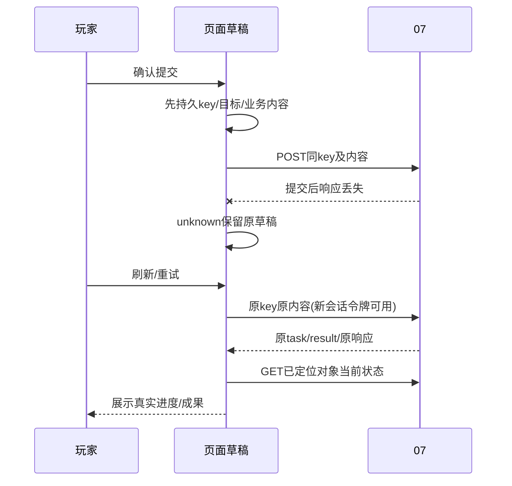

# 06 玩家旅程、页面状态与交互接口详细设计

> 阶段 C5及D-P01—D-P04补全；2026-11-01；建议基线 `product-contract/0.4`；未生成网页、前端代码或像素稿。（独立审计修订；兼容见共享数据§12.2）
> 来源：[原始 06](../design/06-player-experience.md)、C02/C06/C07/C11、D01—D05、[07路由登记](./07-data-and-architecture.md#11-c5-路由集成登记)、各领域模块及 shared 契约。

## 1. 范围与产品选择

按Q1本地网页建议设计，页面只展示/提交声明，不直接读取硬件或决定推荐可执行性/比较资格。已有系统尚无完整产品页面。Q3一次确认、日志导入先行、固定测试场景作为建议流程；可选更细确认或自然游玩，不能因此降低未知/因果门槛。本模块不锁定品牌、配色或像素规格，原始06的浅/深主题可选与键盘可用原则保留。

玩家旅程：选游戏→自主识别/收集→看主推荐与局限→手动设置并声明采用→记录/导入→反馈→有依据维持/调整/补测→历史比较。目标FPS和偏好没有必填入口关卡，公开资料搜集不转嫁给玩家。

## 2. 功能需求与正常页面

| 功能/页面 | 触发、输入与首屏信息 | 主要动作/接口 | 成功与异常路径 |
|---|---|---|---|
| UX-F01 游戏/设备 | 首次进入；游戏、可用设备/能力，关键未知 | 分析游戏→device-scans/knowledge-tasks；可选需求 | GPU失败打开集中补充；无设备可先收集，UX-V01/02 |
| UX-F02 任务进度 | TaskAccepted/刷新；阶段/已得成果/缺口/实际调用 | 查看、取消保留、显式恢复；tasks GET/cancel/resume | 无伪百分比；未知调用先查看/核验，UX-V06 |
| UX-F03 推荐清单 | 固定RecommendationVersion | 主方案、手动设置清单、替代差异、来源、导出 | readiness与review同时显示，三类数值分开，UX-V03 |
| UX-F04 配置/测试 | 安装/固定版本，声明与观测、生效条件 | 保存基线/采用/配置未知继续；sessions、captures/log-imports；comparison-protocols冻结比较口径 | 当前冲突先核对；开放段需结束再分析，UX-V04/08 |
| UX-F05 结果/反馈 | 本机摘要/质量、逐项比较与局限 | 可跳过反馈；feedback/next-actions/outcomes | 先结论再指标/图，接受与效果分开，UX-V05 |
| UX-F06 历史/恢复 | 按安装/游戏的固定事实链 | history、显式comparisons/exports；日志预览/log-associations；手动恢复确认 | 查看不切当前；补录历史独立于当前采用，UX-V07/08 |

## 3. 页面组件与信息结构

建议服务端模板、少量原生JavaScript、本地静态图表资源，不建立第二套领域状态机。组件职责为 GameContextPanel、InformationPanel、TaskProgress、RecommendationTable、ConfigurationDeclarationForm、SessionControls、ResultView、FeedbackForm、HistoryList；未来文件建议在 `game_app/templates/` 和 `game_app/static/`。07返回领域状态，组件只映射人类可读文案。

推荐页顺序：主方案/适用范围/准备与复核→建议目标→独立公开参考→菜单分组设置表→影响选择的未知→替代项→展开来源/测试条件。设置表列为设置原名/显示名、操作/值或条件、当前差异、理由/证据、依赖/重启；keep_current当前未知显示“当前值待确认”，不以灰色数值冒充确定值。

结果页先说明数据质量、能回答的范围与主要动作，再给本机指标/帧间隔时间轴。自适应长帧标为“区段内定位”，共同阈值比较另区显示阈值、有效时长、簇/分钟和时间占比；没有统一口径的指标不画改善箭头。公开参考不与本机结果画成同条件A/B。

比较口径在复测前提供“保存比较方式”：默认固定50ms，可选基于已结束基线计算；选择基线和已登记清洗规则后，提交04 CreateComparisonProtocolRequest至comparison-protocols，保存返回的协议引用并读取后台实际阈值/冻结时间。后续comparisons使用该protocol_id；改口径另存一份，未知响应沿原草稿重送。已经取得后测或无法证明先后时，明确显示“探索性比较”，另建exploratory=true协议，不以客户端选择“预先计划”绕过后台检查；界面不要求玩家输入ID、冻结时刻或派生阈值。

## 4. 页面数据、提交草稿与历史查询

领域实体/TaskAccepted/ResourceResult/ErrorEnvelope直接复用shared，页面不得重新命名为success或补造空测量。聚合历史请求显式revision；当前视图与历史视图的标签分开。路径引用由后台解析；浏览器不保存/导出用户名、绝对路径、服务密钥或认证头。路径选择只有受控本机适配器支持时才提供，浏览器保存引用；无此能力允许路径未知上下文。

MutationDraft为06局部客户端状态：`draft_id:string,operation:string,canonical_route:string,request_schema_version:string,body:JSON,idempotency_key:string,local_state:string,result_refs:ObjectRef[],updated_at:Timestamp`，全R；local_state仅prepared/sending/unknown/accepted/rejected。只持久化允许公开的业务声明/引用，不持久化认证信息；本地用户切换时不复用其他作用域草稿。存储使用本地IndexedDB作为建议，写入失败就阻止发送并保留可复制输入，不在没存key时发有副作用请求。文件上传草稿保存文件内容hash/元信息与已得file ID，不把大CSV复制进页面持久存储。

以下局部只读/导出DTO字段由06唯一定义，07负责执行与权限：

| DTO | 字段（未标D均R） | 规则 |
|---|---|---|
| HistoryQuery | game_id:ID?、installation_id:ID?、cursor:string?、limit:int（D=20） | limit 1—100；安装须属于游戏/用户；cursor后台生成并绑定过滤条件/用户，非法游标422 |
| HistoryEntry | kind:string、ref:ObjectRef、revision:Revision?、event_time:Timestamp?、summary:string、relation_refs:ObjectRef[]、availability:string | kind限已登记领域类型；聚合必须固定revision；availability=ready/gone/unavailable，未知时间不填导入时间 |
| HistoryPage | entries:HistoryEntry[]、next_cursor:string? | 按事件时间/后台稳定ID排序，查询快照截止点固定；无结果空列表合法 |
| ExportSelection | ref:ObjectRef、revision:Revision? | 不可变实体revision=null；聚合必须给具体revision；当前指针不得作为历史内容导出 |
| ExportInput | selections:ExportSelection[]、format:string、profile:string | 非空；format仅markdown/json，profile仅share_summary；其他值422；后台格式化并脱敏 |

导出记录固定源ID/修订、schema/算法、引用与不可用原因，生成ManagedFile返回ResourceResult，不把任意路径交给客户端。原始CSV/完整网页原件/密钥不在share_summary内；需要私人备份走07后台受管理备份机制，不伪装成分享导出。

## 5. HTTP映射、状态文案与动作

接口路径与返回以07 §11为准，01/04逻辑包装由后台从原始声明构造。回答提交 InformationResponseInput，版本来自当前面板；采用expected_current_applied_id来自玩家正在确认的实际版本；绑定使用段/绑定双修订；Outcome只能声明接受情况与引用，不能自报改善/controlled。

| 后台状态/错误 | 面向玩家表达 | 允许动作与输入保持 |
|---|---|---|
| waiting_input | “需要补充这些信息才能继续” | 原问题/已答项恢复；部分提交、明确不知道、取消；不无限转圈 |
| partial / budget_exhausted | “已保存这些成果，仍缺以下信息” | 查看部分结果/显式新增预算，新key/parent任务 |
| provisional / blocked | “以下条件待确定” / “目前缺少可靠方案依据” | 查看具体项、可用参考/补查；不是只有失败横幅 |
| needs_review | “资料有变化，需要重新核对这些项” | 保留旧内容，展示影响；新采用先重核/降级 |
| CURRENT_CONFIGURATION_CONFLICT | “当前配置已更新，请核对差异” | 保留草稿，读取新实际配置；重新确认才新key |
| INFORMATION_*_CONFLICT / CONTEXT_CHANGED | “问题内容已更新，请核对仍需补充的项目” | 读取替代/当前问题；不丢有效原话、不暗中合并选择 |
| BINDING_REVISION_CONFLICT | “这段记录已修改，请核对时段” | 保留历史声明/日志关联草稿，刷新会话/段/绑定；新确认再提交 |
| PREFERENCE_VERSION_CONFLICT / TARGET_ACCEPTANCE_CONFLICT | “这项意向已更新，请核对当前记录” | 读当前声明，保留本次输入，不覆盖其他页面的新选择 |
| CALL_OUTCOME_UNKNOWN | “请求可能已执行，结果尚未确认” | 查看已存成果/可用核验；独立新调用需明确可能重复与新预算，不自动重发 |
| ARTIFACT_UNAVAILABLE / RESOURCE_GONE | “原始文件不可用” / “记录已清理” | 展示可保留摘要/原因，受管理重新上传/新任务；不空白成功 |

页面不展示foreign keys、records、幂等键等工程词。错误至少一个有效动作，具体按钮依据后端固定RecoveryAction；不能把模型文本当URL/脚本执行。错误定位通过短关联编号与开发诊断查看，不暴露本机路径/供应商异常原文。

## 6. 刷新、未知响应与问题接续流程

一个逻辑提交：先存草稿和key→发送期间禁用重复按钮但允许短控制→202/201后存ID并查询→超时设unknown，继续查询已有ID或原key原内容重送。双击/刷新不旋转key；修改业务内容、下一批回答、明确新一轮/新预算才新key。Schema升级时草稿保持原request_schema_version，服务端不能将旧键按新格式重新执行；不兼容则显示已有结果/明确更正流程。

任务轮询建议活动页每2秒一次，失败指数退避至30秒，隐藏页减到15秒；这是调试建议，不是时限保证。已知终态停止轮询，waiting_input按需低频同步/问题事件更新；后台仍可处理其他任务。状态查询无副作用。服务会话令牌刷新不会改变持久user_scope；403先恢复应用会话后沿用原key，不自动新建任务。

问题面板以服务端Request.fields为准：已答内容显示来源，空白不当跳过；“不知道/稍后补充”明确加入skipped_fields。部分成功后按ResourceResult返回的引用读取InformationResponse，取得post_request_version/post_context_revision继续下一批；不假设同步响应直接含这些字段。409读取新问题并高亮差异，原自然语言草稿保留。终态任务后补只保存新事实，页面明确“如需重新分析，创建新任务”，不显示旧任务已继续。

## 7. 无障碍、数据图与特殊旅程

所有操作可键盘完成；问题出现后焦点移到面板标题，提交后定位错误字段，关闭/完成回到原触发点；状态变化用适度live region，不每2秒朗读整页。表格具备表头和文本状态，颜色不单独承担已知/未知/冲突含义；窄屏可横向滚动设置表且保留设置列，关键动作不被遮挡。尊重系统减少动态效果与用户主题选择；不强制“游戏工具必须深色”。

时间轴保留区段/排除/长帧及修改标记，原始统计输入不随图表采样改变；清楚标FPS或ms与帧流。长帧尖峰的图形显示可用保峰聚合，但统计与导出值来自原数据。没有客观画质分不画画质雷达；图表提供同值文本表与下载摘要。

历史补录入口明确“补充过去这段配置”，先收集时段依据，保存后显示“当前配置未改变”；随后可显式补绑/重分析。恢复入口分为查看清单与“我已手动恢复，确认记录”，后者调用01新建rollback版本并检查当前ID。配置未知旅程允许建会话/导入/反馈，只限制设置归因。玩家拒绝复测可保存接受情况和缺口，不阻止查看资料或继续游玩。

外部日志入口：上传取得file ID→GET log-inspection预览已登记格式的原始时间范围/候选流→选择“关联已有记录”或“补录过去一次游玩”→填写可确认的时间对应和依据→POST log-associations→读取新artifact/闭合绑定→显式analyses。页面按04 §4.3组装LogAssociationRequest，时间锚点展示换算前后单位与范围，流选择绑定后台stream_key；不让玩家手填映射系数或JSON。已有记录修订过时保留输入并刷新；历史模式必须有真实过去开始时间，未知时可保留文件、稍后补充，不能默认上传时刻。配置未知无需补造采用版本；仅凭玩家时间声明不显示“已自动确认”。终态导入任务不会因此复活，修正映射创建新artifact/新分析，旧结果仍可查看。

### 7.1 D-P01 空库进入与本机记录

首次页面GET games仅查本地候选；空页仍允许直接填写游戏名称，平台/设备/FPS/偏好均非必填。提交02 GameSelectionRequest，页面用ResourceResult定位GameSelection：selected则读取固定GameContext进入设备扫描/公共knowledge；needs_choice则列候选原名/平台/身份局限，玩家明确选择后新key提交，不自动取首项，也不展示未取得的路径/能力为已支持。

provisional显示“名称已记录，游戏身份和平台待核验”；它允许收集资料，不显示“已确认支持/可直接推荐”。返回上下文installation=null时，可先公共收集。玩家需要保存本机配置/游玩记录时，查看当前用户安装列表并明确选择，或以01 CreateInstallationRequest新建路径未知本机记录；取得返回带安装上下文后再探测。相同标签可以属于两个安装，不按名字自动合并。选已有安装时保存其revision，409刷新列表保留草稿，重新确认才新key。

普通用户始终从选择和返回引用继续，不输入任何游戏/安装/上下文ID。公共选择成功、后续扫描失败是两个提交：选择保留，扫描显示逐字段失败/集中问题，不要求重复选游戏；无模型配置也能完成选择/登记/回答。

### 7.2 D-P02 本机条目与基线

原配置表允许“添加我记得的设置”：只填原名、可选菜单路径和说明，向local-settings提交01局部请求。目录登记返回后页面使用definition_id组装SettingRef，再另行收集已知值/不知道和生效声明，提交原AdoptConfigurationInput保存baseline。条目登记不显示“设置已应用”，不推断预设未展开值，也不把玩家原话当自动读取结果。

路径已声明时普通登记使用identity_mode=auto；路径未知时先GET local-settings列候选，玩家明确选“复用这项”则reuse并带固定reuse_local_setting_id，或选“这是另一项”则distinct/null，保留同名不同项而不改原名/伪造路径。目录更正使用reuse且reuse_local_setting_id=supersedes_local_setting_id，展示旧条目与后继；409读取已有后继供核对。更正不自动改配置引用或复制值。需要让新当前配置使用新定义时，另显示“替换这项记录”：从固定当前A选择旧项，重新确认旧值/单位和新值/生效情况，组装manual_edit的setting_ref_replacements及新SettingDeclaration；保留K/未知项/预设。旧值未知先确认，不能用改目录绕过。登记成功而采用冲突时两次草稿分别保留，新确认才换key；没有适配器/公共知识同样可记录。

### 7.3 D-P03 保存测试计划

测试页在开始采样前提供“保存测试计划”：填写可确认场景/条件，选GET metric-definitions返回的指标，并保留明确的未规定热身/时长/次数。界面可介绍原建议值，但不得将未选择的值混入提交；metric_registry_version与选择的key一并冻结到MutationDraft。POST test-protocols后读取返回具体协议版本，新会话/ChangeSet明确引用；更改计划另存子版本，不替换历史会话。

“测试计划”与基线后“保存比较方式”是两个入口，后者沿现有comparison-protocols。页面显示测试计划登记时间/声明范围，但不标“已执行/受控”；实际每轮条件/绑定仍核对。目录缺规则时解释暂不可保存协议，允许自然游玩test_protocol_id=null；不能让用户手填MetricDefinition或用ComparisonProtocol ID顶替。响应未知沿原key/规则版本重送，后台规则升级不自动改草稿。

### 7.4 D-P04 已处理问题的稍后补充

resolved/skipped问题显示“补充或更正这份记录”。页面读取源问题两修订，选需补字段并填理由，POST information-amendments；成功后根据返回新InformationRequest创建**另一个**回答草稿，按其version/context revision填写InformationResponseInput。原创建提交与新回答各自有key；任何一条响应未知仅重试自己的原内容。

新面板展示来源记录/当时范围与旧回答供参考，不预填成已确认新答案。facts_only明确显示“保存新事实；原任务和旧结果保持原输入”；完成后如需重新分析，再明确选择新快照/范围创建任务。原任务仍running也不会用本次更正悄悄替换其输入；终态任务不出现“已继续”文案。过去配置补录/绑定仍是独立入口。

源问题尚open/partial时引导原回答面板；源已superseded或已有更正后继时，409读取后台替代/后继，保留草稿，不建并列链。0.4更正字段选择来自amendment_root_ref指定的根问题revision（首次源问题自身），即使最新后继只问过GPU，仍能再选根域中的显存；原答值仅参考，不预确认。新回答的背景使用后继固定的历史派生上下文，页面不能丢掉前轮更正或换成当前设备。旧链根依据不可用显示具体原因，不自行补根。LOCAL_SETTING_CONFLICT、INSTALLATION_REVISION_CONFLICT、INFORMATION_REQUEST_STATE_CONFLICT按共享动作处理。

新变更草稿request_schema_version=product-contract/0.4，发送时放X-Product-Contract-Version头；旧草稿沿其旧版本查原响应，不自动改0.4或换key。登记的identity_mode/复用选择、采用的显式替换映射均是业务内容，确认修改后才新key；后台根引用不是客户端可填写字段。

## 8. 依赖与降级

服务端模板+原生JS优于独立SPA作为首版建议，理由是减少双份模型与构建依赖；复杂路由/离线多窗口需求若增大再评估。关键表单即使图表脚本失败也可读数值/限制；JS失效不得显示已发送成功，提供可恢复的只读结果与重试提示。

ECharts官方无障碍文档说明可提供图形描述/非单纯颜色区分，但组件/选项受版本影响，必须在固定分发版本测试键盘/读屏并保留文本替代。[官方可访问说明](https://echarts.apache.org/handbook/en/best-practices/aria/)（2026-11-01只读核验；未安装或渲染）。不加载运行时公共CDN。浏览器持久存储权限、上传中断与本地回环访问保护须真实集成验收，不能用设计文字或函数测试代替。

## 9. 交互验收

| 编号/需求/目的 | 初态/输入 | 操作 | 输出/状态断言 | Mock / 真实环境 |
|---|---|---|---|---|
| UX-V01 / C02/C03：入口最少 | 新用户，仅游戏；服务可用/设备未知 | 开始分析、离页再回来 | 无FPS/画质必填，来源自主收集；任务ID/部分成果可恢复 | 服务桩；真实浏览器回环集成 |
| UX-V02 / C11、D04：集中回答 | 探测失败、部分已知、请求/上下文变化 | 键盘回答→部分提交→刷新→明确跳过→旧回答冲突→终态后补 | 已知不重填，原话不丢；版本更新有效，等待释放；不复活终态 | 双客户端服务桩；真实焦点/存储测试 |
| UX-V03 / C04/C06：推荐可读 | provisional/needs_review，条件项/HDR观察/公开区间 | 看主方案/替代/来源/目标 | 值/条件/未知分别展示，当前未知不伪值，公开参考不变本机预测 | 固定推荐视图；真实键盘/读屏 |
| UX-V04 / C07、D03：配置记录 | 无推荐baseline、未知配置会话、活动段 | 保存基线/未知继续、手动采用、结束/分析 | 无自动写设置；开放段不假分析，生效待重启限制比较 | 领域/工具桩；真实手动游戏另验 |
| UX-V05 / D01/D05：反馈闭环 | 有合法调整/共同阈值比较，另有未测接受 | 采纳→复测→接受/拒绝→看结果 | 原值/新值/恢复清楚；不以自适应次数/满意证明改善，无目标也可keep | 固定摘要/诊断；local_effect另验 |
| UX-V06 / D02：响应未知 | 双击、提交后断连、后台重启、403、旧键410 | 刷新/恢复会话/原key重试/显式新任务 | 同task/result且供应商次数不增；unknown不换key；410不复活，明确预算才新调用 | SpyProvider；真实浏览器/临时库 |
| UX-V07 / D03、历史 | 当前B、过去A依据、旧方案、不同条件两摘要 | 历史补录/绑定、查看、手动恢复确认、比较/导出 | 补录不切B，查看不推进，恢复新ID；不可比项解释；导出固定修订且脱敏 | 固定历史/临时文件；真实浏览器/下载 |
| UX-V08 / D02/D03/D05：协议与日志入口 | 空协议库、相对时间历史日志、可确认过去起点；另有响应丢失/过时段/无依据 | 页面保存比较方式→用返回协议比较；上传预览→人工关联→显式分析；刷新重试 | 普通流程可取得合法protocol_id/闭合引用，无需手改JSON；原key不重复创建，过时保留草稿；无依据仅保留文件，事后口径显示探索性，当前配置/旧摘要不改 | 固定CSV/服务桩/临时DB；真实浏览器回环与存储测试 |
| UX-V09 / D-P01—04、C02/C11：空库补全旅程 | 无Game/安装/协议库、模型未配置；固定规则目录及领域桩；原skipped问题 | 仅名称选择→路径未知本机记录→登记条目/独立baseline→保存测试计划/另比较口径→更正已跳过问题/补答；每步模拟丢响应/刷新/冲突 | 普通流程全由选择/返回取得ID；未输入FPS/平台也可选择；身份未核验明确降级；登记不采用、两协议不混型；新问题facts_only，原任务零写；规则版本/原key保留，全部旧事实可读；未知位置明确选不同项/复用；目录更正后另确认旧值/新值替换；根域两轮不同字段不丢先前回答；版本头随草稿恢复 | 真实浏览器/临时DB/服务与探测桩；免付费，真实游戏/兼容另验 |

## 10. 实施任务与 DoD

| 任务/目标 | 依赖 | 拟建组件/文件 | 必须逻辑与接口 | 验收/完成定义 |
|---|---|---|---|---|
| UX-T01 页面读取与状态映射 | ENG-T01—03、领域只读接口 | game_app/templates/、static/；tests/product/test_view_models.py | 六页信息结构/状态、空目录/候选与安装/规则查询、固定历史/图表文本替代 | UX-V01/03/07/09读取部分；无私有路径或原型工程词暴露 |
| UX-T02 提交草稿与回答恢复 | UX-T01、DEV-T04、ENG-T04路由基础 | static/submissions.js、templates/information.html；tests/integration/test_submissions.py | 发送前持久key、unknown/403/刷新/冲突/部分回答、facts_only更正双提交、规则版本固定及反馈声明 | UX-V02/06/09恢复部分；调用/对象次数可查，键盘焦点与输入保留 |
| UX-T03 闭环及可访问集成 | UX-T02、PERF-T04、FBK-T03、ENG-T04完成 | templates/、static/、tests/integration/test_journey.py | D-P首次进入/本机条目/测试计划/更正、采用/未知、比较冻结/日志关联、采集收尾、反馈/Outcome/历史/导出 | UX-V04/05/07/08/09及VAL-V06/07/08；普通旅程不需手改JSON，真实能力按证据标注 |

UX-T01与ENG-T04可以在领域接口稳定后交替增量交付；ENG-T04的路由基础不依赖UX实现，UX-T02依赖该基础，最后ENG-T05依赖UX-T03/VAL-T04做完整集成，不能写成相互阻塞的任务环。
