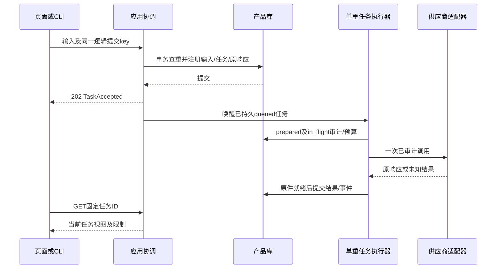

# 07 工程骨架、持久化与接口集成详细设计

> 阶段 C1建立、C5及D-P01—D-P04回补；2026-11-01；建议基线 `product-contract/0.4`。本文件是设计，未新增服务、数据库或依赖。（独立审计修订；兼容见共享数据§12.2）
> 依据：[原始 07](../design/07-data-and-architecture.md)、[架构基准](./00-architecture-overview.md)、[数据](./shared/data-contracts.md)、[状态](./shared/state-conventions.md)、[错误](./shared/error-conventions.md)。确认状态见[台账](./README.md)。

## 1. 范围、状态与技术取舍

已确认约束：C07/C09—C11、D01—D05；只读探测、手动设置、保留历史、创建幂等、未知调用不重发。现有 `game_collector` 的 CLI、Schema、搜索/读取/模型适配器及每运行输出已存在；产品服务和下表组件尚未实现。Q1 本地网页及 R01 的单进程形态作为设计建议继续展开，CLI 复用应用服务；不增加 Redis、Celery、云账号或向量库。

建议新增 `game_app/` 包，避免把产品状态塞入 Collector 的内存字段。核心逻辑只依赖 Python 3.11+ 与现有 Pydantic 2；HTTP、模板与图表作为可替换适配层。实现时必须调整现有 `pyproject.toml` 的包发现规则（当前只包含 `game_collector*`），但本次不改该文件。模块级任务顺序不等于本轮授权编码。

## 2. 功能与前置条件

| 功能 | 触发、输入与前置 | 正常处理及输出 | 分支/异常、验收 |
|---|---|---|---|
| ENG-F01 注册与去重 | 任一变更；MutationContext、合法模块输入，用户可见 | 规范化→查旧键→事务保存事实/原响应；异步 TaskAccepted | 异 hash 409，提交未知先查键；ENG-V01/D02 |
| ENG-F02 调度与控制 | queued、输入已持久；取消/回答走短请求 | FIFO 单重任务槽，调用边界计预算，等待释放槽 | 重启 interrupted；终态不可复活；ENG-V02 |
| ENG-F03 原子领域变更 | 采用/回答/绑定，预期修订匹配 | 调所有者校验，同事务事实、投影、事件与幂等响应 | 任一冲突全部回滚；历史登记无当前指针写；ENG-V03 |
| ENG-F04 文件发布 | 受管理输入/导出、manifest 已知 | staging→校验→最终文件→库内发布 | 孤立文件不消费；损坏保留原因；ENG-V04 |
| ENG-F05 启动恢复与迁移 | 本地启动，独占应用锁 | 核对未发布操作/调用，迁移或拒绝写，重建投影 | 锁占用不开第二工作器；备份失败不迁移；ENG-V05 |
| ENG-F06 读取/导出/清理 | 授权查询或显式变更 | 固定版本视图、脱敏导出、依赖保留/墓碑 | GET 不生成导出；旧键 410；ENG-V06 |

## 3. 组件、部署与调用边界

| 建议组件/文件 | 唯一职责 | 禁止承担 |
|---|---|---|
| `game_app/application.py` | 调用所有者、UnitOfWork、幂等与后继任务登记 | 推荐算法、直接拼 SQL 改他域内容 |
| `game_app/tasks.py` | TaskRun、输入、事件、预算、一个重执行器 | 将 HTTP 重试当供应商重试 |
| `game_app/repository.py` | SQLite、固定版本读取与事务 | 网络、长文件复制、模型解释 |
| `game_app/files.py` | manifest、目录边界、发布日志与核验 | 使用客户端给出的绝对输出路径 |
| `game_app/http.py` / `cli.py` | 身份、同源、请求映射与错误适配 | 自行决定 actionable/controlled |
| `game_app/device.py` / `knowledge.py` / `importer.py` / `recommendation.py` / `performance.py` / `feedback.py` | 对应 01/02/02a/03/04/05 的所有者 | 跨所有者绕过应用协调写库 |

只启动一个产品进程/工作器；HTTP 线程和短事务不占重任务槽。阻塞的供应商/采集等待不能占住处理回答、取消的线程。持久 queued 是事实来源，内存队列只作唤醒；启动核对后旧 queued/running 按 B3 转 interrupted，不自动补执行。采集进程只由 04 的受控适配器管理。

## 4. 物理存储、索引与局部记录

逻辑字段、必填、状态及版本头以 shared 为准，下表仅映射存储，不再定义一套实体。建议根目录由后台安装配置选定，布局为 `product.sqlite3`、`managed/staging/`、`managed/objects/`、`backups/`；不写死玩家盘符。最终文件名使用文件 ID；原名只作经过清洗的元数据。

| 存储族 | 键/索引与约束 | 历史与关系 |
|---|---|---|
| immutable_objects | id 主键；entity_type、schema_version、JSON payload；版本对象另建 unique(type,series_id,version) | 只 INSERT；类型/JSON关系由所有者核验，实体依赖写 references |
| aggregate_heads / aggregate_snapshots | unique(type,id) / unique(type,id,revision)，request 的 version 映射 revision 列 | 更新头用 expected revision；每修订完整快照；状态事件同事务 |
| domain_events | unique(target_type,target_id,dimension,sequence)；专用事件保留具体类型 | 追加；相关引用固定 ID/修订，不读取最新内容替代；只记录实际发生的状态，创建事件用 previous_state=null |
| tasks / task_inputs / external_calls | task id；unique(task_id,input_revision)；按 state/创建次序索引 | calls 与原件独立于检查点，恢复查询全部父链审计 |
| task_responses | unique(task_id,sequence)；response_id 唯一 | 回答与源任务的持久关联投影，只记录 source_task 响应；facts_only 不写。重跑任务按 sequence 升序合并回答，后到覆盖先到，后续 unresolved 删除先前值 |
| device_series_slots | unique(user_scope_id,scope_key)；scope_key 取 installation:<id>/context:<id>/user | 设备序列槽投影，只由 DeviceService 在写快照的同一事务内维护；首次建槽，后续沿用 series_id/device_series_id 并递增 version |
| current_applied / current_applied_events | unique(user_scope_id,installation_id)；事件 unique(scope,installation,pointer_revision) | 指针只接收本事务新 current_adoption ID；historical_record 不触碰 |
| bindings | unique(segment_id,binding_revision)，关联段快照 | 开放与闭合绑定均追加，不 UPDATE 旧 effective_range |
| idempotency | unique(scope,method,canonical_route,key)；存 hash/schema/原响应/墓碑 | 业务事务内登记，不自动过期 |
| references / package_members | unique(owner_id,relation,target_id,locator) / unique(package_id,record_id) | 实际外键指向已存在对象，引用检查另核对类型/安装/包成员 |
| file_operations / managed_files | operation id / file id；operation 状态见下文 | 发布前不可消费；已发布失败通过检查/撤回事件表达 |

D-P新增的GameSelection、InstallationRegistration、LocalSettingRegistration、InformationAmendment仍放immutable_objects并登记类型/所有者/用户可见性，不拆成新的服务。07提供四类必要唯一索引：声明游戏槽`(user_scope_id,normalized_raw_name,declared_platform的显式null标记)`→Game.series_id；本机精确条目键→definition_id；`supersedes_local_setting_id`→直接后继；`amends_request_id`→直接后继。空平台须用明确键编码/非空哨兵列，不能依赖SQL nullable UNIQUE误放重复null。索引目标和声明/对象/原响应同事务，冲突回读已有映射或按所有者规则409；不按标签或游戏ID去重不同安装。MetricDefinition规则映射另以`(key,registry_version,规则hash)`唯一，同事务登记协议引用。

0.4本机精确位置唯一索引仅覆盖menu_path非空的每series当前有效头；[]未知位置另以series_id登记头，位置/原名查询是非唯一候选索引，多个同名未知条目合法。01的auto只接受已定位位置，reuse必须显式固定ID，distinct只创建未知位置独立series。更正保存新版本并按路径是否已知进入/退出位置槽；每父仍一个后继、恢复旧名另增ID；旧版多个已定位同键头按data §12.2歧义桶保留，不能为建立唯一索引先挑一项或合并。头/槽是可重建投影，全部定义/登记/parent关系追加，采用/摘要不随目录自动换ID。

GameSelection的声明manifest、安装登记、本机条目登记、测试协议与问题更正均复用kind=import的FileOperation；后台把operation_id与持久用户/路由/key、规范请求hash关联，准备文件后的原key重试可定位同一操作并核验复用，不能只靠最终资源尚不存在就重复准备无限manifest。该准备关联不算成功幂等响应，仍在最终领域事务内发布资源和原响应。文件复制/哈希不包入长DB事务。新局部记录全部可用授权资源GET读取；不接受未登记entity_type，更不允许绕过所有者反序列化任意对象。

每个连接启用并检查 `PRAGMA foreign_keys=ON`；采用显式短写事务（建议 `BEGIN IMMEDIATE`），不共享跨线程连接，不把网络放进事务。锁忙最多等待 5 秒作为可配置工程初值；仍失败返回 STORAGE_COMMIT_FAILED，同 key 可重送。文件/网络重试不能借数据库锁重试隐式发生。初版采用默认日志模式；只有读写压测证明需要且验证备份后再启用 WAL，不把 WAL 当多写者方案。

`FileOperation` 是 07 的局部恢复记录：`operation_id:ID,kind:string,owner_ref:ObjectRef?,file_ids:ID[],manifest:FileManifest,phase:string,last_error_code:string?` 全字段 R；kind 仅 upload/import/export，phase 仅 prepared/files_ready/committed/abandoned。created_at/updated_at 为后台 Timestamp；phase 变更保留操作日志，不能据此替代共享 PublicationStatus。目标文件检查后按后台路径解析；同步创建在该日志中暂存，不提前注册成功幂等响应。

## 5. 应用接口与外部请求映射

公共返回、错误结构、HTTP 201/202/200、MutationContext 与规范 hash 复用 B3。以下为拟定接口，非已有函数。所有变更均需要幂等上下文；查询不需要 key。下文“模块输入”链接其字段唯一归属，不在此复制请求体。

| 应用函数 | 输入→返回 | 事务/副作用/主要失败 |
|---|---|---|
| register_task | TaskInput, MutationContext→TaskAccepted | 输入/TaskRun/首事件/原响应一事务；校验/引用错误先拒绝 |
| get_task | task_id:ID→TaskView | 只读；不可见 404；失败任务本身仍 200 |
| cancel_task | task_id:ID, MutationContext→ResourceResult | queued/waiting 终止或 running 写控制标记；终态无操作；不杀他人采集 |
| resume_task | ResumeTaskInput, MutationContext→TaskAccepted | 校验终态、可空检查点、全部调用；新 parent 任务；未知调用不得重发 |
| mutate_domain | 模块同步输入, MutationContext→ResourceResult | 所有者组合事务；采用/回答/绑定/Outcome等各自守卫 |
| read_resource | ObjectRef、可选 revision:Revision→类型化只读视图 | 聚合不传 revision 返回当前；历史调用必须传固定修订；404/410/409 按 B3 |

TaskView 是 07 局部只读 DTO：`task:TaskRun,error:ErrorEnvelope?,result_refs:ObjectRef[],progress:TaskProgress`，全 R。error 从持久事件/错误记录构造，绝不重新调用模型生成错误；没有错误为 null。TaskProgress 的全R字段为 `phase:string,last_activity_at:Timestamp?,completed_steps:string[]`：phase限queued/acquire/collect/extract/validate/decide/capture/analyze/finalize/waiting/terminal，由已登记步骤的TaskEvent.cause（phase:<键>，同状态事件）归约，不用模型文本生成；last_activity_at取最近事件created_at，无检查点时completed_steps=[]。聚合历史查询使用 `GET /api/resources/{entity_type}/{id}?revision=N`；不可变实体的 ID 已固定版本，传不适用的 revision 拒绝。

ServiceStatus 是局部只读DTO，全R字段 `model_configured:bool,search_configured:bool,product_contract_version:string,capabilities:map<string,CheckResult>`。configured只说明后台配置存在，不证明凭据/模型可用；GET不发认证探测或付费请求，实际能力检查结果单列日期/依据，不返回密钥、端点认证头或私有路径。

外部请求拒绝客户端 provenance/CheckResult/受信任 RunConditions。对 01/04 的逻辑包装，入口接受原始声明及已有引用，创建 PlayerDeclaration/InformationResponse 后，由领域模块构造来源。需额外输入的本机运行条件走 04 的 `RunDeclarationInput`；外部字段词表由 01/04 登记。预算默认来自明确运行配置，写入 TaskRun 的完整 Budget；不假装所有 TaskInput 都有 budget 字段。

## 6. 事务、调用与恢复步骤

同步变更：解析权限和输入→读原 key（若已注册直接回原响应）→准备事实→写事务重查 key/修订/依赖→所有者写事实、完整投影和事件→保存同一原响应→提交→返回。纯冲突不消耗 key；INFORMATION_CONTEXT_CHANGED 如有维护写则 409 也登记。幂等命中发生在重新生成声明/时间之前。

文件操作：准备 FileOperation→目录内写临时文件/哈希→原子改名到最终不可变位置→短事务重新核对必需文件并发布资源/成员/幂等响应→标 committed。提交前退出：保留不可消费的孤立文件，原 key 再试可在操作日志定位并复核复用；提交后丢响应：回原 ID。Windows 文件被占用、改名失败或磁盘满时不发布。只在受管理目录内按 manifest 清理明确 abandoned 且无引用文件。

外部调用：所有者给出脱敏请求→存 prepared→原子检查取消/预算并登记 in_flight 与计数→发送→原响应写受管理文件→登记 succeeded→类型/语义核验。发送不明或响应未存为 outcome_unknown；无自动模型重试，公开只读请求明确未送/已知失败最多再试 1 次且消耗预算。模型连接/读取超时建议沿现有 10/300 秒作为验证起点；这些是建议参数，不证明兼容。请求超时不取消产品任务。

启动：取得根目录独占锁→检查格式版本和上次操作日志→核验文件/外键→将未决 in_flight 标 outcome_unknown、旧 queued/running 标 interrupted，保留 waiting_input→允许只读和新的显式操作。无检查点恢复依 B3 §6.3；任务从已持久输入开始，也不能跳过审计。恢复期间不启动新供应商调用。

## 7. 安全、迁移、删除与导出

| 边界 | 必须行为与恢复 |
|---|---|
| 回环 HTTP | 校验 Host/Origin 与应用会话；拒绝非预期来源；会话令牌独立于持久用户作用域；不开放局域网 |
| 配置与密钥 | 只读现有环境配置，状态接口只回“已配置”；不提供浏览器写密钥接口，不导出认证头 |
| 上传/路径 | 建议上传上限 1 GiB、JSON 100 MiB，超限 INPUT_VALIDATION_FAILED；不解压不受信任归档；先验证目录边界/重解析点，最终路径再次核对；不接受模型输出路径 |
| 公开网页 | 复用并加固 PublicReader 的公开地址策略；拒绝本地/私网目标与重定向落入私网；来源正文只作数据，不执行命令 |
| Schema 升级 | 关闭写入/重任务，创建一致 DB 备份及对应文件 manifest，验证可读后事务迁移；版本标签不得改写冻结原件或旧幂等 hash；失败恢复备份并保留失败日志，不能半升级继续写 |
| 删除 | 先查 references，默认保留墓碑；有依赖的对象保留必要历史/原件，拒绝破坏性级联；幂等键保留；用户请求文件清理先明确哪些结论将不可复算 |
| 导出 | 只允许 06 定义的分享 profile；去用户名/绝对路径/无关进程/密钥，原 CSV 默认不附；导出包含 schema/版本/算法/引用及不可用项清单 |

## 8. 技术依据、替代与未验证项

2026-11-01 只读核验：SQLite 文档明确写事务的单写者约束及 IMMEDIATE 锁竞争，故选择短事务，而非长事务包网络。[事务官方说明](https://www.sqlite.org/lang_transaction.html)。外键需在连接上启用并验证。[外键说明](https://www.sqlite.org/foreignkeys.html)。备份使用 SQLite 备份机制，不能对活动库简单复制一个主文件。[备份说明](https://www.sqlite.org/backup.html)。这些并非本机故障注入结果。

FastAPI 提供响应后后台处理，但本设计的持久队列/恢复由应用负责，这是基于任务历史要求的设计判断。[FastAPI BackgroundTasks](https://fastapi.tiangolo.com/tutorial/background-tasks/)。新框架版本与现有 Python/Pydantic 组合待安装矩阵验证，默认不写“latest”依赖；若组合失败先提供相同应用服务的 CLI。Pydantic 严格校验能力可作字段校验基础，特定 JSON 数字/默认展开仍须项目规范化规则。[严格模式](https://docs.pydantic.dev/latest/concepts/strict_mode/)。

## 9. 工程验收

下表均是未来用例；本次未执行产品测试。输入中的抽象 ID 在夹具构建时分配合法 UUID，不使用真实游戏设置。

| 编号/需求/目的 | 初态与输入 | 操作 | 输出/状态/副作用断言 | Mock / 真实环境 |
|---|---|---|---|---|
| ENG-V01 / D02：一次注册 | 空临时库，两个相同 key/input，第三个异 hash | 并发提交、丢响应、重启后重试 | 仅一 TaskRun/首输入/原响应；异 hash 409；调用次数不增 | 计数供应商桩；不需真实环境 |
| ENG-V02 / D04：控制不死锁 | running 因关键项等待，另有 queued 任务 | 回答/取消与调度竞态 | 等待释放槽，短请求可完成；取消先提交不复活；非关键未答可有限继续 | 调度桩/临时 DB；不需游戏 |
| ENG-V03 / D01、D03 | 当前 A，两个 expected A；另有历史 H | 并发采用、登记 H、注入事件写失败 | 一方推进/另一 409；事务失败零部分事实；H 不推进当前 | 临时 DB；不需游戏 |
| ENG-V04 / A05：文件窗口 | 完整 staging 文件/manifest | 在改名后、DB 提交前、提交后响应前退出 | 孤立文件不可消费；原 key 查重；缺失文件 409，无空成功 | 故障注入；需真实本地文件系统，免网络 |
| ENG-V05 / A06、兼容 | 旧 queued、waiting、in_flight，无检查点任务，0.1 记录 | 重启、恢复、迁移失败回滚 | interrupted/waiting/outcome_unknown 正确；null 恢复不重发未知；旧响应/hash不改 | 临时 DB/调用桩；真实 Windows 文件占用另测 |
| ENG-V06 / C09、安全 | 错误/导出含诱导路径和密钥；有依赖资源 | 导出、读文件、清理并重试旧 key | 敏感数据不出现；依赖保留/墓碑，旧 key 410；GET 不生成文件 | 固定恶意输入；回环访问保护需浏览器集成 |
| ENG-V07 / D-P01—04、D02：新增入口事务 | 空库/规则目录、两个同key与不同key并发、原响应丢失、声明改名后DB前退出、旧0.2记录 | 经各新增路由提交/读取及恢复；注入后继/声明槽唯一性竞争；facts_only答复 | 同key同资源/原响应；null平台声明槽不重复；文件孤立不可消费；更正后继唯一、冲突无半事实；原任务零写/供应商发送0；旧hash/响应/标签不变，GET无初始化副作用；0.4已定位槽/未知同名独立series及旧歧义桶无误合并；根域可达；显式替换与原响应原子；版本头分流 | 临时文件DB/所有者桩/调用与写入计数；真实HTTP/浏览器另验 |

## 10. 实施任务与完成定义

以下路径为未来建议，测试文件同样未创建。每任务 DoD 为所列断言通过、错误码/记录数量可复核，并保持 `game_collector` 现有回归不退化；不以建空目录算完成。

| 任务/目标 | 依赖 | 组件/拟改文件 | 必须逻辑与接口 | 验收/DoD |
|---|---|---|---|---|
| ENG-T01 产品版本库 | B 共享契约及0.4/旧版本读取兼容 | game_app/repository.py；tests/product/test_repository.py | 固定版本/聚合快照/引用/迁移、已定位槽/未知位置头/旧歧义桶、根快照引用、显式UnitOfWork | ENG-V03/05/07的存储部分、B-DAT-14；失败回滚、旧字节/响应不改 |
| ENG-T02 持久注册及执行器 | ENG-T01 | game_app/tasks.py、application.py；tests/product/test_tasks.py | register/cancel/resume、预算、原响应、单槽与短控制 | ENG-V01/02/05；未知调用计数可核对 |
| ENG-T03 文件与恢复 | ENG-T01/02 | game_app/files.py；tests/product/test_files.py | FileOperation、hash、发布、重启与备份 | ENG-V04/05；故障窗口均不可假发布 |
| ENG-T04 适配入口与分发 | ENG-T01—03、DEV-T04、IMP-T03、KNW-T03、REC-T03、PERF-T03、FBK-T03 | game_app/http.py、cli.py、pyproject.toml；tests/product/test_http.py | C5及D-P路由、同源/用户作用域、局部类型GET、脱敏查询/导出；固定依赖清单 | ENG-V01/06/07；用服务桩验证CLI/HTTP同业务语义，不等待完整页面 |
| ENG-T05 完整产品集成 | ENG-T04、UX-T03、VAL-T04 | http.py、cli.py、打包清单；tests/integration/ | 最终模块连接、静态资源本地分发、真实失败路径及部署诊断 | ENG-V01—06、UX-V01—08；明确未验证能力，不以桩通过代替真实兼容 |

## 11. C5 路由集成登记

路由只绑定模块拥有的输入定义；新请求不能携带内部包装。POST 均带 MutationContext，首次异步返回 202，首次同步返回 201；原 key 回原响应；GET 返回 200/对应读取错误。控制操作返回 ResourceResult；终态取消为无操作成功。

| 路由 | 请求定义唯一归属 | 返回/所有者 |
|---|---|---|
| GET /api/games；POST /api/game-selections | 02 §5.1 GameCatalogQuery / GameSelectionRequest | GameChoicePage / ResourceResult；02公共身份、01构造上下文、07协调；无模型/探测 |
| GET /api/installations；POST /api/installations | 01 §5.1 InstallationCatalogQuery / CreateInstallationRequest | InstallationChoicePage / ResourceResult；01；标签不当安装身份 |
| GET /api/local-settings；POST /api/local-settings | 01 §5.2 installation_id查询 / RegisterLocalSettingRequest | LocalSettingChoice[] / ResourceResult；01；GET列当前头供明确复用/更正，POST只登记不采用 |
| POST /api/device-scans；POST /api/context-declarations | shared DeviceScanInput、ContextDeclarationInput；01 字段白名单 | TaskAccepted / ResourceResult；01/07 |
| POST /api/knowledge-tasks；POST /api/knowledge-imports | shared KnowledgeInput / KnowledgeImportInput | TaskAccepted；02/02a/07 |
| POST /api/recommendations | shared RecommendationInput | TaskAccepted；03 |
| POST /api/applied-configurations；POST /api/historical-configurations | shared AdoptConfigurationInput / HistoricalConfigurationInput | ResourceResult；01 |
| POST /api/sessions；POST /api/segment-bindings | 04 CreateSessionRequest→shared CreateSessionInput / shared BindConfigurationInput | ResourceResult；04 |
| POST /api/segment-splits；POST /api/segment-endings；POST /api/session-endings | 04 SplitSegmentRequest / EndSegmentRequest / EndSessionRequest→对应逻辑Input | ResourceResult；04 |
| POST /api/captures；POST /api/log-imports；POST /api/analyses | shared CaptureInput / LogImportInput / AnalyzeInput | TaskAccepted；04 |
| POST /api/capture-stops | 04 StopCaptureInput | ResourceResult；04/07 控制标记 |
| POST /api/feedback；POST /api/next-actions | shared FeedbackInput / NextActionInput | TaskAccepted；05 |
| POST /api/comparisons；POST /api/outcomes | shared CompareInput / OutcomeInput | ResourceResult；04/05 |
| POST /api/comparison-protocols | 04 CreateComparisonProtocolRequest（§4.2） | ResourceResult；04，创建即冻结，返回具体协议ID |
| GET /api/metric-definitions；POST /api/test-protocols | 04 §4.4 MetricCatalogQuery / CreateTestProtocolRequest | MetricChoicePage / ResourceResult；04；TestProtocol与ComparisonProtocol分开 |
| GET /api/files/{id}/log-inspection；POST /api/log-associations | file_id及source_schema查询参数 / 04 LogAssociationRequest（§4.3） | LogInspection / ResourceResult；04，只读预览/显式关联与必要闭合 |
| POST /api/preferences；POST /api/target-acceptances | 05 PreferenceDeclarationInput / TargetAcceptanceInput | ResourceResult；05 |
| GET /api/tasks/{id}；GET /api/information-requests/{id} | task_id / request_id，均 ID | TaskView / InformationRequest；07 |
| POST /api/tasks/{id}/cancel；POST /api/tasks/{id}/resume | 空业务体 / ResumeTaskInput（parent 必须等于路由 ID） | ResourceResult / TaskAccepted；07 |
| POST /api/information-responses | shared InformationResponseInput | ResourceResult；07+领域所有者 |
| POST /api/information-amendments | 01 §5.3 CreateInformationAmendmentRequest | ResourceResult；01校验、07登记facts_only问题；不改源任务 |
| POST /api/files；GET /api/files/{id} | 07 流式上传、后台文件登记 / file_id:ID | ResourceResult / 已发布授权文件；07 |
| POST /api/exports；GET /api/history | 06 ExportInput / HistoryQuery | ResourceResult / HistoryPage；07+06 |
| GET /api/resources/{entity_type}/{id}；GET /api/service-status | 类型登记表与可选修订 / 无参数 | 类型化视图 / ServiceStatus；07 |

上传 POST 的 key/hash 先基于暂存流计算内容哈希，再以原名（清洗后）、媒体类型和字节 hash 作规范输入；只计算一次暂存原件，不把上传临时路径放入 hash。用户中断未注册的上传可重传；已提交的同 key 同内容回同文件 ID，异内容 409。集合查询仅限当前用户可见对象，分页规则由 06 定义。

comparison-protocols不接受客户端frozen_at或计算阈值；默认值按04规则参与规范hash，幂等命中先回原协议，不能因时间变化重新冻结。log-inspection为受权限保护的有界只读预览，不发布新对象；log-associations使用kind=import的FileOperation保存声明manifest，复核文件hash及会话/段/绑定修订后原子发布新artifact/必要历史事实与原响应。现有资源GET可按ID读取新协议及artifact，按固定revision读取段/绑定；两条POST均不发模型、不恢复终态任务。历史关联不要求客户端预先创建声明ID。

新增目录GET只读本地数据/打包规则，空库/空目录为空页，不能借GET联网或创建默认Game/MetricDefinition。新增POST首次同步201，needs_choice也返回正常GameSelection及候选；完整局部字段只链接各所有者，不在本路由表复制。测试协议引用显式metric_registry_version纳入规范hash；按原request_schema_version处理旧key，不把0.4默认用于旧响应。短同步操作失败沿共享错误；供应商计数应为0。

GET查询中可空参数的缺省由HTTP适配器映射为DTO显式null，limit缺省20；这只是查询字符串表示，不放宽POST的R字段/显式null规则。新局部持久记录的用户作用域由07从MutationContext保存至权限索引，Game的provisional/legacy引用仍须可见性检查，不能因entity_type已注册就公开其他用户声明。

0.4变更请求使用`X-Product-Contract-Version: product-contract/0.4`；CLI用等价选项，06草稿随请求保存版本，不把版本塞入拒绝未知字段的业务JSON。权限/JSON基础解析后先按作用域读key：命中则按记录原request_schema_version验证原输入/hash，返回原状态/响应；显式头与记录版本不符409 IDEMPOTENCY_CONFLICT。无头且已有旧key时使用其已存版本；无头且无key记录时422 INPUT_VALIDATION_FAILED并引导明确版本，不能猜0.4。新0.4默认展开/身份消歧/替换字段进hash；无记录的旧版本请求不能安全消费时按data §12.2拒绝，无副作用。GET不要求版本头也不初始化目录。

facts_only创建将根问题固定修订及直接源固定修订写references；根域校验与amends唯一索引同事务。读取根问题使用资源GET的revision参数，旧链无法恢复根时返回有定位的共享错误，不向源任务写维护事件。显式配置引用替换由01校验，07将其PlayerDeclaration/完整B/指针/原响应同事务写入，不能在目录登记事务顺带替换值。
