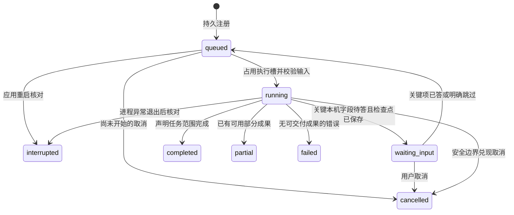
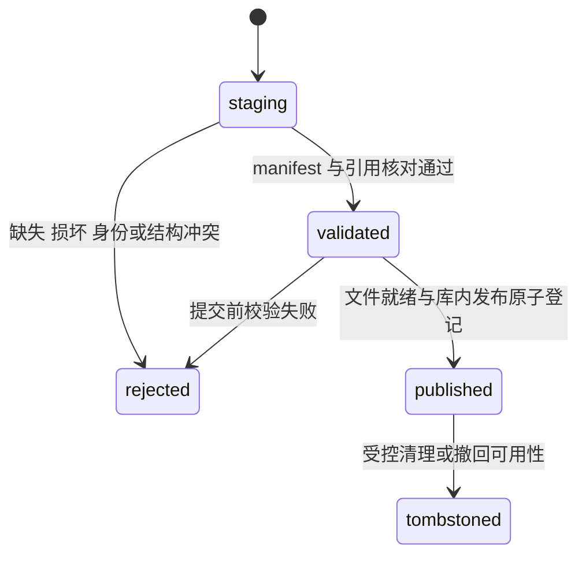

# 阶段 B3：共享状态、守卫与恢复约定

> 建议基线 `product-contract/0.2`；2026-11-01；未实现。读取兼容规则见 data §12。
> 类型/字段见[data-contracts.md](./data-contracts.md)，错误见[error-conventions.md](./error-conventions.md)，需求与建议状态见[台账](../README.md)。
> 本篇统一状态含义、跨模块不变量及提交边界；不设计 SQLite 语句、采集工具参数或完整模块算法。

## 1. 状态维度与写入原则

除 TaskRun/InformationRequest 等投影外，状态的变化也通过追加检查、内容版本或事件记录。历史快照保留当时状态；“当前状态”从对应事件计算，不能把新知识复核结果回写到旧测试事实。

| 维度 | 回答什么问题 | 不能替代 |
|---|---|---|
| 获取状态/来源方法 | 信息怎样取得、尝试结果如何 | 值已知/适用/已生效 |
| 值状态 | 值已知、冲突、未知还是不适用 | 获取成功或程序观测 |
| 公共入库/检查/适用性 | 原载荷是否合规、对本次输入检查到哪一步 | 推荐可执行或本机验证 |
| 发布状态 | 资源与文件是否完整可消费 | 内容范围充分或事实正确 |
| 推荐准备/复核 | 能否在声明范围内操作、是否需按新证据重审 | 实际采用或效果 |
| 配置绑定/生效 | 记录关联了什么、是否满足运行生效条件 | 因果比较或统计显著 |
| 日志质量/比较级别 | 数据可解释程度、两轮能比较什么 | 玩家接受与改善 |
| Task/领域结果/停止原因 | 程序执行情况、产出了什么、为什么停 | 彼此不合并成 success 一个字段 |

模型只提出候选状态与依据，所有者按契约校验后写事件。未经执行的检查必须明确为 not_run/unknown，不按“未发现错误”设 pass。具体关键项由 C 中相应操作的规则确定，不能由模型临时决定。

## 2. 共享枚举登记

除原公共枚举保持旧语义外，新增枚举均为建议；本表是各模块引用的唯一取值表。

| 类型 | 合法值 | 语义/守卫 |
|---|---|---|
| ValueState | known / unknown / conflicting / not_applicable | FieldValue 形状见 data §2；冲突未选择前 value=null；不适用须有依据 |
| AcquisitionStatus | not_attempted / succeeded / failed / skipped | skipped 要求玩家明确动作；字段留白不是 skipped；历史失败尝试不能删除 |
| AcquisitionMethod | system_probe / user_provided / player_confirmed / source_statement / source_author_measurement / agent_derived | 前三项为本机获取/确认，后三项保持来源性质；方法不等于可信度评分 |
| CheckStatus | not_run / pass / fail / unknown / not_applicable | not_applicable 须证明该检查对当前操作不适用，不能替代未知 |
| LegacyRecordState | accepted / quarantined | 沿公共契约原义；产品用途适用性另查 |
| CollectionResult | completed_scope / partial_scope | 沿公共契约 §8.3；只针对声明范围 |
| CollectionStopReason | coverage_reached / low_information_gain / budget_exhausted / access_blocked / source_unavailable / unresolved_conflict | 原值原义保留，不能增加 cancelled 混入旧枚举 |
| PublicationStatus | staging / validated / published / rejected / tombstoned | 原件/成员/引用未齐不发布；详见 §8 |
| CoverageStatus | covered / partially_covered / unknown / not_applicable | 每格保存操作范围及依据；不按记录数量归约 |
| GapPriority / GapStatus | P0 / P1 / P2；open / resolved / stopped | Gap 的 P 级为知识补查优先级；不同于深化计划的问题优先级 |
| RecommendationReadiness | actionable / provisional / blocked | 继承原始 03 §11；逐项到整体归约见 C3/03 §6，关键未知不得绕过 |
| RecommendationActionKind | set_value / keep_current / conditional_strategy / check_in_game / defer | keep_current 当前未知须保留未知；条件动作不能当已确定 fixed |
| ReviewState | current / needs_review / superseded | current 只指尚无已登记复核要求，不代表完美/已测；与 readiness 独立 |
| AppliedOrigin | baseline / recommendation / change_set / manual_edit / rollback | 合法关联见 §4；都只登记事实，不自动设置游戏 |
| ConfigurationRegistrationKind | current_adoption / historical_record | current_adoption 按 §4.1—4.2 推进当前指针；historical_record 按 §4.4 仅补录过去事实 |
| ActivationState | active_confirmed / restart_pending / unknown / conflicting / not_applicable | active_confirmed 须有依据且仍保留 method；不能只因文件读到或单击采用而推定运行生效 |
| ConfigurationState | bound / unverified / mixed | bound 是版本已关联；unverified 无可靠配置绑定；mixed 是该时段发生无法可靠分段的变动 |
| SessionLifecycle | active / ended | 与实际配置状态独立；active 的结束时间为空，ended 必须有合法结束时间/相对时点；开始与结束事件追加保存 |
| FrameStreamKind | application_present / displayed / unknown | unknown 只能按工具报告流描述，不冠名本机原生渲染率 |
| LogQuality | valid / limited / invalid | 继承原始 04 §8；格式/流/单位不可解释不能产确定统计 |
| ThresholdMode | fixed / baseline_derived | baseline_derived 先冻结基线与阈值；事后探索另建 exploratory 协议 |
| ComparabilityLevel | controlled / approximate / descriptive | 单项可比性另存；controlled 不是统计显著或提升保证 |
| InterpretationStatus | unparsed / explicit / inferred / uncertain | explicit 仅用于玩家明确表达；模型推断为 inferred/uncertain；未解析不能冒充无偏好 |
| PreferenceScope | experiment / game / global | global 无 scope_id，其余关联对应对象；不跨游戏扩张偏好 |
| PreferenceExplicitness / PreferenceLifecycle | explicit / tentative；active / withdrawn | 撤回创建新版本；旧推荐引用的偏好不改写 |
| NextActionKind | keep / adjust / measure / research / insufficient_evidence | adjust 必须有合法 ChangeSet，research/measure 只是任务意图，不在领域模块递归调度 |
| LegacyOutcome | accepted / improved_but_rejected / no_clear_change / worse / inconclusive | 保留原始 05 含义；接受与效果独立扩展，兼容归约见 §5 |
| PlayerAcceptance | accepted / rejected / unknown | unknown 不等于 rejected，也不等于接受默认目标 |
| EffectAssessment | improved / no_clear_change / worse / inconclusive / not_measured | 无测量为 not_measured；证据不够或指标取舍无法归约为 inconclusive，不能用接受推导 improved |
| TaskType | device_scan / knowledge / knowledge_import / recommendation / analysis / capture / log_import / feedback / next_action | kind 与 data §9 联合类型一一对应 |
| TaskState | queued / running / waiting_input / completed / partial / failed / cancelled / interrupted | 终态为 completed/partial/failed/cancelled/interrupted，禁止重新运行原终态任务 |
| InformationRequestState | open / partially_answered / resolved / skipped / superseded | 请求版本与字段回答独立；详见 §7 |
| AnswerState | unanswered / unresolved / answered / skipped | 无法可靠归一的原话为 unresolved，不能算有效回答；跳过须明确 |
| ExternalCallState | prepared / in_flight / succeeded / failed_known / outcome_unknown | prepared 已保存意图、未准许发送；in_flight 已进入可能发送窗口；succeeded 仅表示返回原件已保存 |
| BillingState | not_applicable / not_reported / reported / unknown | 无该类费用/供应商未报告/有真实报告/请求结果或计费状态未知，不能推估金额 |
| IdempotencyLifecycle | registered / tombstoned | registered 有原响应与结果/任务定位；清理结果后保留墓碑并返回 410 |
| StateDimension | publication / call / request / session | StateEvent 分别使用下表目标类型与状态枚举，不接受模型自定义维度 |

| StateDimension | target_ref.entity_type | previous_state/next_state 类型 |
|---|---|---|
| publication | ImportSnapshot / KnowledgePackage / ManagedFile | PublicationStatus；分别投影到 import_status/publication_status/file_status |
| call | ExternalCallRecord | ExternalCallState |
| request | InformationRequest | InformationRequestState |
| session | PlaySession / SessionSegment | SessionLifecycle |

ActivationState 是本轮完整化建议：实际字段可由玩家确认生效，但证据性质仍为 player_confirmed；若只是确认“已按方案写值”且重启条件未落实，不能设 active_confirmed。多个配置项的总体状态归约：任一相关项 conflicting→conflicting；否则有 restart_pending→restart_pending；否则有 unknown→unknown；所有相关项 active_confirmed→active_confirmed；均不适用→not_applicable。此归约针对声明的相关字段集，不能把未覆盖菜单声称全部生效。

## 3. Task 状态与领域结果

### 3.1 合法转移

所有转移由 07 检查 TaskRun.revision，在同一产品库事务内保存事件、状态/输入投影与新成果引用；取消标记/输入修订等不改变状态的事件允许 from_state=to_state，不因此重新执行。queued→running 还要确认存在持久化输入、未超预算、并满足同会话活动采集唯一约束。waiting_input 不占重任务槽；不存在 in_flight 调用时才进入等待。已开始的外部调用先记录其结果或未知状态，再保存检查点。

终态不再转 queued/running。取消终态任务返回现有终态，不修改旧成果。running 的取消只设置 cancel_requested 并记录事件；边界处停止新增调用、保存已得成果再进 cancelled。若完成事务先提交，则返回完成；若取消标记先被接受，下一终态提交应为 cancelled 并保留结果。

正常运行的步骤失败不能一律用 interrupted；该值用于进程/执行中断事实。waiting_input 只因应用重启不转 interrupted，持久问题可继续回答。原 queued/running 在重启时转 interrupted，不静默恢复执行；原始 07 已要求的新恢复任务使用 parent_id。

### 3.2 DomainResult 与 TaskState 映射

DomainResult.code 仅允许下表与 domain 匹配的值；TaskRun.domain_result.input_revision 必须指实际成果输入。领域结果不是 HTTP 错误，也不是 TaskState 的别名。

| domain | code 集合 | 正常执行时映射 | 限制 |
|---|---|---|---|
| knowledge | CollectionResult | completed_scope→completed；partial_scope→partial | 取消/中断优先保留事实终态，原领域结果仍可保存 |
| knowledge_import | published / retained_only | published→completed；retained_only→partial | 导入任务完成不改写被导入原采集任务的执行事实；导入不发起模型调用 |
| recommendation | RecommendationReadiness | 三种合法准备结果均可 completed | blocked 是规则判断的有效交付，不是模型调用失败；失败且无合法结果才 failed |
| analysis | LogQuality | valid/limited→completed；invalid 且保留原件/诊断→partial | limited 要声明有限范围，不能冒充全部指标已完成 |
| log_import | ready / retained_only | ready→completed；retained_only→partial | 未知格式可留原件，但不生成假分析 |
| capture | captured / retained_only | captured→completed；retained_only→partial | 无原件/成果且失败→failed；取消/中断另按事实终态 |
| feedback | InterpretationStatus | explicit/inferred/uncertain→completed；unparsed 且原话已存→partial | 未解析不代表玩家没有偏好 |
| next_action | NextActionKind | 所有合法主要动作可 completed | insufficient_evidence 是有效领域输出；adjust 没有 ChangeSet 不合法 |
| device_scan | available / limited / unavailable | available→completed；limited→partial；unavailable→failed | 整体 unavailable 不造设备字段；可以保留失败诊断和问题 |

领域结果合法不意味着可跳过必要输入提问。device_scan 的关键缺项应先按 C11 询问；用户无法补足后才按实际范围终止为 limited/unavailable。C 阶段细化逐字段需求与领域输出，但不能混淆以上维度。

TaskStopReason 是另一个带来源的联合值：`{kind:"collection",code:CollectionStopReason}` 或 `{kind:"execution",code:ExecutionStopCode}`，均 R。ExecutionStopCode 合法值为 user_cancelled/process_exit/provider_error/validation_failed/storage_error/input_unresolved/unsupported_format/scope_completed；细节写脱敏错误和事件，不塞回旧 CollectionStopReason。

### 3.3 原采集器状态导入

| 原始证据 | 产品解释 | 必须保留 |
|---|---|---|
| interrupted=true，无论 status/stop_reason | 对应已知原运行的执行事实为 interrupted | 原 partial_scope、budget_exhausted 仍逐字保留，不反改原文件 |
| 无 interrupted，status=completed_scope | 可作为历史领域 completed_scope；若创建历史任务视图则为 completed | 声明范围与未覆盖检查；不补完整推荐 |
| 无 interrupted，status=partial_scope | 历史领域 partial_scope；历史任务视图为 partial | 原停止原因/缺口，不推导取消 |
| 缺 run.json/状态证据，或仅研究 JSON | 只登记 ImportSnapshot，不虚构 TaskRun 或终态 | 未知执行事实与格式限制 |

ImportSnapshot 的产品导入任务不是被导入的历史采集任务，两者 ID、状态和预算分开。成功导入 partial_scope 是产品导入操作成功，不应把原采集运行改为 completed_scope。

## 4. 配置采用、指针与历史绑定

### 4.1 Origin 的关联守卫

所有关系必须同用户/游戏/安装，输入版本存在且未被伪造。下表用于 registration_kind=current_adoption；历史补录单独遵守 §4.4，不套用“父版本必须为当前”的守卫。表中“必须空”表示禁止拿其他 origin 的语义混用；派生来源仍可从父链/声明追溯。

| origin | recommendation_id | parent_applied_id | change_set_id | restored_from_applied_id |
|---|---|---|---|---|
| baseline | 必须空 | 首次可空；已有当前版本时须为当前版本 | 必须空 | 必须空 |
| recommendation | 必须有，指玩家所确认方案 | 首次可空；否则为当前版本 | 必须空 | 必须空 |
| change_set | 可空；若有则须与基础版本来源一致 | 必须为 ChangeSet.base_applied_id，且仍是当前版本 | 必须有 | 必须空 |
| manual_edit | 可空；若有则与实际继承来源一致 | 必须为当前版本；无当前版本先建立 baseline | 必须空 | 必须空 |
| rollback | 可空；若有则与恢复目标来源一致 | 必须为恢复前当前版本 | 必须空 | 必须指同安装历史恢复目标 |

首次用推荐建立采用记录允许 parent=null；baseline 并不需要推荐或公共知识包，本机目录条目可用于记录原设置。玩家只记得预设时仅存预设引用及已知差异，不展开未核实项。

### 4.2 采用事务

1. AdoptConfigurationInput 只创建 registration_kind=current_adoption。解析幂等键及不可变输入，检查设置值、安装、推荐/ChangeSet、声明与必要生效条件，准备原话和结构化声明，校验通过后才与采用版本一同提交。
2. 在产品库事务内检查 expected_current_applied_id：首次与 null 比较，后续与当前指针比较。冲突返回 CURRENT_CONFIGURATION_CONFLICT，不创建采用版本/声明或推进指针。
3. 调整从 ChangeSet.base 的完整快照合并差异；额外玩家改动一并登记，不能继续声称只执行了原实验单元。保留未改字段、未知与自定义值。
4. 同一事务保存 PlayerDeclaration、新 AppliedConfiguration、父/变更/恢复引用、CurrentAppliedEvent、CurrentAppliedPointer 与幂等原响应。提交后才对外返回新 ID。
5. 该事务只登记手动操作的声明，不写游戏/驱动文件。若来源显示待重启或冲突，版本仍可记录但比较不得为 controlled。

恢复创建新版本，parent 指恢复前当前配置、restored_from 指目标；不把目标旧 ID 重新设为一条新事实。新会话显式绑定新 ID，不按“最新推荐”推断。

### 4.3 区段绑定与比较

| 当前情况 | 允许操作/结果 | 禁止 |
|---|---|---|
| 配置完全未知 | applied_id=null、unverified，仍保存会话/日志/反馈 | 创建假采用对象满足外键；controlled 归因 |
| 配置已知且有当时依据 | bound，保存具体采用 ID 与生效证据 | 把 bound 等同全部值 active_confirmed |
| 中途变动且时点可靠 | 切成互不重叠区段，分别绑定 | 用一个配置标整个混合时段 |
| 中途变动但时点不明 | mixed；保留总体观察，降级比较 | 猜测切分点或跨未知缺口拼帧 |
| 后补历史配置 | 校验时段依据和 expected_binding_revision，追加 ConfigurationBinding | 用“确认当前配置”自动回填过去；改变当前采用指针 |

后补绑定同时校验 expected_segment_revision 与 expected_binding_revision，保存新投影快照/事件，旧摘要仍引用旧 segment_revision/binding_revision。场景、排除区间或运行条件更正也须保存新段快照；不能在相同配置绑定下静默漂移。使用新段/绑定必须生成新 PerformanceSummary 和新的比较/Outcome，不能覆盖既有结论。原比较含单项口径不统一时仅该项降级；实际配置、关键生效或场景不明则整体不能 controlled。

创建活动段时同步建立 revision=1 的 ConfigurationBinding，effective_range 使用 BindingRange，end=null，不填预计结束时间；配置未知仍为 applied_id=null/unverified。结束或切段的同一事务校验段/绑定修订，保存已结束段快照及有实际结束点的新绑定修订（supersedes_revision 指旧绑定），不原地闭合旧绑定。切段还须保存新活动段与其开放初绑定；半开区间在边界衔接，不重叠。采集结果返回最终段/绑定定位，AnalyzeInput 显式选用闭合修订；以开放段或开放绑定分析返回 PRECONDITION_UNVERIFIED，不能自动改用最新修订或补造时长。

04 §4.3的历史日志登记可由有依据的过去起止时间直接初始化ended会话/段及闭合初绑定（revision=1、supersedes_revision=null），同事务追加cause=historical_log_registered的初始session事件，不伪造本次采集的active过程。关联已有开放段时仍走上述结束/双修订守卫，并额外比较会话revision；已有闭合段不重写边界。声明、映射、新artifact、必要闭合事实及幂等响应原子发布；旧任务/原件/摘要/当前采用指针不改，分析须显式新建。

### 4.4 历史配置登记事务

旧会话没有可引用的实际配置版本时，01 经 07 接收 HistoricalConfigurationInput，先登记过去事实，再由 04 显式补绑；若已有适用历史版本则可直接提交 BindConfigurationInput。

1. 核验用户/安装/游戏、设备与游戏快照及 segment_ref；目标段须已结束，所给段/绑定修订仍匹配，effective_range 为段内非空有限区间且时基可核对。时段依据必须覆盖所声明配置；仅证明“现在如此”的回答不够，缺依据返回 PRECONDITION_UNVERIFIED，修订过时返回 BINDING_REVISION_CONFLICT。
2. 基于历史声明与原件构造完整的已知/未知项及预设引用，不从当前配置补齐。同事务保存 PlayerDeclaration（input 为 HistoricalConfigurationInput）、registration_kind=historical_record 的新 AppliedConfiguration 及幂等原响应，返回 ResourceResult。该对象仍须满足至少有已确认项或显式预设的规则；其 adopted_at 仅在历史采用时刻可核验时填写，否则 null，created_at/submitted_at 保存本次登记时间。
3. 本操作的新记录作为独立版本族、version=1、origin=baseline；recommendation_id、parent_applied_id、change_set_id、restored_from_applied_id 均为 null。不得把当前 B 设为过去 A 的父版本，也不凭补录主张某个 ChangeSet 已执行；已有可靠采用链的历史版本直接引用，不在此伪造实验链。补录更正追加另一事实，旧记录/声明仍保留，替代关系通过新绑定的 supersedes_revision 表达。
4. 该事务不检查 expected_current_applied_id，不创建 CurrentAppliedEvent、不更新 CurrentAppliedPointer，也不自动修改段绑定或终态任务。随后补绑仍单独核验时段依据及最新段/绑定修订；中途冲突只拒绝补绑，已登记历史事实可保留并按原 key 查询。若玩家现在手动采用该历史配置，另走 AdoptConfigurationInput 和当前指针守卫，创建新的 current_adoption 事实。

## 5. 推荐复核、偏好与结果

### 5.1 复核事件

- 初建合法推荐的复核投影为 current。02 发现有依据的来源变化后发出影响通知，03 核对依赖并追加 current→needs_review 事件，记录受影响设置、旧证据与新证据。
- needs_review 经重新核验可追加 current 事件；若内容/输入需改，则新建 RecommendationVersion，旧版本追加 superseded 事件。superseded 不重新变 current，历史仍可读，手动恢复亦不能恢复其“无需复核”资格。
- 只知道版本更新但影响未知时记录复核理由和局限，不断言旧配置已错误。ready 与 review 独立，页面需同时显示；对 needs_review 的新采用先重新核对关键适用条件或明确降级。
- 撤回偏好生成 Preference 新版本；旧推荐保留旧偏好输入。新推荐/诊断读取新的有效视图，不把一次选择自动变 global explicit。

### 5.2 Outcome 的兼容归约

先由 04 给比较与逐项变化，05 结合本轮目标、波动、反例与体验形成 effect_assessment，再保存玩家接受情况；不接受客户端或模型自报 controlled。无日志不产生假指标；画面等主观信息保留为反馈依据。

| 独立状态 | legacy_outcome | 解释 |
|---|---|---|
| player_acceptance=accepted，任意 effect | accepted | 保留 effect 原值；接受但未测仍为 not_measured，不是 improved |
| rejected + improved | improved_but_rejected | 保留拒绝画面/操作等原话，不因数值更快宣称整体成功 |
| acceptance 非 accepted，effect=no_clear_change | no_clear_change | 接受未知/拒绝仍单独保留 |
| acceptance 非 accepted，effect=worse | worse | 不以继续叠加猜测掩盖反证 |
| 其余组合 | inconclusive | 包括未测、证据不足、指标取舍未闭合；接受维度仍保留 |

improved/worse 必须指声明范围、比较级别和证据，不能从一次很小数值差就判稳定改善。平均改善但尾部退步、只有一次样本或变化小于重复波动时，按原始 05 保留 inconclusive/限制，完整判定见下述 C4 细化规则。没有基线只允许排查或先补原值，不产生假 ChangeSet。

C4 细化后的效果/重复波动规则以 [05 §7](../05-feedback-optimization.md#7-outcome重复波动与停止规则) 为准，兼容标签仍按本节归约；不是新的 TaskState。偏好/目标接受的当前视图与声明历史由05维护，每次更正/撤回比较当前版本并追加事实；冲突使用 error 的 PREFERENCE_VERSION_CONFLICT / TARGET_ACCEPTANCE_CONFLICT，旧推荐/会话输入不改写。

## 6. 任务注册、外部调用与重启

### 6.1 本地提交与执行槽

创建操作先保存输入、任务/资源及幂等记录，再开始执行；任务仅在持久注册成功后进入队列。提交后、入队前崩溃不会丢掉任务身份；重启核对将其标 interrupted，显式恢复创建新任务。不同 key 的同会话 queued/running 采集也受唯一活动约束，不能靠不同 key 绕过。

预算在调用进入可能发送阶段前原子登记占用，含重读/替代读取；取消/等待不释放已尝试调用次数。waiting_input 的时间不消耗本任务 max_seconds 活动时长；跨重启以 TaskEvent/检查点记录的累计活动时长核对，不用系统时钟差把等待当运行。退出前最后活动段无法可靠计量时保留该限制，不宣称旧时间预算精确满足；原任务不自动续跑，恢复任务必须给明确新预算。时间计量/轮询周期/具体超时值在 C/07 给出验证过的默认值。

### 6.2 ExternalCallState 转移与未知窗口

| 转移 | 前置证据与持久化 | 后续允许动作 |
|---|---|---|
| 创建 prepared | 保存 task/input_revision、请求输入 hash、预算/提示/Schema 标识及意图时间 | 尚未进入发送窗口，可在取消时不发送 |
| prepared→in_flight | 再查取消/预算，持久登记可能发送及计数，然后才调用供应商 | 该登记后发生崩溃即保守视为可能已送达 |
| in_flight→succeeded | 原始响应/实际模型/用量安全保存且校验文件完整性后登记引用 | 继续做提取/Schema/语义检查；调用成功不代表模型输出合格 |
| prepared/in_flight→failed_known | 有明确未发送证据或明确供应商失败响应；记录分类/错误 | 只有错误表允许且不处未知计费状态时才能有界重试 |
| in_flight→outcome_unknown | 断连/超时/进程退出，无法证明是否执行；或响应未持久化 | 不自动重发；保留可能已收费、响应丢失等局限 |
| outcome_unknown→succeeded/failed_known | 供应商可核验的请求状态/返回原件，不是猜测或再次调用同一模型 | 追加核验事件，继续处理已知结果；无核验能力则保持 unknown |

prepared→in_flight 的事务与网络发送无法原子提交；即使在二者之间退出，恢复也不得假定“肯定没送”。当前供应商是否支持请求查询/去重仍未核验，本设计不依赖其存在。新的 key 或新恢复任务不能隐式重发未知调用；用户明确发起独立新调用时必须展示可能重复与新预算，不能伪称续跑原请求。

原型 `_call` 的进程内日志和检查点尚不能满足上述全部持久审计。02a 的初步只读导入不将它包装成已支持取消/恢复；未来产品调用原型时，07 须对可控边界补审计，无法细分中间调用的范围明确标为不支持自动恢复。

### 6.3 恢复前核对

1. 读取旧终态、已持久输入修订、可空检查点、原件 hash 与父任务全部调用状态（包括未进入检查点的调用及恢复链关联的调用）；运行未结束不得恢复，不能靠省略检查点绕过该守卫。
2. checkpoint_id 非空时必须属于父任务且输入兼容；重用已完成且可验证的步骤，后补信息影响的步骤必须重验，其旧成果继续保留。父任务确无检查点时允许 checkpoint_id=null，从其已持久输入创建新任务，不虚构检查点或进程内完成步骤；已有检查点却传 null，或检查点归属/完整性不合法时拒绝恢复并给出具体原因。
3. 创建新 TaskRun、parent_id、新输入与明确预算；注册新的幂等键。原终态任务及其预算不改写。
4. 无检查点也必须核对调用审计：父任务确无可能发送的调用时可从头执行；已有响应仅在可核验输入/步骤归属后复用，可能已发送或结果未知的调用不重发。无法安全定位步骤时只继续独立范围或交付受限结果/具体恢复动作，不能把 null 解释为“没有调用过”，也不做“空成功”。

## 7. InformationRequest 回答与继续

### 7.1 状态归约与转移

| 事件 | 前态/守卫 | 原子保存与后态 |
|---|---|---|
| 自动获取失败需补充 | 任务 running，字段及用途明确，旧检查点已存 | 保存 open 问题及上下文；关键字段待答才 waiting_input，非关键可继续 |
| 部分合法回答 | open/partially_answered；请求/上下文版本匹配 | 保存不可变回答、值/新快照、问题 version/context revision；仍有未处理项→partially_answered |
| 所有字段有可用回答 | 同上；未知自然语言不能算 answered | resolved；等待任务关键项已闭合则转 queued |
| 有明确跳过且无未处理项 | 同上 | skipped；未知保留，等待任务可按有限范围继续，不无限等候 |
| 请求版本旧但上下文仍有效 | expected_request_version 过时 | 409，返回当前请求定位，不改状态/快照 |
| 目标上下文已变使问题失效 | expected_context_revision 失效且历史目标不再匹配 | 原问题 superseded；同事务登记替代问题或解除等待，并更新任务输入关联；返回 409 及替代/当前定位 |
| 终态任务仍有 open/partial 问题，后补回答 | 校验原历史上下文，不用当前安装指针替代 | 保存回答与新快照/请求修订；不改终态任务输入或成果，不重启；再分析显式建新任务 |

归约以全部字段为准：有 unanswered/unresolved 且已有回答或跳过→partially_answered；全部 unanswered→open；无未处理项且存在 skipped→skipped；全为 answered→resolved。任务是否继续只看本步骤关键字段的处理情况，问题可因非关键项未答继续 partially_answered。

resolved/skipped 请求保留为已处理事实；玩家更正或后续补充已跳过字段时建立关联的新问题/上下文版本，原问题/回答不覆盖。superseded 不接收写入；界面读取替代问题。具体更正入口在 C1/01/06/07 定义，不把更正混成旧请求的幂等重试。

### 7.2 回答事务与竞态

领域所有者先验证 answers、skipped_fields、候选选择及来源，07 在短事务内再次检查版本，追加 InformationResponse、新对象版本、请求投影和等待任务 TaskInputRevision。自己的部分回答同时推进请求 version 与 context revision，后续页面使用返回的新版本；不被当成外部失效。

等待任务的关键字段都 answered/skipped 时转 queued，沿用剩余预算，仅重做受影响步骤。跳过仍不足以生成推荐时可以产 blocked 或 partial，不能补猜值。取消与回答并发时以事务内任务状态为准：取消先提交则按终态后补路径；回答先排队后取消则 queued→cancelled。不能丢回答或在终态后暗中重排队。

历史问题按其绑定的历史版本校验。合法后补回答只生成新事实；更新过去区段还须独立 BindConfigurationInput 的时段依据/绑定版本守卫，不自动推进当前采用指针。

## 8. 原型导入、发布与文件恢复边界

### 8.1 PublicationStatus

状态是产品可用性投影，转换记录事件；原文件和已发布内容不就地修改。rejected 的重新修复创建新快照，不改旧证据；published 的内容更新创建新版本。tombstoned 可留元数据/必要引用，不重用 ID 或旧幂等键。

### 8.2 提交次序与恢复责任

| 边界 | 07/领域层必须保证 | 失败后的可见结果与恢复 |
|---|---|---|
| 复制旧运行/研究文件 | 02a 读取稳定输入，复制到受管理 staging，保存 manifest、原 ID、格式与映射版本 | 输入改变/缺文件则 rejected，不触碰原目录；缺口和原件可诊断，不发布 |
| 建立导入映射 | 校验游戏身份、同作用域引用、唯一键、原状态和可解释的检查范围 | 映射不完整或冲突时保留 staging/诊断；不得按同名 ID 补齐 |
| 准备原件/导出文件 | 临时文件完整写入，计算 hash，验证后在受管理目录内原子替换/改名到最终不可变位置 | 临时残留或孤立完整文件都不是有效资源；记录操作 ID/manifest 以便核对，不给消费者可用引用 |
| 产品库发布 | 只有所有必需文件存在且 hash 相符时，单个事务保存可用包/摘要/比较/导出资源、成员关系、发布事件及幂等响应 | 文件已就位但 DB 未提交→孤立文件，重试核对后复用或按受控清理；不得提前返回有效 ID |
| DB 已提交后响应丢失 | 保留原响应与资源 ID，重试查同幂等记录 | 不重建文件/包、不新增模型调用 |
| 已发布文件后续缺失/损坏 | 访问时校验必要完整性，登记不可用/撤回复核事件并阻止消费 | 返回 ARTIFACT_UNAVAILABLE，保留引用与原因；从受核验备份恢复或生成新资源，不返回空文件成功 |

产品库事务不包裹网络或长文件复制；文件系统原子替换不等于 DB+文件共同事务。07 为操作日志、孤立文件与不可用引用负责恢复，02a/领域所有者负责输入映射和语义校验。重启先核对未发布操作，再允许其被消费；具体日志结构、目录布局、迁移 SQL 和恢复命令留 C1/C2/07。

只读导入的初始边界：不向旧 `knowledge.sqlite3` 或原 JSON 回写，不复活原 Collector 内存状态，不声称拥有其内部每次调用的精确发送状态。`INSERT OR REPLACE` 的旧快照不是事件历史，导入时不得反推不存在的中间事件。

## 9. 共享验收场景

以下均为待实现验收；本轮只能静态复核设计。Mock 指供应商/探测/适配器桩，真实环境列不借官方文档代替本机证据。

| 编号/需求/目的 | 初态与输入 | 操作步骤 | 输出/状态断言 | Mock / 真实环境 |
|---|---|---|---|---|
| B-STA-01 / A06、D02：区分执行/结果 | queued 知识任务，产 partial_scope；另一次为合法 blocked 推荐 | 执行各任务并提交结果 | 前者 partial，后者 completed+blocked；状态不互换，原领域/停止原因保留 | 供应商桩；不需真实环境 |
| B-STA-02 / C11、D04：释放等待 | running 任务因 GPU 关键项待答，非关键 CPU 未答 | 进入等待，运行另一个任务，分批回答并刷新 | waiting_input 不占执行槽；回答短事务可完成；关键项处理后 queued，非关键问题可仍 partial | 调度桩＋临时 DB；不需游戏 |
| B-STA-03 / D04：版本和取消竞态 | open 问题与当前输入修订，另页更改上下文 | 旧请求提交、自己的部分回答后再次提交、取消与回答并发 | 外部失效 409 且替代/解除等待原子；自己的后续版本有效；取消先提交则不复活任务 | 两客户端桩＋临时 DB；不需真实环境 |
| B-STA-04 / A06、D02：未知调用 | in_flight 已登记，分别在发送前/发送后/响应未存时退出 | 重启核对并尝试恢复 | 三种不确定窗口均不自动重发；保留 outcome_unknown、调用计数与预算 | 可计数供应商桩＋故障注入；不靠付费调用 |
| B-STA-05 / A04、D01：采用原子性 | 当前 A、ChangeSet C、两页面相同 expected A | 并发采用，再手动恢复 | 仅一方推进，另一方 409；完整保留未改项；恢复新 ID、父链与目标引用正确 | 临时 DB；不需游戏，实际手动设置留 C 验收 |
| B-STA-06 / D03：历史绑定 | unverified 区段与旧摘要；有适用时段的新依据 | 后补绑定并重分析 | 新 binding_revision/摘要，旧摘要/当前采用指针不变；仅新修订可进入新比较 | 时间/原件夹具；不需真实环境 |
| B-STA-07 / A05：文件与库窗口 | staging 导入和完整临时文件 | 在最终改名后/DB 提交前/DB 后响应前退出，再重试 | 未发布资源不被消费；孤立文件可核对；已提交重试回同 ID，无原目录回写 | 临时目录/DB，故障注入；不需网络 |
| B-STA-08 / A13：接受与改善 | 玩家接受但未复测；测得更快却拒绝；平均升但尾部退 | 计算 Outcome 扩展与兼容标签 | accepted+not_measured 不变 improved；拒绝理由保留；指标矛盾不强归约成功 | 受控摘要/反馈；真实效果留 C/08 |
| B-STA-09 / 更新传播 | 历史推荐引用旧包，02 登记受影响证据 | 通知 03、追加复核事件后读取历史 | needs_review 不改原推荐、旧包、采用或会话；重算新版本后旧版本 superseded | 包/推荐夹具；不需网络 |
| B-STA-10 / D03、D05：开放绑定闭合 | 活动段初绑定 end=null，另有并发过时的结束请求 | 结束/切段，重读旧修订，分别请求分析 | 段结束与闭合绑定同事务，切段建立新开放绑定；旧修订不改；过时请求冲突；仅闭合修订可分析 | 时间夹具/临时 DB；不需游戏 |
| B-STA-11 / D03、D04：仅补录过去事实 | 当前指针 B，旧段配置未知且有历史 A 的依据 | 登记历史 A；模拟登记响应丢失后重试，再显式补绑 | 只产生一个 A/声明，无当前指针事件，A 不以 B 为父；缺时段依据拒绝；绑定冲突不删 A，旧摘要不变 | 两客户端/临时 DB；不需游戏 |
| B-STA-12 / A06、D02：首检查点前恢复 | queued 未执行即重启；另有无检查点但 in_flight 调用的任务 | 显式以 null 检查点与新预算恢复；重试同 key | 新任务 parent_id 正确且仅登记一次；无调用分支可执行；未知调用分支保留审计、不自动重发；旧任务终态/输入不改 | 调用桩/故障注入；不需网络 |

## 10. B3 与阶段 C 的分界

B 已确定状态维度、合法转移、P0 原子/恢复边界与错误动作接口。C 仍需给每个操作完整请求/响应、逐字段守卫、比较/推荐/覆盖归约、采集停止策略、文件/SQL 故障注入及兼容样本。若这些细节要求改变共享定义，先升级/修订本契约与数据/错误契约，再同步消费者；不能把相反语义藏在模块内。
