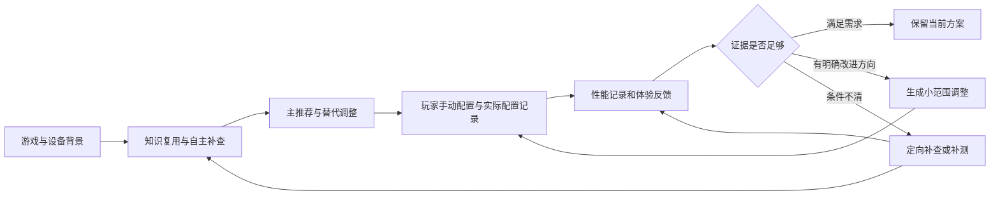

# PC 游戏画质配置优化智能体：完整推荐设计 v1.1

> 日期：2026-11-01。状态：供用户审阅的完整推荐稿；v1.1按设计审查补齐五处流程与契约，仍未进入代码实施。
>
> 本轮仅编写设计文档，暂停代码开发。已有采集原型的能力与局限以实施报告为准。  
> 本文明确课程项目的推荐落地范围，不承诺所有游戏均可自动识别、自动测量或生成完整设置。

## 1. 总体结论

建议建设一个 **Windows 本地运行、以游戏与显卡为主要入口的画质优化助手**。玩家选游戏后，系统自主收集和复用公开资料，生成有出处的主推荐及替代调整。玩家手动设置，系统把实际采用的配置、游玩数据和反馈关联起来，决定维持、调整或补测。

完整闭环为：

推荐采用 **本地网页界面＋Python 单进程后台＋SQLite**，不增加多 Agent、微服务或云端账号系统。现有采集包通过适配层接入，不因新设计重新编写全部采集代码。

## 2. 文档导航

| 板块 | 详细文档 | 回答的问题 |
|---|---|---|
| 设备、游戏与实际配置 | [01 设备与配置](./docs/design/01-device-game-configuration.md) | 输入从哪里来，如何确认玩家实际采用了什么 |
| 知识生命周期 | [02 知识与采集](./docs/design/02-knowledge-and-collection.md) | 如何复用、补查、更新与处理不完整资料 |
| 推荐决策 | [03 推荐引擎](./docs/design/03-recommendation.md) | 如何选主方案、处理分歧、给目标与替代调整 |
| 性能记录与分析 | [04 性能分析](./docs/design/04-performance.md) | 如何采集、定义指标和判断是否可比较 |
| 反馈与持续优化 | [05 反馈优化](./docs/design/05-feedback-optimization.md) | 如何把症状变成有依据的小范围实验 |
| 玩家交互 | [06 产品交互](./docs/design/06-player-experience.md) | 玩家具体操作什么，系统何时自主处理 |
| 数据与工程架构 | [07 数据与接口](./docs/design/07-data-and-architecture.md) | 模块如何连接，记录如何版本化与追溯 |
| 验收与交付 | [08 验收设计](./docs/design/08-validation-and-delivery.md) | 怎样证明有效，如何逐步交付 |

## 3. 已确认原则与新增推荐

### 3.1 已由用户确认

| 编号 | 决定 |
|---|---|
| C01 | 显卡是主要匹配依据，仍保留显存、桌面/笔记本、分辨率、CPU 等适用条件 |
| C02 | 检索前不要求目标 FPS 或画质偏好；目标与取舍也是收集和推荐的结果 |
| C03 | 收集充分优先，允许更长等待；Agent 内部多轮处理，尽量减少玩家搜集资料 |
| C04 | 综合官方与多个作者；主推荐依据画质收益和性能代价，提供偏画质/偏性能的替代调整 |
| C05 | 同卡资料不足可有条件参考邻近显卡，再用本机反馈验证 |
| C06 | 首轮分开呈现建议目标、带条件的公开实测参考和待测的本机表现 |
| C07 | 玩家首版手动配置，自动修改设置属于后续扩展 |
| C08 | 长视频下载、转写、抽帧等暂缓；网页文字、表格与网页图片仍属项目范围 |
| C09 | 使用 DeepSeek Flash 接口，保存请求模型与实际返回模型，版本兼容别名不当作固定版本 |
| C10 | 当前暂停写代码，先交付完整、分板块的推荐设计 |
| C11 | 第一部分的设备、游戏及实际配置自动获取失败或有歧义时，主动向用户提问补充；用户仍不确定时保留未知 |

### 3.2 本稿提出的推荐选择

这些是本次根据现有讨论提出的方案，不写成用户已经确认的决定。

| 编号 | 推荐选择 | 理由与主要代价 |
|---|---|---|
| R01 | Windows 本地网页产品，后台单进程 | 复用 Python 代码、降低打包与跨端成本；仍需本地后台访问硬件 |
| R02 | 以 FH6 作为首个完整验收案例，泛化采集作为扩展能力 | 避免把“能搜索游戏”误当作全游戏适配；通用性需额外样本证明 |
| R03 | 优先完整作者方案作基准，再做有证据的局部调整 | 保留整套配置的关联，减少逐项拼装造成的组合冲突 |
| R04 | 推荐、玩家采用、程序观测三种配置分开 | 推荐不等于实际生效；需要保存一次确认及可能的改动 |
| R05 | 手动配置后一次确认，可靠读取时自动核对 | 降低逐项录入负担；玩家确认仍不是自动验证。此项此前仅提出，尚未获用户单独确认 |
| R06 | 先支持一种已验证日志格式导入，再提供 PresentMon 引导采集 | 先建立可复现的分析口径；不能一开始承诺所有工具都兼容 |
| R07 | 初次本机验证优先固定场景，日常游玩数据作补充 | 便于判断变化；需要少量测试操作 |
| R08 | 一轮默认改一个设置或一个必要联动组 | 便于归因和恢复；收敛可能慢于一次改很多项 |
| R09 | 首版只把游戏内图形/显示设置作为可执行优化对象 | 控制范围；NVIDIA App/控制面板资料可以采集，但不纳入首轮受控调整 |

## 4. 首版边界

### 4.1 课程项目最小完整版本

必须贯通：选游戏与读取设备 → 自主资料收集 → 生成主推荐 → 玩家采用并记录 → 导入或采集本机日志 → 简短反馈 → 一次有依据的维持/调整/补测决策 → 历史对比。

首版不必覆盖每款游戏，但至少一个游戏完整闭环。对其他游戏明确显示能力级别：

- `knowledge_only`：可收集资料，不保证设置清单完整。
- `recommendation_ready`：有可校验的设置/配置依据，能给出明确或条件化方案。
- `feedback_ready`：还具有已验证的进程/日志与场景绑定方式，能进行本机迭代。

版本更新、读取失败或资料冲突可能使能力降级；能力不是一次打标后永久有效。

### 4.2 首版明确后置

自动修改游戏/驱动配置、自动启动所有游戏平台、普遍支持所有游戏、多人账号与云同步、无证据的精确 FPS 预测、画面质量自动打分、长视频处理、复杂强化学习、跨机器共享个人优化模型。

图像能力单独列为知识增强里程碑：必要网页截图/图表可以在后续接入视觉模型。尚未读取图片时，图中关键条件保持缺口；不影响已经通过的文字证据。

## 5. 推荐产品形态及备选

| 形态 | 优点 | 代价 | 推荐结论 |
|---|---|---|---|
| 纯命令行 | 已有基础，验证成本低 | 玩家操作与历史比较不便 | 保留为开发与批处理入口 |
| 本地网页＋本地后台 | 便于配置表、趋势、反馈与来源展开 | 需管理本地进程及任务状态 | 首版推荐 |
| 完整原生桌面应用 | 系统整合与分发体验较好 | 打包、更新与平台接口成本更高 | 后续按需求评估 |

浏览器页面只负责交互，本地后台调用受控硬件/文件/日志适配器。模型只接收必要的结构化上下文，不直接访问任意本地路径或执行网页提供的命令。

## 6. 设计完整性的判据

完成本稿意味着各环节有推荐职责、输入输出、状态、失败降级和验收方法，能够用于讨论实施范围。它不等于硬件读取、日志工具、UI 框架或推荐质量都已经实测成功。

本稿的三类剩余事项：

1. **产品选择待审阅**：R01—R09 可由用户修改；本次不因此中断文档交付。
2. **工程能力待验证**：目标机器的采集权限、FH6 进程识别、配置读取范围、日志口径。
3. **效果待验证**：多作者分歧、本机改善与满意度；不可由现有 45 项程序测试替代。

## 7. 与已有成果的关系

- [知识契约](./knowledge-intake-contract.md)继续定义公共知识字段与入库规则，本稿补充推荐和本机闭环，不默默重定义旧字段。
- [采集原型设计](./web-collector-prototype-design.md)继续作为采集模块基线。
- [首轮实施报告](./collector-implementation-report.md)记录现有代码与真实局限；当前只有采集模块已有程序，其余板块主要仍为设计。
- [讨论纪要](./discussion-notes.md)记录历史；遇到旧候选、过时阶段描述，以本稿明确标记的确认/推荐状态理解。

### 7.1 本次设计修订

本次按审查意见完善五项契约，相关章节同步增加验收；这些为设计修订，未新增已实现能力：

1. 反馈调整从实际配置合并差异，新采用版本保存父版本与ChangeSet，复测结果引用正确版本；过时提交拒绝覆盖，手动回滚生成新记录。
2. 所有创建操作持久化幂等标识，知识/模型任务、采集、导入和补充回答的重试复用原任务；明确外部调用结果未知时不能自动重发。
3. 原配置基线不依赖推荐；配置未知仍能记录会话、日志和反馈，并限制因果结论。
4. 补充问题具备读取、回答/明确跳过、版本冲突和任务继续规则；等待输入不占用重任务队列。
5. 区段自适应长帧用于定位；跨轮比较采用共同阈值、簇/分钟和时间占比，保存协议与分母。

具体字段与操作见[第07章](./docs/design/07-data-and-architecture.md)，可重现验收见[第08章3.1节](./docs/design/08-validation-and-delivery.md#31-本轮设计修订与回归验收)。其他产品推荐选择的确认状态与既有采集基线不因此改变。

## 8. 推荐阅读方式

先看本文的首版范围与推荐选择，再读第 03 章的决策流程和第 05 章的反馈循环。其后核对设备、性能、交互与工程接口，最后用第 08 章判断工作量和交付标准。这样可以先审产品是否合理，再审技术细节。

## 9. 设计交付与实际实现对照

| 板块 | 当前实现 | 本稿交付 |
|---|---|---|
| 公共资料采集 | 已有CLI与首轮真实验证，稳定性仍有缺口 | 复用/覆盖/更新与推荐输入契约 |
| 设备与游戏读取 | 尚未形成已验证的产品模块 | 探测、适配能力、未知与降级设计 |
| 多来源推荐 | 尚未实现完整推荐引擎 | 门槛、基准、取舍、替代项、状态与输出设计 |
| 实际采用配置 | 尚未实现 | 版本、一次确认、观测、冲突与中途修改设计 |
| 本机性能与反馈 | 尚未实现完整闭环 | 采集/导入、统计、比较、假设、实验与停止设计 |
| 玩家界面 | 尚无产品页面 | 页面流程、信息层级、异常与交互验收设计 |
| 整体数据与验收 | 现有数据主要是采集层 | 闭环实体、API、状态、迁移与分阶段验证设计 |

本稿完成的是整体功能与工程边界的推荐设计，视觉像素规格、具体工具兼容与真实效果仍需后续确认/验证。当前没有恢复编码。
